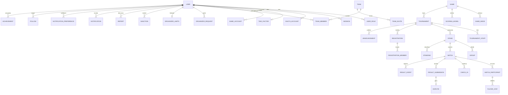

# Nova Arena — Modelo de dados completo

Complementa o PRD §17, que detalha só parte das entidades. Este documento é a base de `packages/schemas` (F1/F2) e do schema Prisma (B1). Issue de origem: #5.

Convenções: `id` é UUID (exceto `AuditLog` e `ResultEvent`, que usam `bigint` sequencial); datas em UTC; `createdAt`/`updatedAt` em todas as tabelas mutáveis.

## Visão geral

## Enums

| Enum | Valores |
|---|---|
| `Role` | `SUPER_ADMIN`, `ADMIN`, `ORGANIZER`, `PARTICIPANT` |
| `UserStatus` | `ACTIVE`, `SUSPENDED`, `BANNED`, `MERGED`, `DELETED` |
| `MatchType` | `DUEL`, `TEAM_VS_TEAM`, `BATTLE_ROYALE` |
| `TournamentStatus` | `DRAFT`, `PUBLISHED`, `REGISTRATION_OPEN`, `REGISTRATION_CLOSED`, `CHECK_IN`, `IN_PROGRESS`, `PAUSED`, `FINISHED`, `ARCHIVED`, `CANCELLED` |
| `StageFormat` | `SINGLE_ELIM`, `DOUBLE_ELIM`, `GROUPS`, `ROUND_ROBIN`, `SWISS`, `BATTLE_ROYALE`, `TEAM_VS_TEAM` |
| `StageStatus` | `PENDING`, `ACTIVE`, `COMPLETED` |
| `Seeding` | `RANDOM`, `RANKED`, `MANUAL` |
| `MatchStatus` | `SCHEDULED`, `CHECK_IN`, `LIVE`, `AWAITING_VALIDATION`, `VALIDATED`, `DISPUTED`, `WALKOVER`, `CANCELLED` |
| `RegistrationStatus` | `PENDING_MEMBERS`, `PENDING_APPROVAL`, `CONFIRMED`, `WAITLIST`, `REJECTED`, `CANCELLED`, `WITHDRAWN`, `DISQUALIFIED` |
| `TeamMemberRole` | `CAPTAIN`, `MEMBER` |
| `InviteStatus` | `PENDING`, `ACCEPTED`, `DECLINED`, `EXPIRED`, `REVOKED` |
| `StaffRole` | `CO_ORGANIZER`, `MODERATOR` |
| `SubmissionStatus` | `PENDING`, `CONFIRMED`, `CONTESTED`, `APPROVED`, `REJECTED` |
| `DisputeStatus` | `OPEN`, `ESCALATED`, `RESOLVED` |
| `ReportTarget` | `USER`, `TEAM`, `MATCH`, `RESULT` |
| `ReportStatus` | `OPEN`, `IN_REVIEW`, `ACTIONED`, `DISMISSED` |
| `SanctionType` | `WARNING`, `SUSPENSION`, `BAN` |
| `RequestStatus` | `PENDING`, `APPROVED`, `REJECTED` |
| `NotificationType` | `REGISTRATION_CONFIRMED`, `TEAM_INVITE`, `CHECKIN_OPEN`, `MATCH_SOON`, `RESULT_POSTED`, `QUALIFIED`, `ELIMINATED`, `ANNOUNCEMENT`, `ORGANIZER_REQUEST_RESULT`, `DISPUTE_UPDATE`, `SANCTION` |

## Conta e acesso

| Entidade | Campos principais | Observações |
|---|---|---|
| `User` | `email` (único), `nickname` (único, sem diferenciar maiúsculas), `passwordHash?`, `emailVerified`, `birthDate`, `avatarUrl?`, `country?`, `state?`, `bio?`, `socials` (jsonb), `timezone?`, `status`, `sessionVersion`, `lastSeenAt` | `passwordHash` nulo para conta só OAuth. `sessionVersion` sobe em sanção para derrubar sessões. |
| `UserRole` | `userId`, `role`, `grantedBy`, `grantedAt` | Único por (`userId`, `role`). Todo usuário tem `PARTICIPANT`. |
| `Session` | `userId`, `familyId`, `refreshTokenHash`, `userAgent`, `ip`, `twoFactorVerified`, `expiresAt`, `revokedAt?`, `replacedById?` | Família de refresh tokens: reuso de um token já trocado revoga a família. |
| `OAuthAccount` | `userId`, `provider` (`google`/`discord`), `providerAccountId`, `email`, `emailVerified` | Único por (`provider`, `providerAccountId`). |
| `TwoFactor` | `userId` (único), `secretEnc`, `enabledAt`, `recoveryCodesHash[]` | Segredo cifrado; códigos de recuperação de uso único. |
| `EmailToken` | `userId`, `type` (`VERIFY`/`RESET`/`CHANGE_EMAIL`), `tokenHash`, `expiresAt`, `usedAt?` | Uso único. |
| `RoleInvite` | `role`, `tokenHash`, `email?`, `maxUses`, `uses`, `expiresAt`, `revokedAt?`, `createdBy` | Como no PRD. |
| `OrganizerRequest` | `userId`, `justification`, `status`, `reviewedBy?`, `reviewReason?`, `reviewedAt?` | Um pedido pendente por usuário. |
| `OrganizerLimits` | `userId` (único), `maxActiveTournaments`, `allowedGameIds[]`, `verified` | Ver RN-10. |
| `AdminRemovalRequest` | `targetUserId`, `requestedBy`, `status`, `decidedBy?` | Ver RN-11. |
| `GameAccount` | `userId`, `gameId`, `fields` (jsonb: ex. `{ "playerId": "123", "nick": "Alfa" }`) | Único por (`userId`, `gameId`). Visível só para staff do campeonato e adversários da partida. |

## Catálogo

| Entidade | Campos principais | Observações |
|---|---|---|
| `Game` | `slug` (único), `name`, `coverUrl`, `platform`, `requiredAccountFields` (jsonb), `extraStatFields` (jsonb), `active` | `extraStatFields`: campos extras de estatística (ex.: pênaltis). |
| `GameMode` | `gameId`, `name`, `teamSize`, `maxSubs`, `matchType`, `maxLobbySize?` | `maxLobbySize` só para BR. |
| `ScoringModel` | `gameId`, `name`, `matchType`, `rules` (jsonb), `tiebreakers` (jsonb), `isDefault`, `ownerId?` | `ownerId` nulo = modelo do catálogo; preenchido = modelo personalizado de um organizador. |

## Campeonato

| Entidade | Campos principais | Observações |
|---|---|---|
| `Tournament` | `slug` (único), `gameId`, `gameModeId`, `ownerId`, `name`, `description` (rich-text sanitizado), `rules`, `prize`, `bannerUrl?`, `streamUrls[]`, `status`, `participantType` (`SOLO`/`TEAM`), `maxParticipants`, `registrationOpensAt`, `registrationClosesAt`, `startsAt`, `manualApproval`, `waitlistEnabled`, `checkInConfig` (jsonb: `opensMinutesBefore`, `closesMinutesBefore`, `requireAllMembers`), `rosterLockAt?`, `featured`, `draftStep?` | `draftStep` guarda o passo do assistente. |
| `TournamentStaff` | `tournamentId`, `userId`, `role`, `addedBy` | Único por (`tournamentId`, `userId`). |
| `TournamentTemplate` | `ownerId?`, `name`, `gameId`, `gameModeId`, `payload` (jsonb: fases, inscrições, pontuação) | `ownerId` nulo = modelo da plataforma. |
| `Stage` | `tournamentId`, `order`, `name`, `format`, `scoringModelId`, `config` (jsonb), `qualification` (jsonb), `tiebreakers` (jsonb), `seeding`, `randomSeed?`, `status`, `lockedAt?` | `config` por formato: `bestOf`, `thirdPlace`, `grandFinalReset`, `groupCount`, `doubleRound`, `rounds`, `drops`, `lobbySize`, `killsPerPlayer`. |
| `Group` | `stageId`, `name`, `order` | — |
| `Announcement` | `tournamentId?`, `stageId?`, `groupId?`, `authorId`, `title`, `body`, `audience` | `tournamentId` nulo = comunicado global do Admin (`audience`: todos, organizadores, inscritos de um jogo). |
| `Follow` | `userId`, `targetType` (`TOURNAMENT`/`GAME`), `targetId` | Único por (`userId`, `targetType`, `targetId`). Ver RN-15. |

## Squads e inscrições

| Entidade | Campos principais | Observações |
|---|---|---|
| `Team` | `name`, `tag` (único), `logoUrl?`, `captainId`, `gameId?` | Persistente, reutilizável. |
| `TeamMember` | `teamId`, `userId`, `role`, `isSub`, `joinedAt` | Único por (`teamId`, `userId`). |
| `TeamInvite` | `teamId`, `invitedUserId?`, `code` (6 caracteres, único), `status`, `expiresAt` (72 h), `createdBy` | `invitedUserId` preenchido no convite por nick; nulo no convite por link/código. |
| `Registration` | `tournamentId`, `userId?`, `teamId?`, `status`, `seed?`, `waitlistPosition?`, `checkedInAt?`, `rulesAcceptedAt`, `statusReason?`, `reservedUntil?` | Únicos (`tournamentId`, `userId`) e (`tournamentId`, `teamId`). `reservedUntil`: vaga reservada do squad promovido (RN-12). |
| `RegistrationMember` | `registrationId`, `userId`, `confirmedAt?`, `isSub` | Elenco do squad **naquele** campeonato. Único por (`tournamentId`, `userId`) para garantir a exclusividade. |

## Competição

| Entidade | Campos principais | Observações |
|---|---|---|
| `Match` | `stageId`, `groupId?`, `round`, `position`, `bracket` (`WINNERS`/`LOSERS`/`FINAL`/`null`), `bestOf`, `nextMatchId?`, `loserNextMatchId?`, `scheduledAt?`, `lobbyCodeEnc?`, `status`, `multiplier` | Índice (`stageId`, `round`, `position`). |
| `MatchParticipant` | `matchId`, `registrationId`, `slot`, `placement?`, `kills?`, `score?`, `isWinner?`, `points`, `rawStats` (jsonb), `walkover` | `score` generaliza coroas/gols/frames/jogos vencidos na série. |
| `PlayerStat` | `matchParticipantId`, `userId`, `stats` (jsonb) | Kills por jogador (RN-03). |
| `CheckIn` | `matchId`, `registrationId`, `userId`, `at` | Único por (`matchId`, `registrationId`, `userId`). |
| `Standing` | `stageId`, `groupId?`, `registrationId`, `position`, `points`, `played`, `wins`, `draws`, `losses`, `booyahs`, `kills`, `scoreFor`, `scoreAgainst`, `avgPlacement`, `tiebreakNote?`, `qualified` | Tabela recalculada pelo motor a cada resultado; cache no Redis. |
| `ResultSubmission` | `matchId`, `submittedBy`, `payload` (jsonb), `evidenceUrls[]`, `status`, `confirmedBy?`, `reviewedBy?` | Envio pelo participante. |
| `Dispute` | `submissionId?`, `matchId`, `openedBy`, `reason`, `evidenceUrls[]`, `status`, `resolution?`, `resolvedBy?` | Mensagens e anexos em `DisputeMessage` (`disputeId`, `authorId`, `body`, `evidenceUrls[]`). |
| `ResultEvent` | `matchId`, `actorId`, `type` (`ENTERED`/`CORRECTED`/`WALKOVER`/`REVERTED`), `before` (jsonb), `after` (jsonb), `createdAt` | Somente inserção. |

## Governança

| Entidade | Campos principais | Observações |
|---|---|---|
| `AuditLog` | como no PRD + `tournamentId?`, `reason?`, `userAgent?` | Somente inserção; particionado por mês; retenção ≥ 1 ano. `tournamentId` permite ao organizador ver só os próprios logs. |
| `Report` | `reporterId`, `targetType`, `targetId`, `reason`, `description`, `evidenceUrls[]`, `status`, `handledBy?`, `resolution?` | — |
| `Sanction` | `userId`, `type`, `reason`, `issuedBy`, `startsAt`, `endsAt?`, `liftedAt?`, `reportId?` | Suspensão expira sozinha em `endsAt`. |
| `Notification` | `userId`, `type`, `title`, `body`, `link`, `readAt?`, `emailSentAt?` | — |
| `NotificationPreference` | `userId`, `type`, `inApp`, `email` | Único por (`userId`, `type`). |
| `Achievement` | `userId`, `gameId?`, `type`, `tournamentId?`, `awardedAt` | Títulos e conquistas do perfil competitivo. |
| `SiteSettings` | chave/valor | Na produção fica no Edge Config (plano B2.6). |

## Exclusão de conta (LGPD) × histórico imutável

Excluir a conta **anonimiza**, não apaga o histórico:

| Dado | Tratamento |
|---|---|
| `User` | `status = DELETED`; e-mail, nick, avatar, bio, redes e data de nascimento substituídos por valores anônimos (`jogador-removido-<hash>`). |
| Sessões, OAuth, 2FA, tokens, `GameAccount`, preferências, notificações, `Follow` | Apagados. |
| Arquivos no Blob (avatar, provas enviadas por ele) | Apagados, exceto provas de disputas resolvidas, mantidas pelo prazo de retenção. |
| Inscrições, partidas, resultados, classificações | Mantidos, apontando para o usuário anonimizado. |
| `AuditLog`, `ResultEvent` | Mantidos sem alteração (base legal: obrigação de registro e prevenção a fraude). Guardam só o `actorId`, que passa a apontar para o usuário anonimizado. |
| `Team` em que era capitão | Capitania passa ao membro mais antigo; sem membros, o squad é arquivado. |
