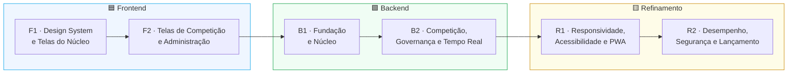
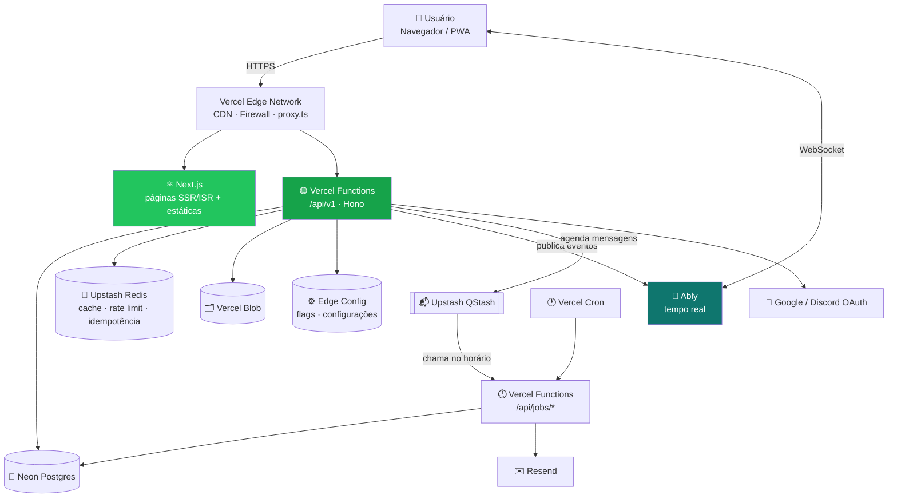
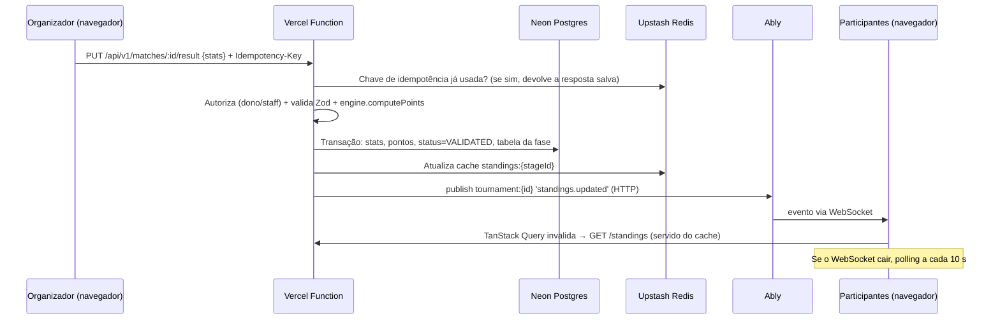
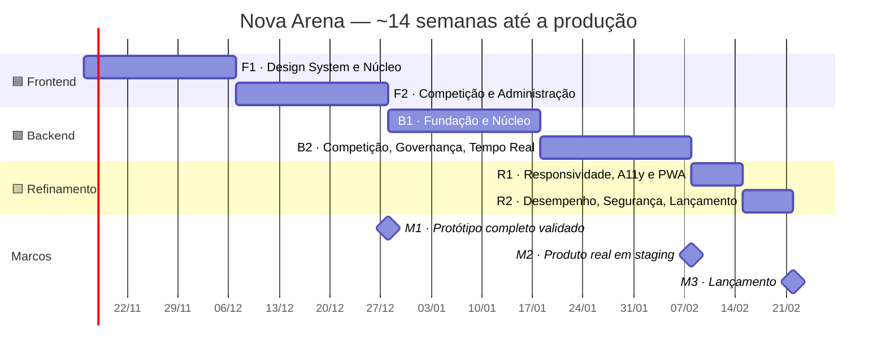
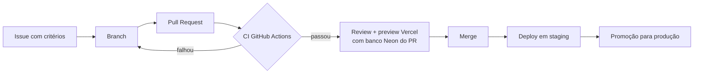

<div align="center">

# 🟢 NOVA ARENA — Plano de Implementação

**Frontend → Backend → Refinamento · 6 fases · todo o PRD coberto · 100% na Vercel**


-0F766E?style=for-the-badge)


| Campo | Valor |
|---|---|
| **Documento** | Plano de Implementação |
| **Versão** | 2.0 — readaptado para rodar inteiro na Vercel |
| **Baseado em** | [`prd.md`](prd.md) v1.0 |
| **Data** | 11/11/2026 |
| **Público** | Desenvolvedores front-end e back-end, QA, design, gestão |

</div>

---

## 📑 Sumário

1. [Como o plano funciona](#1-como-o-plano-funciona)
2. [Arquitetura na Vercel](#2-arquitetura-na-vercel)
3. [Cronograma](#3-cronograma)
4. [Regras para todas as fases](#4-regras-para-todas-as-fases)
5. [🟦 Módulo Frontend](#5--módulo-frontend)
   - [F1 — Design System e Telas do Núcleo](#f1--design-system-e-telas-do-núcleo)
   - [F2 — Telas de Competição e Administração](#f2--telas-de-competição-e-administração)
6. [🟩 Módulo Backend](#6--módulo-backend)
   - [B1 — Fundação e Núcleo](#b1--fundação-e-núcleo)
   - [B2 — Competição, Governança e Tempo Real](#b2--competição-governança-e-tempo-real)
7. [🟨 Módulo Refinamento](#7--módulo-refinamento)
   - [R1 — Responsividade, Acessibilidade e PWA](#r1--responsividade-acessibilidade-e-pwa)
   - [R2 — Desempenho, Segurança e Lançamento](#r2--desempenho-segurança-e-lançamento)
8. [Cobertura do PRD (nada fica para trás)](#8-cobertura-do-prd-nada-fica-para-trás)
9. [Cenários de teste de referência](#9-cenários-de-teste-de-referência)
10. [Checklist de produção](#10-checklist-de-produção)
11. [Melhorias sugeridas](#11-melhorias-sugeridas)

---

## 1. Como o plano funciona

O projeto tem **3 módulos** feitos **nesta ordem**, cada um com **2 fases**:



### Por que o frontend vem primeiro

1. **O produto é validado antes de construir o servidor.** O front é feito com uma **API simulada** (MSW — Mock Service Worker, com um "banco" em memória no navegador). No fim do frontend existe um **protótipo navegável completo**, publicado em um *preview* da Vercel e testado com organizadores e jogadores reais. Mudanças de fluxo nessa etapa custam pouco.
2. **As telas definem os contratos.** Durante o front são escritos os schemas de dados (Zod, em `packages/schemas`). O backend implementa exatamente esses contratos, sem idas e vindas.
3. **O motor de chaveamento e pontuação nasce no front.** O `packages/engine` é TypeScript puro: roda no navegador durante o protótipo e depois é **reaproveitado sem mudanças nas funções da Vercel**. A parte mais difícil do projeto fica pronta e testada cedo.
4. **O backend fica mais direto.** Ele só precisa "trocar o mock pelo real", tela por tela, com o comportamento esperado já definido.

### Formato de cada fase

> **Objetivo** → **Entregas** (com prioridade e IDs do PRD) → **Testes** → **Critérios de saída**

| Prioridade | Significado |
|---|---|
| **P0** | Obrigatório para fechar a fase |
| **P1** | Entra na fase; se atrasar, fecha na fase seguinte do mesmo módulo, nunca depois do lançamento |

---

## 2. Arquitetura na Vercel

> **Meta:** todo o código (telas, API, tarefas agendadas e filas) é publicado **em um único projeto da Vercel**. Banco, cache, filas e e-mail são serviços *serverless* contratados pelo **Vercel Marketplace**: as variáveis de ambiente entram sozinhas no projeto e a cobrança vem na fatura da Vercel. Não existe nenhum servidor próprio para manter.

### 2.1 O que mudou em relação ao PRD (§16)

A arquitetura original do PRD dependia de processos que ficam ligados o tempo todo (NestJS, gateway Socket.IO, workers BullMQ). A Vercel roda **funções sob demanda**, então essas peças foram trocadas por equivalentes *serverless*:

| Peça no PRD | Por que não roda na Vercel | Substituta neste plano |
|---|---|---|
| React SPA (Vite) em um lugar, API em outro domínio | Funcionaria, mas cookie `SameSite=Lax` entre sites diferentes quebra o *refresh token* | **Next.js (App Router)**: telas **e** API no mesmo projeto e no mesmo domínio |
| API NestJS (servidor contínuo) | Vercel não mantém servidores ligados | **Hono** dentro de uma rota do Next.js (`/api/v1/*`), rodando como **Vercel Function** (Node.js, *Fluid compute*) |
| Gateway Socket.IO + Redis adapter | Funções da Vercel **não mantêm WebSocket** aberto | **Ably** (tempo real gerenciado): canais por campeonato, partida e usuário. A função só **publica** o evento via HTTP |
| BullMQ + workers (W.O., lembretes, e-mails, recálculo) | Não há processo contínuo para consumir a fila | **Upstash QStash** (mensagens com atraso e novas tentativas) + **Vercel Cron** (varredura de segurança a cada minuto) |
| Redis (cache, ranking, rate limit) | Conexões TCP longas não combinam com funções | **Upstash Redis** (via HTTP, feito para *serverless*) |
| PostgreSQL 16 gerenciado | — | **Neon Postgres** (Marketplace), com *pooler*, **um banco por preview** (*branching*) e restauração por ponto no tempo |
| S3 / R2 + CDN | — | **Vercel Blob** (upload direto do navegador, CDN incluída) |
| Resend / SES | — | **Resend** (Marketplace) |
| *Feature flags* e configurações no banco | — | **Vercel Edge Config** + Flags SDK (leitura em milissegundos, sem consultar o banco) |
| Grafana/Loki, OpenTelemetry, Sentry | — | **Vercel Observability** + `@vercel/otel` + **Sentry** (Marketplace) + *log drain* |
| Pré-renderização das páginas públicas (era "melhoria futura") | — | **Nativo no Next.js**: páginas públicas com SSR/ISR e imagem Open Graph gerada |

> ⚠️ **Único ponto que a Vercel não hospeda sozinha:** conexões WebSocket. Por isso o tempo real usa o Ably (serviço externo gerenciado). Se o Ably cair, o site continua funcionando com **polling de 10 s** (CT-10), já previsto no PRD.

### 2.2 Visão de contêineres



### 2.3 Fluxo de tempo real (resultado → tabela)



Regras do tempo real:
- O evento só leva **o que mudou** (`{ stageId }`), nunca dados sensíveis. O navegador busca os dados na API, que confere a permissão.
- A publicação acontece **depois do commit**. Se o Ably falhar, a requisição não falha: o erro vai para o Sentry e o polling garante a consistência.
- Canais privados (`match:{id}`, `user:{id}`) usam **token do Ably emitido pela nossa API** com permissão só para os canais daquele usuário.

### 2.4 Limites da Vercel e como o plano lida com eles

| Limite | Impacto | Como resolvemos |
|---|---|---|
| Corpo da requisição de uma função limitado a ~4,5 MB | Prints de até 5 MB (RNF-09) não passam pela função | **Upload direto do navegador para o Vercel Blob** com token emitido pela API (tipo MIME e tamanho validados na emissão do token) |
| Tempo máximo de execução por função | Importações e exportações grandes | CSV de resultados é lido **no navegador** e enviado em lotes; exportações (inscritos, auditoria) usam **resposta em *streaming*** |
| Sem processos contínuos | Jobs com hora marcada | **QStash** com `notBefore` + **Cron** varrendo pendências a cada minuto (o que o QStash perder, o Cron pega). Todo job é **idempotente** |
| Sem WebSocket | Tempo real | **Ably** + polling de 10 s |
| Funções escalam para muitas instâncias | Muitas conexões no banco | **Pooler do Neon** (`DATABASE_URL` com pool, `DIRECT_URL` só para migrations) |
| Plano Hobby proíbe uso comercial e limita o Cron | Produção | **Plano Pro** a partir do staging (Cron por minuto, *log drains*, Firewall com regras próprias, ambiente de staging) |

### 2.5 Ambientes

| Ambiente | Onde | Banco | Uso |
|---|---|---|---|
| Local | `next dev` | Postgres e Redis em Docker **ou** branch de desenvolvimento do Neon | Desenvolvimento |
| Preview | Um deploy por PR (automático) | **Branch do Neon criada para o PR** (integração Neon ↔ Vercel) | Review, E2E, testes com usuários |
| Staging | Branch `staging` → ambiente personalizado da Vercel | Branch `staging` do Neon | Validação final, teste de carga |
| Produção | Branch `main` → domínio definitivo | Branch principal do Neon | Usuários reais |

**Região:** funções na região de São Paulo (`gru1`) e Neon, Upstash e QStash na região mais próxima disponível (preferência `sa-east-1`), para manter a latência baixa entre função e banco. Confirmar a disponibilidade de cada serviço em B1.1.

### 2.6 Decisões de arquitetura revisadas (substituem as ADRs do PRD §24)

| ADR | Decisão | Substitui | Motivo |
|---|---|---|---|
| ADR-001 | **Monólito modular em funções** (Hono em `packages/api`, montado no Next.js) | NestJS | Roda como Vercel Function; módulos com fronteiras claras continuam permitindo extrair serviços depois |
| ADR-002 | **Next.js (App Router)** com áreas logadas renderizadas no cliente e páginas públicas com SSR/ISR | SPA Vite | Mesmo domínio para telas e API (cookies funcionam), SEO nativo, imagens otimizadas |
| ADR-003 | PostgreSQL + JSONB (no **Neon**) | — | Mantida |
| ADR-004 | Motor de chave/pontuação como pacote TS puro compartilhado | — | Mantida |
| ADR-005 | **Ably** para tempo real + polling de 10 s como alternativa | Socket.IO + Redis Pub/Sub | Vercel não mantém WebSocket; serviço gerenciado escala sozinho nas finais |
| ADR-006 | Pontos sempre derivados no servidor | — | Mantida |
| ADR-007 | Seed aleatória registrada | — | Mantida |
| ADR-008 | **QStash + Vercel Cron** para jobs, todos idempotentes | BullMQ | Sem processo contínuo; o Cron é a rede de segurança |
| ADR-009 | **Autenticação própria** (`jose` + `arctic` + `otplib`) com cookies `httpOnly` no mesmo domínio | JWT em header `Bearer` | Atende RNF-06 (JWT 15 min + refresh rotativo) e funciona no `proxy.ts` da borda |

---

## 3. Cronograma



| Semanas | Fase | Resultado no fim |
|---|---|---|
| 1–3 | **F1** | Design system + telas de conta, exploração, criação de campeonato, squads e inscrição, funcionando com dados simulados num preview da Vercel |
| 4–6 | **F2** | Todas as telas do PRD prontas: chave, partidas, resultados, Admin, notificações. **M1 — protótipo validado com usuários** |
| 7–9 | **B1** | API real (Vercel Functions + Neon) de conta, papéis, jogos, campeonatos, squads e inscrições; essas telas deixam de usar o mock |
| 10–12 | **B2** | API real de competição, Admin, moderação, notificações, jobs (QStash/Cron) e tempo real (Ably). **M2 — produto completo em staging** |
| 13 | **R1** | Revisão de responsividade, acessibilidade e PWA |
| 14 | **R2** | Desempenho, segurança, beta e **M3 — lançamento** |

> **Equipe de referência:** 1 dev front-end, 1 dev back-end e 1 designer em meio período.
> **Para encurtar sem mudar a ordem:** durante F2, o dev back-end pode criar o projeto Pro da Vercel, conectar Neon, Upstash, Resend e Sentry pelo Marketplace, configurar domínio e CI. Nada disso depende das telas. Com 1 dev full-stack, conte ~20 semanas.

---

## 4. Regras para todas as fases

### 4.1 Definição de Pronto

- [ ] Pull Request revisado por outra pessoa.
- [ ] Lint, checagem de tipos e testes passando no CI.
- [ ] Preview da Vercel do PR funcionando.
- [ ] Tela funcionando em **360 px** e **1440 px** (*mobile-first* desde o primeiro dia).
- [ ] Estados de **carregando, vazio e erro** implementados.
- [ ] Permissões verificadas no back-end *(a partir de B1)*.
- [ ] Ações sensíveis registradas na auditoria *(a partir de B1)*.
- [ ] Nenhum segredo no código; variáveis novas cadastradas na Vercel para Preview, Staging e Produção *(a partir de B1)*.

### 4.2 Fluxo de trabalho



- **Ambientes:** local → preview (um por PR) → staging → produção (ver [§2.5](#25-ambientes)).
- **Deploy:** feito pela integração Git da Vercel. O GitHub Actions roda lint, tipos, testes e E2E contra a URL do preview.
- **Migrations:** `prisma migrate deploy` roda no build de cada ambiente, contra o banco daquele ambiente.
- **Commits:** *Conventional Commits* (`feat:`, `fix:`, `test:`…).
- **Feature flags** no Edge Config para liberar recursos aos poucos.

### 4.3 Ferramentas de teste

| Tipo | Ferramenta | Meta |
|---|---|---|
| Unitário | Vitest + fast-check (testes por propriedade) | Motor ≥ 90% · resto ≥ 70% |
| Componentes | Testing Library + Storybook | Todo o design system |
| Integração da API | Vitest chamando o app Hono direto (`app.request`) + Postgres em contêiner no CI | Todos os endpoints |
| Contrato | Respostas da API validadas pelos schemas de `packages/schemas` | 100% dos endpoints |
| Jobs | Handlers de `/api/jobs/*` chamados com assinatura do QStash simulada; servidor local do QStash (`qstash-cli dev`) nos testes de integração | Todos os jobs, incluindo execução repetida (idempotência) |
| E2E | Playwright (desktop + celular emulado) contra o **preview da Vercel** | Todos os fluxos P0 |
| Acessibilidade | axe-core | 0 violações sérias |
| Desempenho/carga | Lighthouse CI · k6 contra o staging | Metas do PRD (RNF-01 a 04) |

### 4.4 Estrutura do repositório

```
nova-arena/
├── apps/
│   └── web/                 # Next.js — único projeto publicado na Vercel
│       ├── app/
│       │   ├── (public)/    # home, campeonatos, perfil público (SSR/ISR)
│       │   ├── (participant)/
│       │   ├── organizador/
│       │   ├── admin/
│       │   └── api/
│       │       ├── v1/[[...route]]/route.ts   # monta o app Hono de packages/api
│       │       ├── jobs/[job]/route.ts        # recebe mensagens do QStash
│       │       └── cron/[task]/route.ts       # chamado pelo Vercel Cron
│       ├── proxy.ts         # proteção de rotas na borda (antigo middleware.ts)
│       └── vercel.json      # crons, região, headers
└── packages/
    ├── ui/         # Design system (F1)
    ├── schemas/    # Contratos Zod (F1/F2 → usados em B1/B2)
    ├── engine/     # Chaveamento + pontuação (F1/F2 → reaproveitado em B2)
    ├── api/        # Hono: módulos, guards, serviços (B1/B2)
    ├── db/         # Prisma: schema, migrations, seed (B1)
    └── config/     # ESLint, tsconfig, preset Tailwind
```

---

## 5. 🟦 Módulo Frontend

### F1 — Design System e Telas do Núcleo

> **Objetivo:** identidade visual pronta e todas as telas de conta, exploração, criação de campeonato, squads e inscrição, funcionando com a API simulada e publicadas em preview na Vercel.
> **Duração:** 3 semanas

#### Entregas

| # | Entrega | Detalhes | PRD | Prior. |
|---|---|---|---|:-:|
| F1.1 | **Setup** | Monorepo (pnpm + Turborepo). **Next.js (versão estável mais recente, App Router) + React 19 + TypeScript**. Grupos de rotas por área, com carregamento separado de código. TanStack Query, Zustand, React Hook Form + Zod. Todas as chamadas passam por `shared/api` (cliente único com as query keys), para que a troca do mock pela API real seja transparente. **MSW no navegador com banco em memória** e *seed* (jogos, usuários dos 4 papéis, campeonatos). Projeto conectado à Vercel: **cada PR gera um preview**. CI com lint, tipos e testes. | §16.1 | P0 |
| F1.2 | **Design system "Nova Green"** | `tokens.css` com toda a paleta (verde da marca, neutros, teal, ouro/prata/bronze, status), tipografia (Rajdhani, Inter, JetBrains Mono via `next/font`, sem requisição externa), espaçamento, raio, sombra; tema claro e escuro ("Arena Night"); `prefers-reduced-motion`. Componentes com Radix UI: `Button`, `Input`, `Select`, `Badge/StatusPill`, `Card`, `Modal`, `Drawer`, `Toast`, `Skeleton`, `EmptyState`, `Avatar`, `Tabs`, `Stepper`, `DataTable`. Storybook (publicado como projeto estático separado na Vercel). | §15.2–15.5 | P0 |
| F1.3 | **Layouts por área** | `layout.tsx` de cada grupo: público, participante (verde), organizador (teal), admin (verde-escuro + dourado). Componente `<RequireRole>` no cliente, página 403, troca de área para quem tem mais de um papel. Mapa do site do PRD (§15.7). *(A proteção real na borda, pelo `proxy.ts`, entra em B1.)* | §4, §6 | P0 |
| F1.4 | **Conta e perfil** | Entrar, cadastrar, verificar e-mail, recuperar senha, botões Google/Discord. Minha conta (dados, avatar com recorte, IDs de jogo, redes, bio). Perfil público `/u/[nick]`. Formulário "Quero ser organizador". | PAR-01, PAR-13, RF-01 | P0 |
| F1.5 | **Exploração** | Home (hero, atalhos por jogo, destaques, minhas próximas partidas). Lista com filtros (jogo, modo, status, data, vagas, organizador verificado) guardados na URL, busca e rolagem infinita. `TournamentCard`. Página do campeonato `/c/[slug]` com abas (Visão geral, Regulamento, Inscritos, Comunicados). Página personalizável (banner, rich-text, premiação, links de transmissão). *No protótipo, os dados são buscados no cliente; em B1 essas páginas passam a ser renderizadas no servidor (ver B1.6).* | PAR-02, PAR-03, ORG-13 | P0 |
| F1.6 | **Criação de campeonato** | Assistente em 7 passos (Informações → Jogo & Modo → Inscrições → Fases → Pontuação → Regras → Revisão) com rascunho automático. `StageBuilder` com **os 7 formatos** do PRD e regras de classificação. Começar a partir de **modelo** e salvar modelos próprios. Painel "Meus campeonatos". | ORG-01, ORG-02, ORG-04, ORG-05, RF-07, RF-08, RF-21 | P0 |
| F1.7 | **Jogos e pontuação (Admin)** | Lista e formulário de jogo (capa, modos, tamanho de equipe, reservas, campos de ID exigidos). **Editor de modelo de pontuação** com os 6 tipos de regra (`PER_UNIT`, `TABLE`, `OUTCOME`, `BONUS`, `CAP`, `MULTIPLIER`), ordem de desempate e prévia ("7 kills + 1º lugar = 10 pts"). | ADM-06, §11 | P0 |
| F1.8 | **Motor — parte 1 (`packages/engine`)** | `computePoints` com os 6 tipos de regra e os modelos padrão (FF: kill = 1, Booyah = 3; CR: coroas + vitória; eFootball: 3/1/0; 8 Ball: frames). Sem dependências de Node ou do navegador, para rodar igual nas duas pontas. Usado na prévia do editor e do assistente. | §11, RN-01 | P0 |
| F1.9 | **Squads e inscrições** | Meus squads (nome, tag, logo), `SquadRoster` com status dos convites e coroa do capitão, convite por nick/link/código, compartilhar (Web Share API), aceitar convite, transferir capitania. Inscrição solo (com aceite do regulamento e aviso de ID faltando) e com squad (pendente até o mínimo confirmar). Lista de espera. "Meus campeonatos". Organizador: inscritos, aprovar/recusar, remover/substituir, exportar CSV. | PAR-04 a 06, ORG-03, §12, RF-14, RF-15 | P0 |

#### Testes

| Área | O que testar |
|---|---|
| Design system | Testes de componente (estados, foco, teclado) · axe-core em todas as *stories* · contraste AA de todos os pares de cor · screenshots nos dois temas. |
| Motor | `computePoints({kills: 7, placement: 1}, modeloFF)` = **10** · cada tipo de regra isolado · `CAP` e `MULTIPLIER` combinados. |
| Rotas | Participante abrindo `/admin` vê a página 403. |
| E2E no preview (360 px e 1440 px) | Cadastro e login · criar campeonato FF Squad com 3 fases (grupos BR → mata-mata → final BR) e publicar · capitão cria squad, convida, membros aceitam, squad inscrito · filtrar "Free Fire + vagas abertas". |
| Usabilidade | 3 pessoas que nunca usaram o sistema criam e publicam um campeonato em **≤ 10 minutos**. |

#### ✅ Critérios de saída

- [ ] Storybook publicado; nenhuma cor fora dos tokens.
- [ ] Schemas Zod de usuário, jogo, campeonato, fase, squad e inscrição prontos em `packages/schemas`.
- [ ] Todos os fluxos do núcleo navegáveis no preview da Vercel, com dados simulados.

---

### F2 — Telas de Competição e Administração

> **Objetivo:** todas as telas restantes do PRD prontas. No fim, o **protótipo completo** é testado com usuários reais.
> **Duração:** 3 semanas

#### Entregas

| # | Entrega | Detalhes | PRD | Prior. |
|---|---|---|---|:-:|
| F2.1 | **Motor — parte 2 (`packages/engine`)** | Geradores dos **7 formatos**: eliminação simples (com *byes* e disputa de 3º), eliminação dupla (chave de perdedores e *reset* na final), grupos (serpentina por potes), pontos corridos (turno e returno), suíço (sem repetir confronto), Battle Royale (salas por tamanho máximo) e equipe x equipe (MD1 a MD7). *Seeding* aleatório com **seed registrada**, por ranking ou manual. `computeStandings` com os 8 critérios de desempate. `applyQualification` (top N por grupo, top N geral, vencedores). Meta de desempenho: gerar uma chave de 1.024 participantes em < 200 ms (cabe com folga no tempo de uma função). | §10.3–10.6, RF-09, RF-13 | P0 |
| F2.2 | **Chave e tabelas** | `BracketView` em SVG (simples e dupla; zoom e arrastar no desktop, **lista por rodada com abas** no celular). `GroupTable`, `StandingsTable`, tabela BR por queda e acumulada (Pos, Squad, Booyahs, Kills, Pts) com zona de classificação em verde. Explicação do desempate ao tocar na posição. | §15.5, PAR-09 | P0 |
| F2.3 | **Operação do campeonato** | Prévia da chave com **arrastar e soltar** antes de confirmar. Assistente "Avançar fase" com prévia dos classificados. Agenda (partida ou rodada inteira), código da sala. Equipe do evento (co-organizadores e moderadores). Comunicados (todos, uma fase ou um grupo). Pausar, cancelar e encerrar com pódio (ouro, prata, bronze). | ORG-04 a 06, ORG-10 a 12 | P0 |
| F2.4 | **Partidas e resultados** | `MatchCard` com todos os estados. Check-in com contagem regressiva. `ScoreInput` (duelos) e `BRDropTable` (quedas, com Tab/Enter, teclado numérico e coluna "Pontos (prévia)"). Kills por equipe ou por jogador (MVP). Upload de print com **compressão no navegador** e envio direto para o armazenamento (no protótipo, simulado; em B1, Vercel Blob). Importação de CSV **lida no navegador**, com prévia dos erros, enviada em lotes. | ORG-07, PAR-07, RN-03 | P0 |
| F2.5 | **Envio, validação e disputas** | Participante envia placar + print; adversário confirma ou contesta. Fila "Resultados para validar" do organizador. Tela de disputa com histórico e anexos. | ORG-08, PAR-08, RF-19 | P0 |
| F2.6 | **Arte de resultado** | Layout da imagem de campeões / certificado. Em B2 ela passa a ser gerada no servidor com `next/og` e serve também de imagem de compartilhamento do campeonato. | ORG-12, RF-24 | P1 |
| F2.7 | **Perfil competitivo** | Estatísticas por jogo (campeonatos, vitórias, kills, coroas, títulos) e conquistas no perfil público. | PAR-11, RF-22 | P1 |
| F2.8 | **Painel Admin** | Dashboard (KPIs + gráficos com Recharts). Usuários (buscar, suspender com prazo, banir, redefinir senha, mesclar duplicadas). Administradores e Organizadores (promover, revogar, limites, selo verificado). **Convites** por e-mail ou link com validade e limite de usos. Fila de pedidos de organizador. Campeonatos (visão global, trocar responsável, destacar). Auditoria (linha do tempo com antes/depois, exportar CSV). Moderação (denúncias, disputas escaladas, ações rápidas). Comunicados globais. Configurações do site e *feature flags*. Saúde do sistema (banco, cache, filas, tempo real, versão publicada). Configuração do 2FA com QR code. | ADM-01 a 11 | P0 |
| F2.9 | **Denúncias** | Botão "Denunciar" em perfis, squads, partidas e resultados, com anexo. | PAR-12 | P0 |
| F2.10 | **Notificações e tempo real (simulados)** | Sino com contador, lista, marcar como lida, preferências por tipo. Interface `RealtimeClient` (assinar canal, receber evento, estado da conexão) com **implementação simulada** que emite os eventos do PRD (§18.3); em B2 ela é trocada pela implementação do Ably sem mudar as telas. Hook `useTournamentChannel` usando essa interface. Indicador "AO VIVO", animação nas trocas de posição, aviso "reconectando…" e **polling de 10 s** quando a conexão cai. | PAR-10, RF-17, RF-18 | P0 |

#### Testes

| Área | O que testar |
|---|---|
| Motor — casos fixos | 2, 3, 5, 8, 13, 16 e 64 participantes em cada formato. |
| Motor — **por propriedade** (N de 2 a 1.024) | Ninguém aparece duas vezes na mesma rodada · eliminação simples tem N − 1 partidas · na eliminação dupla ninguém perde mais de 2 vezes · no suíço não há confronto repetido · *byes* só para os melhores seeds · mesma seed = mesma chave · grupos diferem em no máximo 1 participante. |
| Pontuação | Queda do PRD: Alfa (1º, 7 kills) = 10 · Bravo (2º, 9) = 9 · Charlie (3º, 4) = 4. Cada critério de desempate isolado e em cadeia. |
| Visual | Chave simples e dupla com 8, 16 e 32 participantes, nos dois temas e no celular. |
| Acessibilidade | Cada confronto da chave tem `aria-label` ("Quartas: Squad Alfa contra Squad Bravo, 20h") e é navegável por teclado. |
| E2E | Gerar chave → arrastar dois participantes → confirmar · lançar MD3 → vencedor avança · **cenário completo do Free Fire** (CT-06) · Admin gera convite e outra conta aceita · tabela muda sozinha com evento do tempo real simulado · conexão simulada cai → polling assume (CT-10). |
| Usabilidade | Lançar uma queda de 12 squads em **≤ 60 s**. |

#### ✅ Critérios de saída — Marco M1

- [ ] **Todas as telas do PRD** existem e estão navegáveis no preview da Vercel.
- [ ] Cobertura do `packages/engine` ≥ 90%, com os testes por propriedade passando.
- [ ] `packages/schemas` completo: é o contrato que o backend vai implementar.
- [ ] **Protótipo validado** com pelo menos 3 organizadores e 5 jogadores; ajustes de fluxo já feitos.

---

## 6. 🟩 Módulo Backend

> O backend implementa os contratos de `packages/schemas` e reaproveita o `packages/engine`. Tudo roda como **Vercel Functions** dentro do mesmo projeto Next.js. A cada entrega, **as telas correspondentes deixam de usar o mock** e passam a usar a API real.

### B1 — Fundação e Núcleo

> **Objetivo:** API real de conta, papéis, auditoria, jogos, campeonatos, squads e inscrições.
> **Duração:** 3 semanas · **Depende de:** M1

#### Entregas

| # | Entrega | Detalhes | PRD | Prior. |
|---|---|---|---|:-:|
| B1.1 | **Infraestrutura na Vercel** | Projeto no **plano Pro**. Pelo Marketplace: **Neon** (Postgres, integração que cria uma branch de banco por preview), **Upstash Redis** e **QStash**, **Resend**, **Sentry**. **Vercel Blob** e **Edge Config** no próprio projeto. Domínio definitivo (PRD Q7) com HTTPS. Região das funções `gru1` e serviços na região mais próxima. `packages/api` (Hono, TypeScript estrito) montado em `app/api/v1/[[...route]]/route.ts` com runtime Node.js. `packages/db` com Prisma (URL com pool para a aplicação, URL direta para migrations). Variáveis validadas com Zod na inicialização. `GET /api/v1/health` (banco, Redis, QStash). Postgres e Redis em Docker para desenvolvimento local. Ambiente de staging. | §16 | P0 |
| B1.2 | **Autenticação** | Cadastro, login, verificação de e-mail, recuperação de senha. Argon2id (`@node-rs/argon2`). JWT de acesso de 15 min (`jose`) em cookie `httpOnly`, `Secure`, `SameSite=Lax`, e **refresh rotativo** em outro cookie restrito à rota de refresh, com detecção de reuso (família de tokens no banco). OAuth Google e Discord (`arctic`). Como API e telas estão no mesmo domínio, não há CORS. Proteção contra CSRF: `SameSite=Lax` + checagem do cabeçalho `Origin` em toda mutação. Rate limit no login (5/min/IP) com `@upstash/ratelimit`. | RF-01, RNF-06, RNF-07 | P0 |
| B1.3 | **Papéis, permissões e auditoria** | `UserRole`. Middlewares do Hono `requireRole` (papel global) e `requireTournamentAccess` (dono/staff do campeonato), seguindo a matriz RBAC do PRD. **`proxy.ts` do Next.js** valida o JWT na borda e redireciona quem não pode abrir `/organizador` ou `/admin` (a checagem que vale continua na API). *Seed* do Super Admin. `AuditLog` somente-inserção (permissão de banco só para `INSERT`/`SELECT` + gatilho que bloqueia `UPDATE`/`DELETE`) gravado por um *helper* `audited()` dentro da mesma transação da ação. | §6, RF-02, RF-06, RNF-15 | P0 |
| B1.4 | **Perfil** | `/me`, IDs de jogo, nick único, pedido para virar organizador. **Avatar e imagens por upload direto para o Vercel Blob**: a API emite o token de upload só para imagens de até 5 MB, e o navegador envia o arquivo sem passar pela função. | PAR-01, PAR-13, RNF-09 | P0 |
| B1.5 | **Catálogo de jogos** | `Game`, `GameMode`, `ScoringModel` (regras em JSONB validadas pelo schema). CRUD para o Admin. *Seed* com Free Fire, Clash Royale, 8 Ball Pool e eFootball. Lista de jogos ativos em cache no Redis. | ADM-06, RF-05 | P0 |
| B1.6 | **Campeonatos** | `Tournament`, `Stage`, `TournamentStaff`, modelos de campeonato. Máquina de estados do ciclo de vida (§8.3). CRUD, publicar, pausar, cancelar. Listagem com filtros, busca e paginação por cursor. **Abrir e fechar inscrições:** ao publicar, a API agenda mensagens no QStash para as datas de abertura e fechamento; um Cron a cada minuto corrige o que tiver ficado para trás. Comunicados. **Páginas públicas** (home, lista, `/c/[slug]`, `/u/[nick]`) passam a ser renderizadas no servidor com ISR e são **revalidadas na hora** (`revalidateTag`) quando o campeonato muda. | ORG-01, 02, 10, 11, 13, RF-07, RF-08, RF-21 | P0 |
| B1.7 | **Squads** | `Team`, `TeamMember`, `TeamInvite` (nick, link, código; 72h). Trava de elenco por data. Transferir capitania. Um jogador por squad no mesmo campeonato. | §12, RF-15 | P0 |
| B1.8 | **Inscrições** | Solo e squad, vagas, prazo, ID de jogo obrigatório, aprovação manual opcional, lista de espera com promoção automática, organizador não se inscreve no próprio evento, exportação CSV em *streaming*. Controle de concorrência na última vaga: transação com `SELECT … FOR UPDATE` na linha do campeonato (funciona pelo *pooler* do Neon, pois o lock vive dentro da transação). | ORG-03, RF-14, RF-23 | P0 |

#### Testes

| Área | O que testar |
|---|---|
| Auth | Cadastro → verificação → login → refresh → logout · reuso de refresh token derruba a sessão · 6ª tentativa de login em 1 min = 429 · mutação com `Origin` de outro site = 403. |
| Permissões | **Matriz RBAC do PRD** automatizada: cada rota × 4 papéis + visitante → 200/401/403. |
| Contrato | Toda resposta validada pelos schemas de `packages/schemas`. |
| Campeonatos | Transições inválidas recusadas · organizador A não edita o campeonato do B · job de abrir inscrições executado 2 vezes não muda nada na 2ª. |
| Inscrições | **CT-02:** 100 inscrições simultâneas para 10 vagas → 10 confirmadas, 90 na lista de espera (rodar também contra o preview, com várias instâncias de função ao mesmo tempo) · cancelamento promove o primeiro da lista. |
| Squads | Convite expirado recusado · jogador não fica em dois squads no mesmo campeonato. |
| Uploads | Token de upload recusado para arquivo que não é imagem ou maior que 5 MB. |
| Auditoria | `UPDATE`/`DELETE` em `AuditLog` falham no banco. |
| E2E | Os testes E2E de F1 rodam **contra o preview com a API real** (mocks desligados) e continuam passando. |

#### ✅ Critérios de saída

- [ ] Telas de F1 funcionando 100% com a API real no preview e no staging.
- [ ] Matriz RBAC passando para as rotas existentes.
- [ ] CT-01 e CT-02 passando no servidor.

---

### B2 — Competição, Governança e Tempo Real

> **Objetivo:** API real de chaveamento, partidas, resultados, Admin, moderação, notificações, jobs e tempo real.
> **Duração:** 3 semanas · **Depende de:** B1

#### Entregas

| # | Entrega | Detalhes | PRD | Prior. |
|---|---|---|---|:-:|
| B2.1 | **Chave** | `Group`, `Match`, `MatchParticipant`. Geração com o `packages/engine` (os 7 formatos): **prévia** → ajuste manual → confirmar. Seed registrada. Chave travada após a 1ª partida concluída (só o Admin destrava). Ajustes manuais auditados. | RF-09, ORG-04 | P0 |
| B2.2 | **Agenda e check-in** | Agenda por partida ou rodada. Código da sala **cifrado** (AES-256-GCM, chave em variável sensível da Vercel). Ao agendar, a API cria no QStash as mensagens daquela partida: **lembrete 15 min antes**, **abertura do check-in**, **revelação da sala** e **fechamento do check-in (W.O. automático)**. Reagendar cancela e recria as mensagens. Cron a cada minuto aplica qualquer W.O. atrasado. A sala nunca vai no evento de tempo real: o evento `lobby.revealed` só avisa, e o participante busca o código em `GET /matches/:id/lobby`, que confere se ele está na partida e se já está no horário. | ORG-06, PAR-07, RF-16, RN-04 | P0 |
| B2.3 | **Resultados** | Lançamento de duelos (placar MD) e de quedas BR (colocação + kills, por equipe ou por jogador). Pontos **sempre calculados no servidor**. Prova (print no Vercel Blob). Avanço automático do vencedor. Importação de CSV em lotes. Correção com recálculo. Cabeçalho `Idempotency-Key` guardado no Upstash Redis por 24 h com a resposta original. | ORG-07, RF-11, RF-12, RN-01 a 03 | P0 |
| B2.4 | **Classificação e avanço** | Tabela recalculada a cada resultado, guardada no Postgres (tabela `standings`) e em cache no Redis. Avanço de fase com prévia. Mudança de modelo em fase em andamento recalcula tudo (com auditoria). Encerramento com 1º, 2º e 3º. Estatísticas do perfil competitivo. **Arte de resultado gerada com `next/og`** (também usada como imagem de compartilhamento). | ORG-05, ORG-12, RF-10, RF-13, RF-22, RF-24, RN-02 | P0 |
| B2.5 | **Envio e disputas** | Envio pelo participante → confirmação do adversário → validação do staff. Contestação, disputa com anexos e escalonamento para o Admin. | ORG-08, PAR-08, RF-19 | P0 |
| B2.6 | **Administração** | KPIs do dashboard (consultas agregadas com cache de 5 min). Gestão de usuários (suspender, banir, redefinir senha, mesclar). **Convites de Admin/Organizador** por e-mail ou link com validade e limite de usos (token guardado como hash). Fila de pedidos de organizador. Limites por organizador e selo verificado. Gestão global de campeonatos. Consulta de auditoria com exportação CSV em *streaming*. **Configurações do site e *feature flags* no Edge Config**, editadas pelo painel por meio da API da Vercel (com auditoria). Comunicados globais. **Saúde do sistema:** estado do banco, Redis, QStash (mensagens com falha), Ably, versão publicada (`VERCEL_GIT_COMMIT_SHA`) e taxa de erro do Sentry. | ADM-01 a 05, 08 a 11, RF-03, RF-04, RF-25 | P0 |
| B2.7 | **2FA** | TOTP (`otplib`) obrigatório para acessar `/admin`, opcional para os demais. O JWT carrega a informação de que o 2FA foi feito; o `proxy.ts` e a API conferem. | RNF-08 | P0 |
| B2.8 | **Moderação** | Denúncias (usuário, squad, resultado), fila com status, sanções com efeito imediato, desclassificação com recálculo da tabela. **Derrubar sessão:** a sanção aumenta a versão da sessão do usuário no banco e grava o bloqueio no Redis, que é consultado a cada requisição; o token do Ably é revogado e o navegador recebe `session.revoked`. | ADM-07, PAR-12, RF-20, RN-05 | P0 |
| B2.9 | **Tempo real (Ably)** | Rota `POST /api/v1/realtime/token` emite token do Ably só com os canais permitidos: `tournament:{id}` (leitura, público), `match:{id}` (só participantes e staff), `user:{id}` (só o dono). As funções publicam via REST do Ably **depois do commit**. Eventos `match.updated`, `standings.updated`, `stage.advanced`, `announcement.created`, `notification.created`, `lobby.revealed`, `session.revoked`. Implementação Ably da interface `RealtimeClient` de F2.10; polling de 10 s continua como alternativa. | RF-17, §18.3 | P0 |
| B2.10 | **Notificações** | No site (registro no banco + evento no canal `user:{id}`) e por e-mail (Resend, enviado por mensagem do QStash, que tenta de novo sozinho; o ID da notificação evita e-mail duplicado). Preferências por tipo. Todos os eventos de PAR-10. | PAR-10, RF-18 | P0 |
| B2.11 | **Jobs e Cron** | Rotas `/api/jobs/*` aceitam **só mensagens assinadas pelo QStash**; `/api/cron/*` aceita só o segredo do Vercel Cron. Crons no `vercel.json`: varredura de pendências (inscrições, check-in, W.O.) a cada minuto, limpeza de convites e uploads órfãos diária. Todo job confere o estado atual antes de agir, então rodar duas vezes é seguro. Mensagens que falharam todas as tentativas vão para a fila de falhas do QStash e aparecem na Saúde do Sistema. | RN-04, RF-16 | P0 |

#### Testes

| Área | O que testar |
|---|---|
| Chave | Gerar → ajustar → confirmar → ajustar de novo depois de uma partida concluída = 409. |
| Resultados | Colocação repetida = 400 · quem não é staff = 403 · correção recalcula tabela e chave (CT-08) · mesma `Idempotency-Key` não grava duas vezes. |
| Check-in | W.O. com relógio simulado (CT-07) · job de W.O. entregue duas vezes aplica uma vez só · W.O. aplicado pelo Cron quando a mensagem do QStash não chega · quem não está na partida não recebe o código da sala. |
| Jobs | Chamada a `/api/jobs/*` sem assinatura válida = 401 · chamada a `/api/cron/*` sem segredo = 401. |
| **Cenário completo** | **CT-06:** 48 squads FF → grupos BR → mata-mata MD3 → final BR → campeão igual ao da planilha de referência, via API. Mais um Clash Royale 1v1 em eliminação dupla e um 8 Ball em suíço. |
| Admin | Convite expirado ou revogado não concede papel (CT-03) · Admin não remove o Super Admin · sem 2FA, `/admin/*` = 403 · mudança de flag no painel aparece no site sem novo deploy. |
| Moderação | Banido perde a sessão em até 1 minuto (CT-09) · desclassificação zera pontos e reordena a tabela. |
| Tempo real | Resultado salvo → evento no cliente em < 2 s · token do Ably de um participante não assina `match:{id}` de outra partida · **k6 + Ably:** 2.000 conexões no canal de um campeonato, p95 < 2 s · Ably bloqueado no navegador → polling funciona (CT-10). |
| Notificações | Cada evento gera a notificação certa · preferência desligada não envia e-mail · falha do Resend tenta de novo sem duplicar. |
| Permissões | Matriz RBAC **completa** do PRD automatizada. |
| E2E | Todos os testes E2E de F2 rodam contra o preview com a API real. |

#### ✅ Critérios de saída — Marco M2

- [ ] **Nenhuma tela usa mais o mock.**
- [ ] CT-01 a CT-10 passando em staging.
- [ ] 100% das ações sensíveis auditadas.
- [ ] Campeonato completo jogado pelo time inteiro em staging.

---

## 7. 🟨 Módulo Refinamento

> As regras *mobile-first*, os estados de carregando/vazio/erro e o axe no CI valem desde a semana 1. O refinamento é a **revisão final e o fechamento** para a produção.

### R1 — Responsividade, Acessibilidade e PWA

> **Objetivo:** todas as telas perfeitas em qualquer tamanho e acessíveis.
> **Duração:** 1 semana

#### Tamanhos de tela

| Nome | Largura | Referência | Layout |
|---|---|---|---|
| `xs` | 360–479 px | Android de entrada, iPhone SE | 1 coluna, barra inferior |
| `sm` | 480–767 px | Celulares grandes | 1 coluna |
| `md` | 768–1023 px | Tablets | 2 colunas, menu lateral recolhível |
| `lg` | 1024–1439 px | Notebooks | 3 colunas, menu lateral fixo |
| `xl` | ≥ 1440 px | Desktops | Conteúdo com largura máxima de 1280 px |

#### Como os componentes se adaptam

| Componente | Celular | Tablet | Desktop |
|---|---|---|---|
| Navegação do participante | Barra inferior (5 ícones) | Barra inferior ou lateral | Header completo |
| Navegação Org/Admin | *Drawer* (☰) | Menu lateral recolhível | Menu lateral fixo |
| Chave | Lista por rodada com abas | SVG com zoom | SVG completo |
| Tabelas de classificação | Pos, Equipe, Pts + linha expansível | Todas as colunas com rolagem | Todas as colunas |
| Tabelas do Admin | Cartões | Tabela compacta | Tabela completa + ações em lote |
| Filtros | *Drawer* de baixo para cima | Barra lateral | Barra lateral fixa |
| Assistente de criação | Um passo por tela, botões no rodapé | Stepper horizontal | Stepper lateral + resumo |
| Lançar queda BR | Um squad por cartão | Tabela | Tabela com atalhos de teclado |
| Modais | Tela cheia | Centralizado | Centralizado |

#### Entregas

| # | Entrega | PRD | Prior. |
|---|---|---|:-:|
| R1.1 | Revisão de **todas as telas** nos 5 tamanhos e em paisagem (checklist abaixo). | RNF-13 | P0 |
| R1.2 | Áreas de toque ≥ 44×44 px, teclado certo em cada campo (`inputmode`), *safe areas* do notch. | RNF-13 | P0 |
| R1.3 | **PWA:** manifesto (`app/manifest.ts`), ícones, *service worker* com Serwist (cache dos estáticos, sem cache das rotas `/api`), página offline, botão "Instalar app". | RNF-12 | P0 |
| R1.4 | **WCAG 2.2 AA:** foco visível, "pular para o conteúdo", `aria-live` nas mudanças ao vivo, rótulos, textos alternativos. Revisão com NVDA e VoiceOver. | RNF-11 | P0 |
| R1.5 | Microinterações do PRD revisadas: skeletons (`loading.tsx` por rota), estados vazios ilustrados, confete do campeão respeitando `prefers-reduced-motion`. | §15.8 | P0 |
| R1.6 | Textos externalizados (i18n com `next-intl`) com pt-BR como padrão. | RNF-16 | P0 |

#### Checklist por tela

| Tela | 360 | 768 | 1024 | 1440 | Paisagem |
|---|:-:|:-:|:-:|:-:|:-:|
| Home e exploração | ⬜ | ⬜ | ⬜ | ⬜ | ⬜ |
| Página do campeonato (todas as abas) | ⬜ | ⬜ | ⬜ | ⬜ | ⬜ |
| Chave e tabelas | ⬜ | ⬜ | ⬜ | ⬜ | ⬜ |
| Squads e inscrição | ⬜ | ⬜ | ⬜ | ⬜ | ⬜ |
| Check-in, envio de resultado e disputa | ⬜ | ⬜ | ⬜ | ⬜ | ⬜ |
| Assistente de criação | ⬜ | ⬜ | ⬜ | ⬜ | ⬜ |
| Lançamento de resultados | ⬜ | ⬜ | ⬜ | ⬜ | ⬜ |
| Perfil e perfil competitivo | ⬜ | ⬜ | ⬜ | ⬜ | ⬜ |
| Painel Admin (todas as telas) | ⬜ | ⬜ | ⬜ | ⬜ | ⬜ |

#### Testes

- Playwright com os fluxos P0 em **iPhone SE (375), Pixel 7 (412) e desktop (1440)**, contra o preview.
- Screenshots de cada tela nos 5 tamanhos.
- Verificação automática: **nenhuma rolagem horizontal em 360 px**.
- axe-core em todas as páginas: 0 violações sérias ou críticas.
- Teste manual em aparelhos reais: 1 Android de entrada, 1 iPhone, 1 tablet.

#### ✅ Critérios de saída

- [ ] Checklist por tela 100% preenchido.
- [ ] Roteiros com leitor de tela aprovados (inscrição, check-in, ver chave, lançar resultado).
- [ ] PWA instalável no Android e no iOS.

---

### R2 — Desempenho, Segurança e Lançamento

> **Objetivo:** produto rápido, seguro, monitorado e no ar na Vercel.
> **Duração:** 1 semana + beta

#### Entregas

| # | Entrega | Detalhes | PRD | Prior. |
|---|---|---|---|:-:|
| R2.1 | **Desempenho** | Índices e consultas revisados. Páginas públicas com ISR e cache na borda da Vercel. Respostas públicas da API com `Cache-Control` (`s-maxage` + `stale-while-revalidate`). Imagens com `next/image` (WebP/AVIF e `srcset` automáticos). Divisão de código por área. JavaScript inicial **≤ 180 KB gzip** por rota (medido no build do Next.js). Funções e banco na mesma região. Ajuste do *autoscaling* do Neon para o pico das finais. | RNF-01 a 04 | P0 |
| R2.2 | **Segurança** | Revisão OWASP Top 10. Headers (CSP com *nonce* gerado no `proxy.ts`, HSTS, `X-Content-Type-Options`, `Referrer-Policy`). **Vercel Firewall:** regras de rate limit nas rotas sensíveis, proteção contra bots e modo de desafio pronto para ataques. Varredura de dependências e segredos. Variáveis marcadas como *sensitive* na Vercel. Proteção de deploy nos previews (só o time acessa). Teste de acesso de um usuário aos dados de outro em todos os recursos. Alertas anti-fraude (contas por IP/dispositivo, IDs de jogo duplicados). | RNF-06 a 09, §16.5 | P0 |
| R2.3 | **LGPD** | Exportar e excluir dados pessoais (incluindo arquivos no Blob), banner de cookies (opção mais restritiva por padrão; Vercel Analytics sem cookies), Termos, Privacidade, aviso de "não afiliado aos jogos", idade mínima no cadastro. | RNF-10 | P0 |
| R2.4 | **Operação** | Logs estruturados com *log drain*. OpenTelemetry com `@vercel/otel`. Sentry (front, funções e jobs). Vercel Speed Insights para LCP/INP reais. Alertas (erro > 1%, latência acima da meta, mensagens com falha no QStash, Cron sem rodar). **Backup:** restauração por ponto no tempo do Neon, com **restauração testada** em uma branch separada. *Runbook* de incidentes. **Rollback com o Instant Rollback da Vercel** (segundos) e migrations sempre compatíveis com a versão anterior. | RNF-05, RNF-14 | P0 |
| R2.5 | **Beta e lançamento** | Beta fechado com 3–5 organizadores → correções → cadastro público liberado por *feature flag* no Edge Config → 2 semanas de monitoramento intensivo. Revisão dos limites e custos de cada serviço (Vercel, Neon, Upstash, Ably, Resend) com base no uso do beta. | §21 | P0 |

#### Testes

| Tipo | Meta |
|---|---|
| Lighthouse mobile (páginas públicas) | ≥ 90 · LCP ≤ 2,5 s · INP ≤ 200 ms |
| k6 — carga geral (staging, com o time liberado no Firewall) | 5.000 usuários simultâneos, 50 campeonatos ativos · API p95 ≤ 300 ms (leitura) / ≤ 600 ms (escrita) · sem erro de conexão no banco |
| Segurança | Nenhuma vulnerabilidade alta ou crítica aberta |
| Backup | Restauração completa em uma branch separada do Neon |
| Rollback | Instant Rollback executado em staging e site funcionando em < 5 min |
| Regressão | Suíte E2E completa verde antes do beta e antes do lançamento; *smoke test* depois de cada deploy |

#### Etapas do lançamento

| Etapa | Para avançar |
|---|---|
| Beta fechado | **3 campeonatos reais concluídos** sem planilha e sem bug crítico aberto |
| Cadastro público | Taxa de erro < 0,5% e nenhuma disputa causada por erro de pontuação |

#### ✅ Critérios de saída — Marco M3

- [ ] Metas de desempenho atingidas no teste de carga.
- [ ] [Checklist de produção](#10-checklist-de-produção) 100% verde.
- [ ] Site em produção na Vercel.

---

## 8. Cobertura do PRD (nada fica para trás)

Todos os itens do PRD e a fase em que são feitos (tela → API).

### Administrador

| ID | Funcionalidade | Tela | API |
|---|---|:-:|:-:|
| ADM-01 | Dashboard | F2 | B2 |
| ADM-02 | Gestão de Administradores (convites) | F2 | B2 |
| ADM-03 | Gestão de Organizadores e pedidos | F2 | B2 |
| ADM-04 | Gestão de Usuários | F2 | B2 |
| ADM-05 | Gestão global de campeonatos | F2 | B2 |
| ADM-06 | Catálogo de jogos e pontuação | F1 | B1 |
| ADM-07 | Moderação | F2 | B2 |
| ADM-08 | Auditoria | F2 | B1 (registro) · B2 (consulta) |
| ADM-09 | Configurações e *feature flags* (Edge Config) | F2 | B2 |
| ADM-10 | Saúde do sistema | F2 | B2 |
| ADM-11 | Comunicados globais | F2 | B2 |

### Organizador

| ID | Funcionalidade | Tela | API |
|---|---|:-:|:-:|
| ORG-01 | Assistente de criação | F1 | B1 |
| ORG-02 | Modelos de campeonato | F1 | B1 |
| ORG-03 | Gestão de inscrições | F1 | B1 |
| ORG-04 | Fases e chaveamento (aleatório, ranking, manual) | F1 · F2 | B2 |
| ORG-05 | Troca de formato entre fases | F1 · F2 | B2 |
| ORG-06 | Agenda de partidas | F2 | B2 |
| ORG-07 | Lançamento de resultados (duelo e BR, CSV) | F2 | B2 |
| ORG-08 | Validação e disputas | F2 | B2 |
| ORG-09 | Tabelas ao vivo | F2 | B2 |
| ORG-10 | Equipe do evento | F2 | B1 |
| ORG-11 | Comunicados | F2 | B1 |
| ORG-12 | Encerramento e arte de resultado | F2 | B2 |
| ORG-13 | Página pública personalizável | F1 | B1 |

### Participante

| ID | Funcionalidade | Tela | API |
|---|---|:-:|:-:|
| PAR-01 | Cadastro e perfil | F1 | B1 |
| PAR-02 | Explorar campeonatos | F1 | B1 |
| PAR-03 | Página do campeonato | F1 · F2 | B1 · B2 |
| PAR-04 | Inscrição solo | F1 | B1 |
| PAR-05 | Inscrição com squad | F1 | B1 |
| PAR-06 | Meus campeonatos | F1 | B1 |
| PAR-07 | Check-in | F2 | B2 |
| PAR-08 | Envio de resultado | F2 | B2 |
| PAR-09 | Acompanhar ao vivo | F2 | B2 |
| PAR-10 | Notificações | F2 | B2 |
| PAR-11 | Perfil competitivo | F2 | B2 |
| PAR-12 | Denúncia | F2 | B2 |
| PAR-13 | Pedir para ser organizador | F1 | B1 |

### Motor de campeonatos e pontuação

| Item do PRD | Onde |
|---|---|
| 7 formatos (simples, dupla, grupos, pontos corridos, suíço, Battle Royale, equipe x equipe) e MD1 a MD7 | F2 (engine + telas) · B2 (API) |
| 7 regras de chaveamento (sorteio com seed, ranking, manual, byes, serpentina, suíço, salas BR) + avanço | F2 · B2 |
| 8 critérios de desempate configuráveis | F2 · B2 |
| 6 tipos de regra de pontuação (`PER_UNIT`, `TABLE`, `OUTCOME`, `BONUS`, `CAP`, `MULTIPLIER`) | F1 · B1 |
| Modelos padrão: Free Fire (kill = 1, Booyah = 3, e a tabela alternativa), Clash Royale, eFootball, 8 Ball Pool | F1 · B1 |
| RN-01 a RN-05 (pontos no servidor, recálculo, kills por jogador, W.O., desclassificação) | B2 |
| Squads: capitão, convites, reservas, trava de elenco, exclusividade, transferir capitania | F1 · B1 |
| Ciclo de vida completo do campeonato (incluindo Pausado e Cancelado) | F1 · B1 |

### Requisitos não funcionais

| RNF | Onde | Como na Vercel |
|---|---|---|
| RNF-01 a 04 (desempenho e escala) | R2 | ISR + cache na borda, funções escalam sozinhas, pooler do Neon, Ably para as conexões ao vivo |
| RNF-05 (disponibilidade) | R2 | Infraestrutura gerenciada + Instant Rollback |
| RNF-06 a 09 (segurança, 2FA, uploads) | B1 · B2 · R2 | Cookies no mesmo domínio, Upstash Ratelimit, Vercel Firewall, upload direto para o Blob |
| RNF-10 (LGPD) | R2 | — |
| RNF-11 (acessibilidade) | Todas · fechamento em R1 | — |
| RNF-12, 13 (compatibilidade, responsividade) | Todas · fechamento em R1 | PWA com Serwist |
| RNF-14 (observabilidade) | R2 | Vercel Observability, `@vercel/otel`, Sentry, *log drain* |
| RNF-15 (auditoria) | B1 | — |
| RNF-16 (i18n) | R1 | `next-intl` |
| RNF-17 (qualidade do motor ≥ 80%; aqui a meta é 90%) | F1 · F2 | — |

### Considerações futuras do próprio PRD (§5.3)

O PRD marca estes itens como **fora do escopo desta versão**. Eles continuam no plano, para depois do lançamento:

| Item | Observação |
|---|---|
| Ranking de temporada (ELO/MMR) | Usa o histórico de partidas já guardado desde B2 |
| Marketplace de organizadores verificados e campeonatos patrocinados | O selo verificado já existe desde F2/B2 |
| Bot do Discord (avisos e check-in) | Usa os mesmos eventos do tempo real; as interações do Discord funcionam por *webhook* HTTP, que roda em Vercel Function |
| Pagamentos e premiação | Depende da decisão Q4 do PRD |
| Importação automática de resultados pelas APIs dos jogos | Depende da decisão Q2 do PRD |

---

## 9. Cenários de teste de referência

Sempre na suíte de regressão, desde a fase em que aparecem:

| ID | Cenário | Esperado | Desde |
|---|---|---|:-:|
| CT-01 | Queda FF: Alfa (1º, 7 kills), Bravo (2º, 9), Charlie (3º, 4) | 10 / 9 / 4 pontos | F1 |
| CT-02 | 100 inscrições simultâneas para 10 vagas | 10 confirmadas, 90 na lista de espera | B1 |
| CT-03 | Convite de admin expirado | Acesso negado, nenhum papel concedido | F2 · B2 |
| CT-04 | 5 participantes em eliminação simples | *Byes* para os seeds 1, 2 e 3; 4 partidas no total | F2 |
| CT-05 | Empate em pontos no grupo, desempate por Booyahs | Quem tem mais Booyahs fica à frente | F2 |
| CT-06 | Campeonato FF de 48 squads, grupos → mata-mata → final BR | Campeão igual ao da planilha de referência | F2 · B2 |
| CT-07 | Participante sem check-in | W.O. ao fechar a janela (pelo QStash ou, se falhar, pelo Cron); adversário avança | B2 |
| CT-08 | Correção de resultado já validado | Tabela e chave recalculadas, registro na auditoria | B2 |
| CT-09 | Usuário banido com sessão aberta | Sessão derrubada em até 1 minuto | B2 |
| CT-10 | Tempo real (Ably) indisponível | Página atualiza por polling a cada 10 s | F2 · B2 |

**O CI quebra o build se:** cobertura do motor < 90% · violação séria de acessibilidade · JavaScript inicial > 180 KB gzip em alguma rota · Lighthouse mobile < 90 nas páginas públicas · resposta da API fora do contrato.

---

## 10. Checklist de produção

**Vercel e infraestrutura**
- [ ] Projeto no plano **Pro**, com o time e as permissões corretas.
- [ ] Domínio definitivo com HTTPS e HSTS.
- [ ] Funções na região `gru1`; Neon, Upstash e QStash na região mais próxima.
- [ ] Neon com restauração por ponto no tempo e restauração testada.
- [ ] Upstash Redis e QStash de produção separados dos de staging.
- [ ] Crons do `vercel.json` ativos e alertando quando não rodam.
- [ ] Todas as variáveis de produção cadastradas e marcadas como *sensitive* (nunca no repositório).
- [ ] Proteção de deploy ativa nos previews.

**Segurança**
- [ ] 2FA obrigatório para todos os Admins.
- [ ] Rate limit nas rotas sensíveis (Upstash + regras do Vercel Firewall).
- [ ] Headers de segurança validados.
- [ ] Rotas de jobs e cron recusando chamadas sem assinatura ou segredo.
- [ ] Nenhuma vulnerabilidade alta ou crítica aberta.

**Qualidade**
- [ ] Suíte E2E verde em staging.
- [ ] Metas de desempenho e acessibilidade atingidas.
- [ ] CT-01 a CT-10 passando.

**Operação**
- [ ] Sentry, *log drain* e alertas configurados e testados.
- [ ] *Runbook* de incidentes revisado (inclui "Ably fora", "QStash com falhas", "Neon lento").
- [ ] Instant Rollback testado em < 5 min.

**Legal**
- [ ] Termos, Privacidade e aviso de "não afiliado aos jogos" publicados.
- [ ] Idade mínima definida (PRD Q5) e aplicada.
- [ ] Exportação e exclusão de dados (LGPD) funcionando.

---

## 11. Melhorias sugeridas

Itens que **não estão no PRD** e que, na minha visão, valem a pena. Nenhum deles atrasa o lançamento.

| # | Melhoria | Por que vale a pena | Quando |
|---|---|---|---|
| 1 | **Notificações push** no PWA (Web Push enviado por Vercel Function) | O jogador não perde o check-in com o site fechado; menos W.O. | R1 (se sobrar tempo) ou logo depois |
| 2 | **Histórico de resultados como eventos** (cada lançamento ou correção guardado) | Permite "voltar no tempo" da tabela e resolver disputas com precisão | B2 |
| 3 | **Modo telão** — tabela e chave ao vivo em tela cheia, com fundo transparente para o OBS | Organizadores transmitem; vira divulgação gratuita | Pós-lançamento |
| 4 | **Assistente de formato** — sugere o formato pelo nº de inscritos e tempo disponível | Facilita para organizadores iniciantes | Pós-lançamento |
| 5 | **Leitura do print com OCR** (sugere kills e colocação) | Pode cortar pela metade o tempo de lançamento, sempre com confirmação humana | Experimental |
| 6 | **Lançamento de resultados offline** | Organizador com internet ruim continua trabalhando | Pós-lançamento |
| 7 | **Exportar partidas para o calendário** (.ics) | Menos faltas | Pós-lançamento |
| 8 | **Chat por partida** entre capitães e moderador (canais do Ably) | Tira a combinação de horários do WhatsApp | Pós-lançamento |
| 9 | **Ligas semanais** que somam pontos numa temporada | O participante volta toda semana | Pós-lançamento |
| 10 | **Plano "Organizador Pro"** e espaço para patrocinadores | Receita sem depender de apostas ou de taxa dos jogadores | Pós-lançamento |

> A antiga melhoria "pré-renderização das páginas públicas" saiu desta lista: com o Next.js ela já faz parte de B1.6.

---

<div align="center">

🟢 **Nova Arena** · *Frontend → Backend → Refinamento · ~14 semanas até a produção · 100% na Vercel.*
<sub>Plano vivo: revise ao fim de cada marco.</sub>

</div>
