<div align="center">

# 🟢 NOVA ARENA

### Plataforma de Gestão de Campeonatos de eSports Mobile & Casual

**Product Requirements Document (PRD) · v1.1**


| Campo | Valor |
|---|---|
| **Produto** | Nova Arena |
| **Documento** | PRD — Requisitos de Produto, UX e Arquitetura |
| **Versão** | 1.1.0 — arquitetura alinhada à Vercel; questões em aberto decididas |
| **Data** | 11/11/2026 |
| **Status** | Rascunho para revisão |
| **Público do documento** | Produto, Engenharia (Front/Back), Design/UX, QA, Stakeholders |

</div>

---

## 📑 Sumário

1. [Resumo Executivo](#1-resumo-executivo)
2. [Problema](#2-problema)
3. [Objetivos e OKRs](#3-objetivos-e-okrs)
4. [Personas e Papéis](#4-personas-e-papéis)
5. [Escopo](#5-escopo)
6. [Matriz de Permissões (RBAC)](#6-matriz-de-permissões-rbac)
7. [Módulo do Administrador](#7-módulo-do-administrador)
8. [Módulo do Organizador](#8-módulo-do-organizador)
9. [Módulo do Participante](#9-módulo-do-participante)
10. [Motor de Campeonatos: Jogos, Formatos e Chaveamento](#10-motor-de-campeonatos-jogos-formatos-e-chaveamento)
11. [Sistema de Pontuação](#11-sistema-de-pontuação)
12. [Equipes, Squads e Convites](#12-equipes-squads-e-convites)
13. [Requisitos Funcionais (consolidado)](#13-requisitos-funcionais-consolidado)
14. [Requisitos Não Funcionais](#14-requisitos-não-funcionais)
15. [Design System & UX](#15-design-system--ux)
16. [Arquitetura Técnica](#16-arquitetura-técnica)
17. [Modelo de Dados](#17-modelo-de-dados)
18. [API (contratos principais)](#18-api-contratos-principais)
19. [Estrutura do Front-end (React)](#19-estrutura-do-front-end-react)
20. [Métricas de Sucesso](#20-métricas-de-sucesso)
21. [Roadmap e Marcos](#21-roadmap-e-marcos)
22. [Riscos e Mitigações](#22-riscos-e-mitigações)
23. [Dependências e Premissas](#23-dependências-e-premissas)
24. [Decisões de Arquitetura (ADRs)](#24-decisões-de-arquitetura-adrs)
25. [Questões em Aberto](#25-questões-em-aberto)
26. [Glossário](#26-glossário)

---

## 1. Resumo Executivo

O **Nova Arena** é uma plataforma web para **criar, organizar, operar e acompanhar campeonatos online** de jogos competitivos — como **Free Fire, Clash Royale, 8 Ball Pool, eFootball** e outros cadastráveis pelo administrador.

A plataforma tem três áreas, cada uma com sua interface:

| Área | Para quem | Em uma frase |
|---|---|---|
| 🛡️ **Administração** | Donos e equipe técnica da plataforma | Controla **tudo**: usuários, organizadores, jogos, campeonatos, moderação e configurações do site. |
| 🎯 **Organização** | Coordenadores de campeonatos | Cria e opera **seus** campeonatos: formato, chaveamento, partidas, resultados e pontuação. |
| 🎮 **Participante** | Jogadores e capitães de squad | Descobre campeonatos, se inscreve (solo ou com squad), acompanha chaves, tabelas e resultados. |

O diferencial do produto é um **motor de campeonatos com várias fases**: um campeonato pode começar em **fase de grupos com pontos corridos**, passar para **mata-mata** e terminar numa **final em Battle Royale**, cada fase com seu formato e sua **regra de pontuação por jogo** (ex.: Free Fire → 1 ponto por kill + 3 pontos por Booyah; Clash Royale → coroas).

---

## 2. Problema

### 2.1 Situação atual

Campeonatos amadores e semiprofissionais de jogos mobile costumam ser organizados com **grupos de WhatsApp/Discord, planilhas e prints de tela**. Isso causa:

| # | Dor | Quem sofre | Impacto |
|---|---|---|---|
| P1 | Inscrições manuais, duplicadas ou perdidas | Organizador | Horas de trabalho repetitivo |
| P2 | Chaveamento feito à mão, sujeito a erro e a desconfiança | Organizador / Participante | Disputas e perda de credibilidade |
| P3 | Pontuação de Battle Royale (kills + colocação) calculada em planilha | Organizador | Erros de soma, atraso na divulgação |
| P4 | Sem um lugar único para ver chave, horários e resultados | Participante | Faltas (W.O.) e desistências |
| P5 | Montar squad e confirmar membros é confuso | Capitão de squad | Times incompletos no dia do jogo |
| P6 | Mudar o formato no meio (grupos → final BR) não é suportado por ferramentas genéricas | Organizador | Usam várias ferramentas ao mesmo tempo |
| P7 | Sem controle de quem pode organizar nem trilha de auditoria | Dono da plataforma | Fraudes e abusos sem rastreio |

### 2.2 Declaração do problema

> **Organizadores de campeonatos de jogos mobile não têm uma ferramenta única que aceite formatos mistos e pontuação específica de cada jogo, e por isso perdem tempo, erram e perdem a confiança dos participantes.**

---

## 3. Objetivos e OKRs

### 3.1 Objetivos de produto

- **O1 — Automatizar a operação:** inscrição, chaveamento, pontuação e ranking sem planilhas.
- **O2 — Gerar confiança:** chaveamento auditável, resultados com evidência e histórico imutável.
- **O3 — Engajar participantes:** acompanhamento ao vivo, notificações e perfil competitivo.
- **O4 — Governança:** hierarquia clara (Admin → Organizador → Participante) com auditoria.

### 3.2 OKRs (primeiros 6 meses após o lançamento)

| Objetivo | Key Result | Meta |
|---|---|---|
| O1 | Tempo médio para criar e publicar um campeonato | **≤ 10 min** |
| O1 | % de campeonatos encerrados sem ajuste manual de pontuação | **≥ 90%** |
| O2 | Disputas de resultado por partida | **≤ 3%** |
| O3 | Participantes que se inscrevem em um 2º campeonato em até 30 dias | **≥ 40%** |
| O3 | Taxa de W.O. (não comparecimento) | **≤ 8%** |
| O4 | Ações administrativas com registro de auditoria | **100%** |

### 3.3 North Star Metric

> ⭐ **Partidas concluídas com resultado validado por semana.**
> Mede ao mesmo tempo quantos campeonatos acontecem, se os participantes comparecem e se a plataforma resolve o problema de ponta a ponta.

---

## 4. Personas e Papéis

### 4.1 Hierarquia de papéis

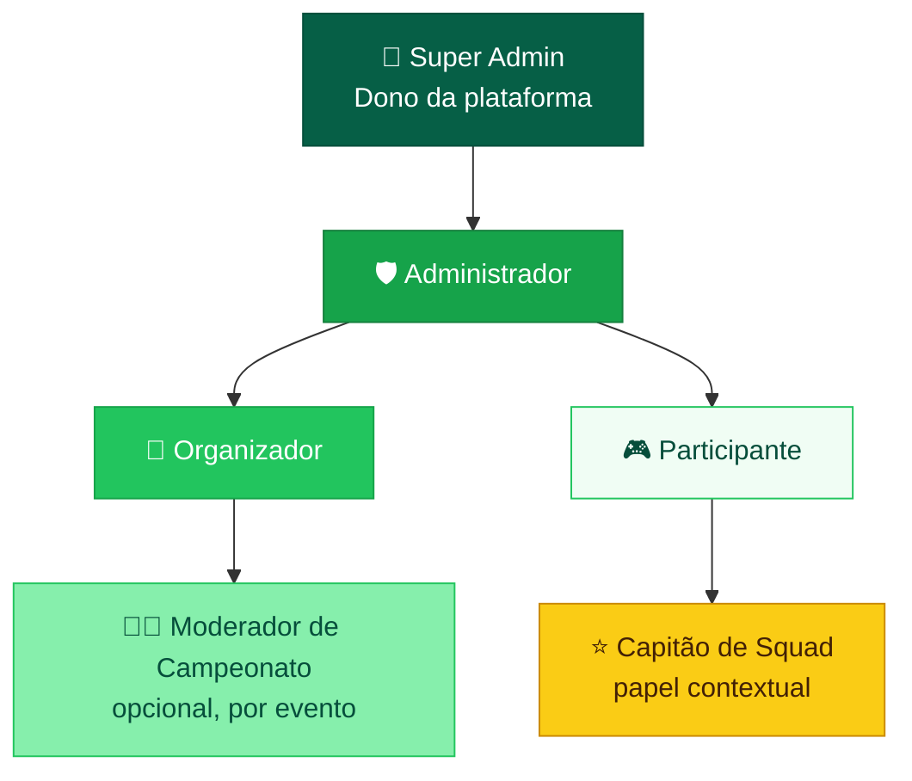

> **Capitão** não é um papel global: é uma função que o participante tem **dentro de um squad**. **Moderador** é um ajudante que o organizador designa **para um campeonato específico** (lançar resultados, conferir check-in).

### 4.2 Personas

#### 👑 Rafael — Administrador da plataforma
- **Idade:** 28 · Dono da Nova Arena
- **Objetivo:** manter a plataforma saudável, crescer a base de organizadores e evitar fraudes.
- **Dores:** não consegue ver de forma centralizada quem faz o quê; precisa delegar parte da administração.
- **Precisa de:** painel com métricas, gestão de papéis, convite para novos admins, logs de auditoria, moderação.

#### 🎯 Camila — Organizadora
- **Idade:** 24 · Organiza ligas semanais de Free Fire e Clash Royale
- **Objetivo:** fazer campeonatos com 50–200 participantes sem planilha.
- **Dores:** calcular pontuação de BR à mão; reorganizar a chave quando alguém desiste.
- **Precisa de:** assistente de criação, chaveamento automático, lançamento rápido de resultados, troca de formato entre fases.

#### ⭐ Lucas — Capitão de squad
- **Idade:** 19 · Lidera um squad de 4 no Free Fire
- **Objetivo:** inscrever o squad rápido e acompanhar a pontuação.
- **Dores:** membros que não confirmam; não saber o horário da próxima queda.
- **Precisa de:** convite por link/código, status dos membros, notificações e tabela ao vivo.

#### 🎮 Bianca — Participante solo
- **Idade:** 22 · Joga 8 Ball Pool e eFootball
- **Objetivo:** achar campeonatos abertos e subir no ranking.
- **Precisa de:** filtros por jogo/data/vagas, inscrição em poucos cliques, chave visual, histórico no perfil.

---

## 5. Escopo

### 5.1 ✅ Dentro do escopo (MVP + v1)

- Autenticação (e-mail/senha, Google, Discord) e perfis com IDs de jogo.
- Três áreas com permissões distintas (Admin, Organizador, Participante).
- Convite e promoção de **novos administradores** e **organizadores**.
- Catálogo de jogos configurável (nome, modo, tamanho de equipe, regra de pontuação padrão).
- Campeonatos **com várias fases**, cada fase com formato próprio:
  - Eliminação simples (mata-mata)
  - Eliminação dupla
  - Fase de grupos (pontos corridos dentro do grupo)
  - Pontos corridos (liga / todos contra todos)
  - Sistema suíço
  - **Battle Royale por quedas** (vários times na mesma partida)
- Inscrição solo ou por **squad** (capitão + convites).
- Check-in antes da partida, W.O. automático.
- Lançamento de resultados com evidência (print), confirmação e contestação.
- **Motor de pontuação configurável** por jogo e por fase (kills, Booyah/colocação, coroas, gols, vitórias).
- Tabelas, chaves visuais e ranking em tempo real.
- Notificações dentro do site e por e-mail.
- Logs de auditoria e moderação (banimentos, denúncias).

### 5.2 ❌ Fora do escopo (nesta versão)

- Integração automática com APIs oficiais dos jogos para importar resultados *(avaliar na v2; ver [Q2](#25-questões-em-aberto))*.
- Pagamento de inscrição e premiação em dinheiro dentro da plataforma *(v2)*.
- Transmissão de vídeo própria (só embed de Twitch/YouTube).
- Aplicativo móvel nativo (o site será **PWA responsivo**).
- Apostas de qualquer tipo.

### 5.3 🔮 Considerações futuras

- Ranking global da temporada por jogo (ELO/MMR).
- Marketplace de organizadores verificados e campeonatos patrocinados.
- Bot do Discord para avisos e check-in.

---

## 6. Matriz de Permissões (RBAC)

Legenda: ✅ total · 🟡 só nos próprios recursos · 👁️ só leitura · ❌ sem acesso

| Recurso / Ação | Super Admin | Admin | Organizador | Moderador (evento) | Participante |
|---|:-:|:-:|:-:|:-:|:-:|
| Configurações globais do site | ✅ | 👁️ | ❌ | ❌ | ❌ |
| Convidar/remover **Administradores** | ✅ | ✅¹ | ❌ | ❌ | ❌ |
| Promover/revogar **Organizadores** | ✅ | ✅ | ❌ | ❌ | ❌ |
| Catálogo de jogos e regras de pontuação padrão | ✅ | ✅ | 👁️ | 👁️ | 👁️ |
| Criar campeonato | ✅ | ✅ | ✅ | ❌ | ❌ |
| Editar/cancelar campeonato | ✅ | ✅ | 🟡 | ❌ | ❌ |
| Gerar/regerar chaveamento | ✅ | ✅ | 🟡 | ❌ | ❌ |
| Lançar/validar resultados | ✅ | ✅ | 🟡 | 🟡 | ❌ |
| Enviar resultado (capitão/jogador) | — | — | — | — | 🟡 |
| Contestar resultado | — | — | — | — | 🟡 |
| Gerenciar inscrições (aprovar/recusar) | ✅ | ✅ | 🟡 | 🟡 | ❌ |
| Banir usuário da plataforma | ✅ | ✅ | ❌ | ❌ | ❌ |
| Desclassificar do campeonato | ✅ | ✅ | 🟡 | ❌ | ❌ |
| Ver logs de auditoria | ✅ | ✅ | 🟡² | ❌ | ❌ |
| Inscrever-se / criar squad | ✅ | ✅ | ✅³ | ✅ | ✅ |

¹ Um Admin **não pode** remover um Super Admin nem outro Admin com mais tempo de casa sem aprovação do Super Admin (regra configurável).
² Só os logs dos próprios campeonatos.
³ O organizador não pode se inscrever num campeonato que ele mesmo organiza.

**Regras de segurança:**
- As permissões são verificadas **no back-end** (o front só esconde botões).
- Todo campeonato tem um `ownerId` e uma lista de `staff` (co-organizadores/moderadores).
- Toda mudança de papel gera um registro em `AuditLog` com quem fez, quem foi afetado, IP e data.

---

## 7. Módulo do Administrador

### 7.1 Mapa de telas

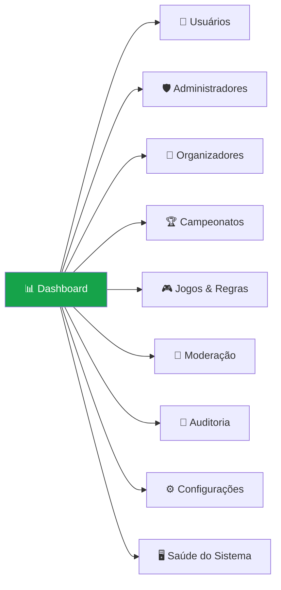

### 7.2 Funcionalidades

| ID | Funcionalidade | Descrição | Prioridade |
|---|---|---|---|
| ADM-01 | **Dashboard** | KPIs: usuários ativos, campeonatos ativos/encerrados, partidas da semana, disputas abertas, novos cadastros (gráficos com intervalo de datas). | P0 |
| ADM-02 | **Gestão de Administradores** | Convidar por e-mail ou **link compartilhável com validade** (24h/7d) e limite de usos; revogar; ver lista de admins com último acesso. | P0 |
| ADM-03 | **Gestão de Organizadores** | Promover participante a organizador, revogar, definir limites (nº de campeonatos simultâneos, jogos permitidos), selo "verificado". Fila de **pedidos para virar organizador**. | P0 |
| ADM-04 | **Gestão de Usuários** | Buscar, filtrar, ver perfil completo, histórico, suspender (com prazo), banir, redefinir senha, mesclar contas duplicadas. | P0 |
| ADM-05 | **Gestão de Campeonatos (global)** | Ver/editar/cancelar/arquivar qualquer campeonato; trocar o organizador responsável; destacar na home. | P0 |
| ADM-06 | **Catálogo de Jogos** | CRUD de jogos: nome, capa, plataforma, modos (Solo, Duo, Squad), tamanho de equipe, **modelos de pontuação** (ver §11) e campos de ID exigidos (ex.: "ID Free Fire"). | P0 |
| ADM-07 | **Moderação** | Fila de denúncias (usuário, squad, resultado, chat), disputas escaladas pelo organizador, ações rápidas. | P1 |
| ADM-08 | **Auditoria** | Log imutável de ações sensíveis com filtros por ator, tipo de ação, recurso e período; exportar CSV. | P0 |
| ADM-09 | **Configurações do site** | Nome, logo, banners da home, termos de uso, política de privacidade, e-mails transacionais, recursos liga/desliga (*feature flags*). | P1 |
| ADM-10 | **Saúde do Sistema** | Status de filas, jobs, WebSocket, taxa de erro, uso de armazenamento, versão em produção. | P2 |
| ADM-11 | **Comunicados** | Enviar aviso global (banner) ou notificação para um segmento (todos, organizadores, inscritos de um jogo). | P1 |

### 7.3 Fluxo — Convidar um novo Administrador

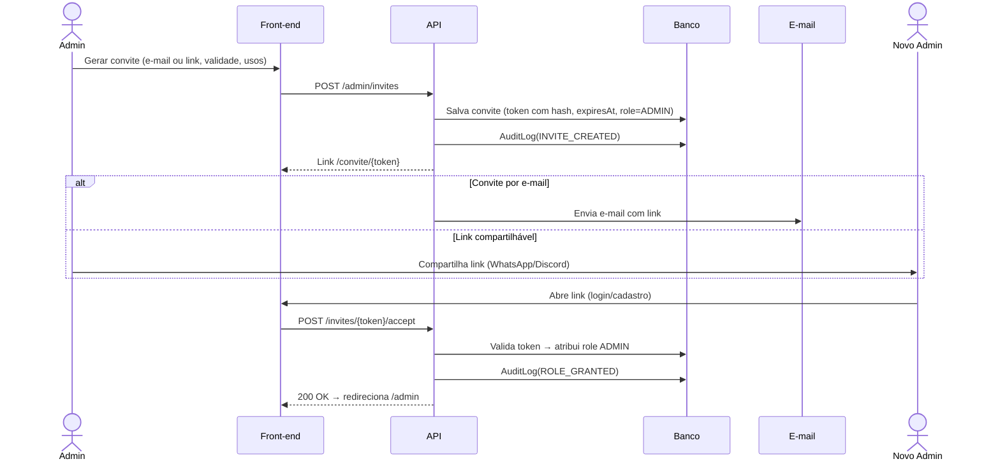

### 7.4 Histórias de usuário

**US-ADM-02 — Compartilhar acesso de administrador**
> Como **administrador**, quero **gerar um link de convite para administrador com validade e limite de usos**, para **delegar a gestão sem expor minha conta**.

Critérios de aceite:
- [ ] Posso escolher validade (1h, 24h, 7 dias) e limite de usos (1–10).
- [ ] O link expira automaticamente e pode ser revogado antes disso.
- [ ] Quem aceita precisa estar logado e com e-mail verificado.
- [ ] Criar e aceitar o convite geram registros na auditoria.
- [ ] Convite expirado mostra uma mensagem clara e não concede nenhum acesso.

**US-ADM-03 — Aprovar pedido de organizador**
> Como **administrador**, quero **ver e aprovar pedidos de quem quer ser organizador**, para **controlar a qualidade dos campeonatos**.

Critérios de aceite:
- [ ] A fila mostra o perfil, o histórico de participação e a justificativa do pedido.
- [ ] Aprovar/recusar exige um motivo (opcional na aprovação, obrigatório na recusa).
- [ ] O usuário recebe notificação com o resultado.

**US-ADM-06 — Cadastrar um novo jogo**
> Como **administrador**, quero **cadastrar um jogo com suas regras de pontuação padrão**, para que **organizadores criem campeonatos dele sem configurar tudo do zero**.

Critérios de aceite:
- [ ] Defino os modos (Solo/Duo/Squad) e o tamanho de equipe de cada modo.
- [ ] Defino um ou mais modelos de pontuação (ex.: "FF Padrão: kill=1, Booyah=3").
- [ ] Jogo desativado não aparece na criação de campeonatos, mas os antigos continuam visíveis.

---

## 8. Módulo do Organizador

### 8.1 Mapa de telas

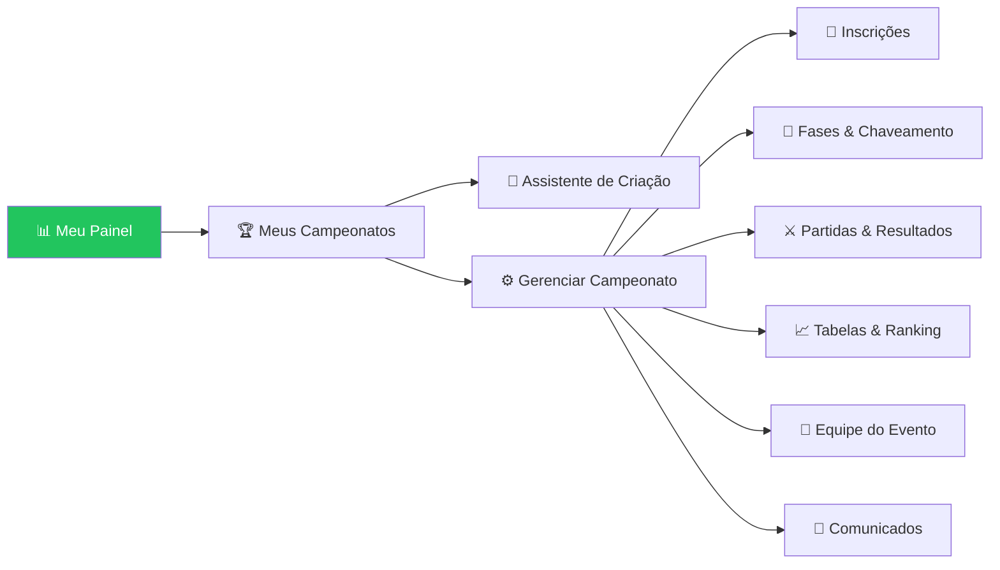

### 8.2 Funcionalidades

| ID | Funcionalidade | Descrição | Prioridade |
|---|---|---|---|
| ORG-01 | **Assistente de criação** | Passo a passo: Informações → Jogo & Modo → Inscrições → Fases → Pontuação → Regras → Revisão & Publicar. Salva rascunho automaticamente. | P0 |
| ORG-02 | **Modelos de campeonato** | Começar a partir de um modelo pronto (ex.: "FF Squad — Grupos + Final BR", "CR 1v1 — Mata-mata MD3"). Salvar meus próprios modelos. | P1 |
| ORG-03 | **Gestão de inscrições** | Aprovação automática ou manual, lista de espera, limite de vagas, prazo, check-in, remover/substituir inscrito. | P0 |
| ORG-04 | **Fases e chaveamento** | Adicionar fases em sequência, escolher formato por fase, regra de classificação entre fases, gerar chave (aleatória, por ranking/*seed* ou manual com arrastar e soltar). | P0 |
| ORG-05 | **Troca de formato entre fases** | Ex.: Fase 1 em grupos de squads → Fase 2 mata-mata → **Final em Battle Royale** com os 2 (ou N) finalistas. | P0 |
| ORG-06 | **Agenda de partidas** | Definir data/hora por rodada ou partida, sala/código do jogo (visível só para os envolvidos), lembretes automáticos. | P0 |
| ORG-07 | **Lançamento de resultados** | Formulário rápido por partida: placar/coroas/gols (1v1) ou tabela de kills + colocação por equipe (BR). Importar CSV. | P0 |
| ORG-08 | **Validação e disputas** | Ver resultados enviados pelos participantes, aprovar, corrigir ou abrir disputa; anexos de prova. | P0 |
| ORG-09 | **Tabelas ao vivo** | Classificação recalculada a cada resultado; critérios de desempate configuráveis. | P0 |
| ORG-10 | **Equipe do evento** | Convidar co-organizadores e moderadores para aquele campeonato. | P1 |
| ORG-11 | **Comunicados** | Mensagem para todos os inscritos, para uma fase ou para um grupo. | P1 |
| ORG-12 | **Encerramento** | Definir campeões (1º, 2º, 3º), gerar certificado/arte de resultado, arquivar. | P1 |
| ORG-13 | **Página pública personalizável** | Banner, descrição em rich-text, regulamento, premiação (texto), links de transmissão. | P1 |

### 8.3 Ciclo de vida de um campeonato

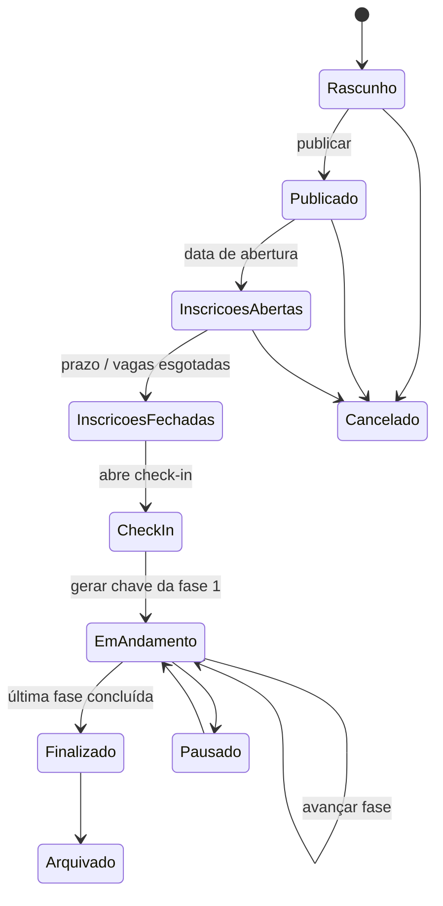

### 8.4 Histórias de usuário

**US-ORG-05 — Campeonato com troca de formato**
> Como **organizadora**, quero **montar um campeonato de Free Fire com fase de grupos de squads e uma final em Battle Royale**, para **reproduzir o formato que minha comunidade já joga**.

Critérios de aceite:
- [ ] Consigo criar N fases e escolher o formato de cada uma.
- [ ] Defino quantos avançam de cada grupo (ex.: top 2) e como desempatar.
- [ ] Ao concluir a fase anterior, a próxima é **preenchida automaticamente** com os classificados (com confirmação antes).
- [ ] A final BR permite várias quedas (ex.: 3 quedas) somando pontos.
- [ ] Posso alterar a configuração de uma fase **que ainda não começou**.

**US-ORG-07 — Lançar resultado de queda BR**
> Como **organizadora**, quero **lançar kills e colocação de cada squad numa queda**, para que **a tabela seja calculada sozinha**.

Critérios de aceite:
- [ ] A tela lista todos os squads da sala com campos "Colocação" e "Kills" (ou kills por jogador, se ativado).
- [ ] O sistema não aceita colocação repetida nem kills negativas.
- [ ] A pontuação é calculada pelo modelo da fase e mostrada antes de salvar.
- [ ] Depois de salvar, a tabela atualiza para todos em menos de 2 s (tempo real).

**US-ORG-04 — Chaveamento manual**
> Como **organizadora**, quero **ajustar a chave gerada arrastando participantes**, para **evitar confrontos entre jogadores do mesmo clã na primeira rodada**.

Critérios de aceite:
- [ ] Posso arrastar e soltar participantes entre posições antes de a fase começar.
- [ ] Toda alteração manual fica registrada na auditoria do campeonato.
- [ ] Depois da primeira partida concluída, a chave da fase fica travada (só o Admin destrava).

---

## 9. Módulo do Participante

### 9.1 Funcionalidades

| ID | Funcionalidade | Descrição | Prioridade |
|---|---|---|---|
| PAR-01 | **Cadastro e perfil** | Apelido, avatar, país/estado, **IDs/nicks por jogo**, redes sociais, bio. | P0 |
| PAR-02 | **Explorar campeonatos** | Lista com filtros: jogo, modo (solo/squad), status, data, vagas, gratuito, organizador verificado. Busca por nome. | P0 |
| PAR-03 | **Página do campeonato** | Abas: Visão geral · Regulamento · Inscritos · Chave/Tabela · Partidas · Resultados · Comunicados. | P0 |
| PAR-04 | **Inscrição solo** | Um clique (com aceite do regulamento) e validação do ID do jogo exigido. | P0 |
| PAR-05 | **Inscrição com squad** | Capitão escolhe um squad existente ou cria um novo, convida membros, e a inscrição só é confirmada quando o mínimo de membros aceitar. | P0 |
| PAR-06 | **Meus Campeonatos** | Próximas partidas, status de inscrição, check-in pendente, histórico. | P0 |
| PAR-07 | **Check-in** | Botão de check-in na janela definida (ex.: 30 a 10 min antes); quem não fizer leva W.O. | P0 |
| PAR-08 | **Envio de resultado** | Capitão/jogador envia placar + print; o adversário confirma ou contesta. | P1 |
| PAR-09 | **Acompanhar ao vivo** | Chave e tabela atualizadas em tempo real; seguir um campeonato. | P0 |
| PAR-10 | **Notificações** | Inscrição confirmada, convite de squad, check-in aberto, partida em 15 min, resultado lançado, classificado/eliminado. | P0 |
| PAR-11 | **Perfil competitivo** | Estatísticas por jogo: campeonatos, vitórias, kills, coroas, títulos, conquistas. | P1 |
| PAR-12 | **Denúncia** | Denunciar usuário, squad ou resultado, com anexo. | P1 |
| PAR-13 | **Pedir para ser organizador** | Formulário com justificativa → fila do Admin. | P1 |

### 9.2 Jornada do participante (squad)

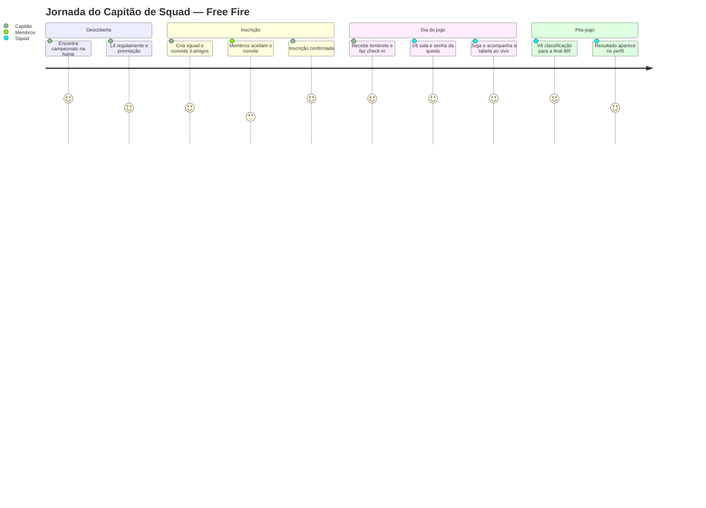

### 9.3 Histórias de usuário

**US-PAR-02 — Encontrar campeonato**
> Como **participante**, quero **filtrar campeonatos por jogo e por vagas abertas**, para **me inscrever rápido no que me interessa**.

Critérios de aceite:
- [ ] Os filtros ficam na URL (dá para compartilhar o link filtrado).
- [ ] Os cards mostram jogo, modo, data, vagas restantes e status.
- [ ] A lista carrega em menos de 1,5 s (p75) com 20 itens por página e rolagem infinita.

**US-PAR-07 — Check-in**
> Como **participante**, quero **fazer check-in pelo celular**, para **confirmar presença e não levar W.O.**

Critérios de aceite:
- [ ] O botão aparece só durante a janela de check-in.
- [ ] Recebo notificação quando a janela abre.
- [ ] Em squads, basta o check-in do capitão (ou de todos, se o organizador exigir).

---

## 10. Motor de Campeonatos: Jogos, Formatos e Chaveamento

### 10.1 Jogos suportados no lançamento

| Jogo | Modos | Tamanho da equipe | Tipo de partida | Métrica principal |
|---|---|---|---|---|
| 🔥 **Free Fire** | Solo, Duo, Squad | 1 / 2 / 4 (+1 reserva) | Battle Royale ou Contra Squad (4v4) | Kills + colocação (Booyah) |
| 👑 **Clash Royale** | 1v1, 2v2 | 1 / 2 | Duelo | Coroas e vitórias |
| 🎱 **8 Ball Pool** | 1v1 | 1 | Duelo | Vitórias (frames) |
| ⚽ **eFootball** | 1v1 | 1 | Duelo | Gols / vitórias |
| ➕ **Outros** | Configurável | Configurável | Duelo, Equipe x Equipe ou Battle Royale | Configurável |

> O catálogo é **dirigido por dados**: novos jogos são cadastrados pelo Admin sem precisar de deploy (ver ADM-06).

### 10.2 Arquitetura conceitual

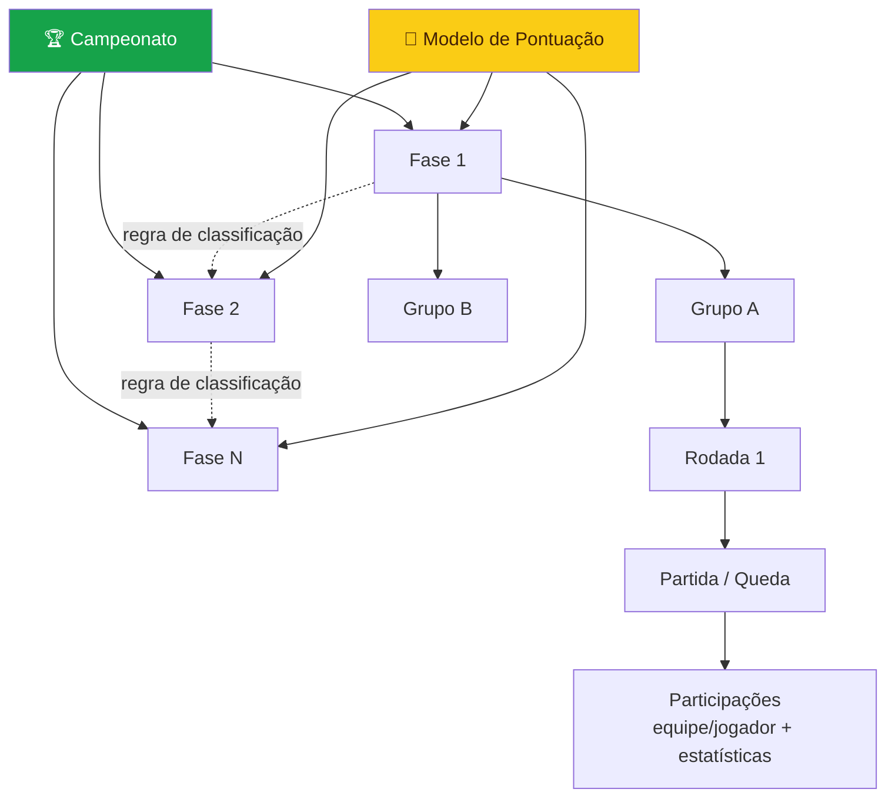

**Princípio central:** `Campeonato → Fases → (Grupos) → Rodadas → Partidas → Participações`.
Cada **fase** tem: `formato`, `modelo de pontuação`, `critérios de desempate` e uma `regra de classificação` para a próxima fase.

### 10.3 Formatos disponíveis

| Formato | Código | Como funciona | Uso típico |
|---|---|---|---|
| **Eliminação simples** | `SINGLE_ELIM` | Perdeu, está fora. Chave em potência de 2 com *byes* automáticos. Disputa de 3º opcional. | CR, 8 Ball, eFootball |
| **Eliminação dupla** | `DOUBLE_ELIM` | Chave de vencedores + chave de perdedores; Grande Final com *reset* opcional. | Campeonatos competitivos 1v1 |
| **Fase de grupos** | `GROUPS` | Participantes divididos em grupos; dentro de cada grupo, pontos corridos ou quedas BR. Os top K avançam. | Copa, FF Squad |
| **Pontos corridos** | `ROUND_ROBIN` | Todos contra todos (turno ou turno e returno). | Ligas |
| **Suíço** | `SWISS` | N rodadas pareando quem tem pontuação parecida, sem repetir confronto. | Muitos inscritos, poucas rodadas |
| **Battle Royale** | `BATTLE_ROYALE` | Várias equipes na mesma partida (queda). Pontuação = colocação + kills. Soma de X quedas. | Free Fire |
| **Equipe x Equipe** | `TEAM_VS_TEAM` | Duelo entre equipes (ex.: Contra Squad 4v4) em MD1/MD3/MD5. | FF Contra Squad |

**Opções por partida (duelos):** Melhor de 1 / 3 / 5 / 7 (MD1–MD7).

### 10.4 Exemplo — Free Fire Squad: Grupos → Mata-mata → Final BR

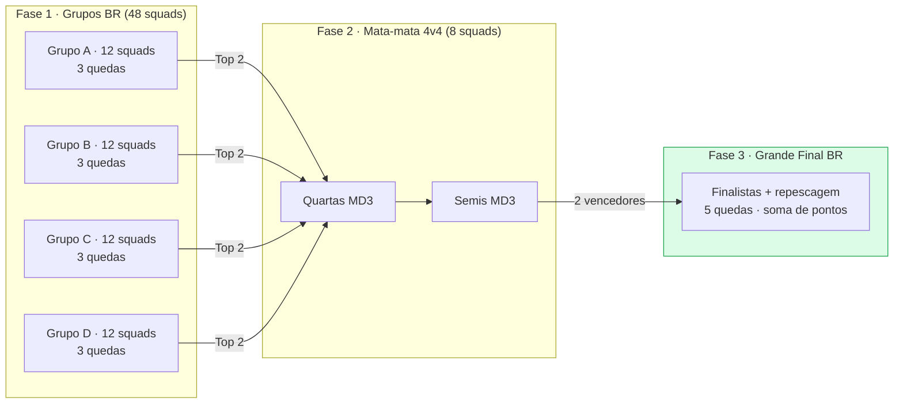

> No exemplo pedido — "na final os dois squads finalistas jogam em Battle Royale" — a Fase 3 recebe os 2 vencedores das semis. O organizador pode configurar a final para **completar a sala** com os melhores eliminados (repescagem) ou jogar só com os finalistas.

### 10.5 Algoritmos de chaveamento

| Etapa | Regra |
|---|---|
| **Sorteio** | Aleatório com *seed* registrada (o resultado pode ser reproduzido e auditado). |
| **Por ranking** | Cabeças de chave pelo ranking/MMR ou pela classificação da fase anterior (1º x último, padrão 1-16, 8-9…). |
| **Manual** | Arrastar e soltar; validação de duplicidade. |
| **Byes** | Quando o nº de participantes não é potência de 2, os melhores *seeds* recebem *bye* na 1ª rodada. |
| **Grupos** | Distribuição em "serpentina" (*snake*) pelos potes para equilibrar os grupos. |
| **Suíço** | Pareamento por pontuação (Monrad/holandês), sem repetir confronto; *bye* para o pior colocado quando o número é ímpar. |
| **BR** | Distribuição de equipes em salas de tamanho máximo configurável (ex.: 12 squads/sala). |
| **Avanço** | Ao fechar todas as partidas da fase, aplica a regra de classificação → gera a pré-visualização da próxima fase → organizador confirma. |

**Pseudocódigo — avanço de fase:**

```ts
function advanceStage(stage: Stage): StagePreview {
  assert(stage.matches.every(m => m.status === 'VALIDATED'));
  const standings = computeStandings(stage);              // aplica pontuação + desempate
  const qualified = applyQualificationRule(standings, stage.qualification);
  // ex.: { type: 'TOP_N_PER_GROUP', n: 2 } | { type: 'TOP_N_OVERALL', n: 8 }
  const next = stage.next;
  return generateBracket(next.format, qualified, next.seedingMethod);
}
```

### 10.6 Critérios de desempate (configuráveis e ordenáveis)

1. Pontos totais
2. Nº de Booyahs / vitórias
3. Total de kills / coroas / gols
4. Melhor colocação média (BR)
5. Confronto direto
6. Saldo (gols, coroas)
7. Kills na última queda
8. Sorteio (registrado na auditoria)

---

## 11. Sistema de Pontuação

### 11.1 Conceito

Cada fase usa um **Modelo de Pontuação** (`ScoringModel`): um conjunto de regras que transforma as **estatísticas brutas** de uma participação (kills, colocação, coroas, gols, vitória) em **pontos**.

```json
{
  "id": "ff-squad-padrao",
  "name": "Free Fire · Squad Padrão",
  "game": "free-fire",
  "matchType": "BATTLE_ROYALE",
  "rules": [
    { "stat": "kills",     "type": "PER_UNIT",  "points": 1 },
    { "stat": "placement", "type": "TABLE",     "table": { "1": 3 } }
  ],
  "caps": { "killsPerMatch": null },
  "tiebreakers": ["points", "booyahs", "kills", "avgPlacement"]
}
```

### 11.2 Modelos padrão por jogo

#### 🔥 Free Fire — Battle Royale (pedido do cliente)

| Evento | Pontos |
|---|---|
| **Kill** | **1 ponto** por eliminação |
| **Booyah!** (1º lugar) | **3 pontos** para a equipe |

**Exemplo de uma queda:**

| Squad | Colocação | Kills | Pontos de colocação | Pontos de kill | **Total** |
|---|:-:|:-:|:-:|:-:|:-:|
| Squad Alfa | 1º 🏆 | 7 | 3 | 7 | **10** |
| Squad Bravo | 2º | 9 | 0 | 9 | **9** |
| Squad Charlie | 3º | 4 | 0 | 4 | **4** |

> **Modelo alternativo** (opcional, por fase): tabela de colocação completa, no estilo das ligas oficiais — 1º=12, 2º=9, 3º=8, 4º=7, 5º=6, 6º=5, 7º=4, 8º=3, 9º=2, 10º=1, 11º-12º=0 + 1 ponto por kill. O organizador escolhe o modelo ou cria um personalizado.

#### 👑 Clash Royale

| Contexto | Regra |
|---|---|
| Tabela/grupos | **1 ponto por coroa** conquistada + **3 pontos por vitória** (configurável) |
| Mata-mata | Vence quem ganhar a série MD; coroas servem de desempate |
| Desempate | Saldo de coroas → coroas feitas → confronto direto |

#### ⚽ eFootball

| Resultado | Pontos |
|---|---|
| Vitória | 3 |
| Empate | 1 |
| Derrota | 0 |
| Desempate | Saldo de gols → gols marcados → confronto direto |
| Mata-mata empatado | Pênaltis registrados como campo extra |

#### 🎱 8 Ball Pool

| Resultado | Pontos |
|---|---|
| Vitória de frame | 1 |
| Vitória de série | 3 (em grupos) |
| Desempate | Saldo de frames → confronto direto |

### 11.3 Tipos de regra suportados pelo motor

| Tipo | Descrição | Exemplo |
|---|---|---|
| `PER_UNIT` | Pontos × quantidade | 1 pt por kill, 1 pt por coroa |
| `TABLE` | Pontos por posição/valor | Colocação 1º = 3 |
| `OUTCOME` | Pontos por resultado | Vitória 3 / Empate 1 / Derrota 0 |
| `BONUS` | Bônus condicional | +2 se fez ≥ 10 kills |
| `CAP` | Limite | Máximo de 15 pts de kill por queda |
| `MULTIPLIER` | Multiplicador por fase/queda | Última queda da final vale ×2 |

### 11.4 Regras de negócio da pontuação

- **RN-01:** A pontuação é sempre **recalculada no servidor** a partir das estatísticas brutas; o cliente nunca envia "pontos".
- **RN-02:** Mudar o modelo de uma fase **em andamento** exige confirmação e recalcula a fase inteira (fica registrado na auditoria).
- **RN-03:** No squad, as kills podem ser lançadas **por equipe** (padrão) ou **por jogador** (para o ranking individual de MVP).
- **RN-04:** W.O. vale vitória pelo placar configurado (ex.: 3×0 / 2 coroas) e 0 kills no BR.
- **RN-05:** Desclassificar zera a pontuação da equipe e reordena a tabela.

---

## 12. Equipes, Squads e Convites

### 12.1 Regras

| Regra | Detalhe |
|---|---|
| Criação | Qualquer participante pode criar um squad e vira seu **Capitão**. |
| Squad persistente | O squad existe fora dos campeonatos (nome, tag, logo) e pode ser reutilizado. |
| Convites | Por **busca de nick**, **link** ou **código de 6 caracteres**; o convite expira em 72h. |
| Tamanho | Mínimo/máximo definidos pelo modo do jogo + reservas (ex.: FF Squad = 4 + 1). |
| Inscrição | Só o Capitão inscreve o squad. A inscrição fica **Pendente** até o mínimo de membros confirmar. |
| Trava de elenco | O organizador define a data-limite para trocar membros; depois disso, só ele pode substituir. |
| Exclusividade | Um jogador não pode estar em dois squads **no mesmo campeonato**. |
| Transferir capitania | O Capitão pode passar o papel a outro membro. |

### 12.2 Fluxo de inscrição com squad

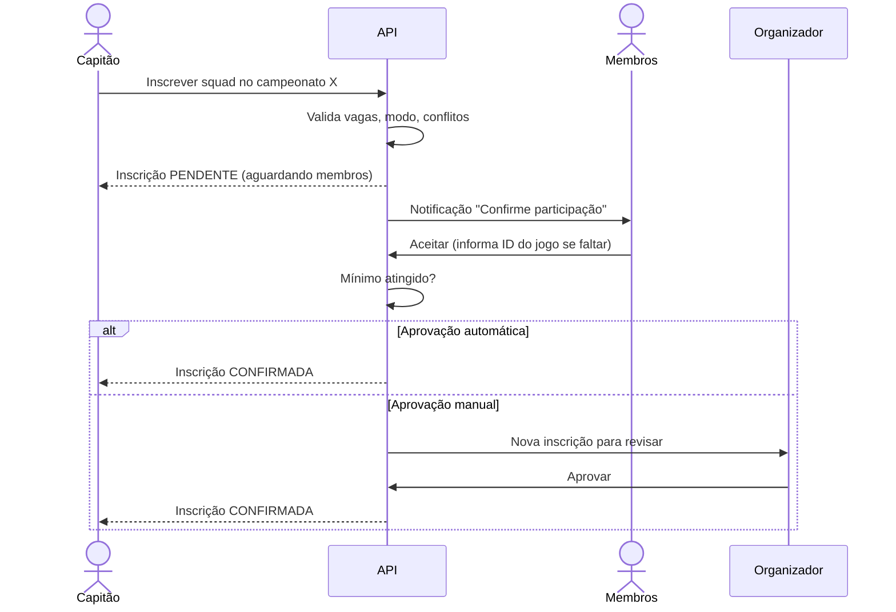

---

## 13. Requisitos Funcionais (consolidado)

| ID | Requisito | Módulo | Prioridade |
|---|---|---|---|
| RF-01 | Cadastro/login com e-mail+senha, Google e Discord; verificação de e-mail; recuperação de senha | Auth | P0 |
| RF-02 | Controle de acesso por papel com verificação no back-end | Core | P0 |
| RF-03 | Convite de administradores por e-mail/link com validade e limite de usos | Admin | P0 |
| RF-04 | Promover/revogar organizadores; fila de pedidos | Admin | P0 |
| RF-05 | CRUD de jogos, modos e modelos de pontuação | Admin | P0 |
| RF-06 | Auditoria de ações sensíveis | Admin | P0 |
| RF-07 | Assistente de criação de campeonato com rascunho automático | Organizador | P0 |
| RF-08 | Campeonato com N fases e formato independente por fase | Motor | P0 |
| RF-09 | Geração de chave: aleatória, por seed e manual | Motor | P0 |
| RF-10 | Avanço de fase com pré-visualização e confirmação | Motor | P0 |
| RF-11 | Lançamento de resultados (duelo e BR), com validação | Organizador | P0 |
| RF-12 | Motor de pontuação configurável | Motor | P0 |
| RF-13 | Desempate configurável e ordenável | Motor | P0 |
| RF-14 | Inscrição solo e com squad; lista de espera | Participante | P0 |
| RF-15 | Squads persistentes com convites (link, código, busca) | Participante | P0 |
| RF-16 | Check-in com janela e W.O. automático | Participante | P0 |
| RF-17 | Chaves e tabelas em tempo real (Ably, com polling como alternativa) | Todos | P0 |
| RF-18 | Notificações no site e por e-mail | Todos | P0 |
| RF-19 | Envio de resultado pelo participante com evidência e contestação | Participante | P1 |
| RF-20 | Moderação e denúncias | Admin | P1 |
| RF-21 | Modelos de campeonato reutilizáveis | Organizador | P1 |
| RF-22 | Perfil competitivo com estatísticas | Participante | P1 |
| RF-23 | Exportação CSV (inscritos, resultados, auditoria) | Admin/Org | P1 |
| RF-24 | Arte de resultado/certificado gerado automaticamente | Organizador | P2 |
| RF-25 | Painel de saúde do sistema | Admin | P2 |

---

## 14. Requisitos Não Funcionais

| Categoria | ID | Requisito |
|---|---|---|
| **Desempenho** | RNF-01 | LCP ≤ 2,5 s e INP ≤ 200 ms (p75, 4G) nas páginas públicas. |
| | RNF-02 | API: p95 ≤ 300 ms em leitura e ≤ 600 ms em escrita. |
| | RNF-03 | Atualização de tabela/chave propagada em ≤ 2 s após o resultado. |
| **Escalabilidade** | RNF-04 | Suportar 5.000 usuários simultâneos e campeonatos de até 1.024 participantes/equipes. |
| **Disponibilidade** | RNF-05 | SLO de 99,5% ao mês; janela de manutenção avisada com 48h de antecedência. |
| **Segurança** | RNF-06 | Senhas com Argon2id; JWT de acesso (15 min) + refresh token rotativo em cookie `httpOnly`, `Secure`, `SameSite=Lax`. |
| | RNF-07 | Proteção OWASP Top 10: validação com Zod, ORM parametrizado, CSP, rate limit (login: 5 tentativas/min/IP), CSRF nos fluxos com cookie. |
| | RNF-08 | 2FA (TOTP) **obrigatório** para Admin e opcional para os demais. |
| | RNF-09 | Uploads (prints/logos) com verificação de tipo MIME, limite de 5 MB e URLs assinadas. |
| **Privacidade (LGPD)** | RNF-10 | Consentimento explícito, exportação e exclusão de dados pessoais, IDs de jogo visíveis só para quem precisa. |
| **Acessibilidade** | RNF-11 | WCAG 2.2 nível AA: contraste ≥ 4,5:1, navegação por teclado, foco visível, `aria-*` nas chaves. |
| **Compatibilidade** | RNF-12 | Últimas 2 versões de Chrome, Edge, Firefox e Safari; Android 9+ e iOS 15+; PWA instalável. |
| **Responsividade** | RNF-13 | *Mobile-first*; breakpoints 360 / 768 / 1024 / 1440 px. |
| **Observabilidade** | RNF-14 | Logs estruturados, rastreamento distribuído (OpenTelemetry), monitoramento de erros (Sentry), alertas. |
| **Auditoria** | RNF-15 | `AuditLog` só aceita inserção (*append-only*); retenção mínima de 1 ano. |
| **Internacionalização** | RNF-16 | pt-BR como padrão; textos externalizados (i18n) para futuro en/es. |
| **Qualidade** | RNF-17 | Cobertura de testes ≥ 80% no motor de chaveamento/pontuação; testes E2E dos fluxos P0. |

---

## 15. Design System & UX

### 15.1 Princípios de UX

1. **Clareza competitiva** — o jogador precisa saber em até 3 segundos: *quando jogo, contra quem, quantos pontos tenho*.
2. **Mobile primeiro** — a maior parte do público joga e acompanha pelo celular.
3. **Ao vivo por padrão** — tabelas e chaves se atualizam sozinhas, com animações discretas.
4. **Poucos cliques para o organizador** — lançar o resultado de uma queda BR em menos de 60 segundos.
5. **Confiança visível** — selos de verificação, histórico de alterações e provas anexadas.
6. **Inclusivo** — contraste AA, textos claros, sem depender só de cor para indicar status.

### 15.2 🎨 Paleta de cores — "Nova Green"

Identidade **verde e branco**, com cores de apoio para estados, destaques e o tema escuro.

#### Cores primárias

| Amostra | Token | Hex | Uso |
|:-:|---|---|---|
|  | `--color-primary-600` | `#16A34A` | **Cor da marca**, botões primários, links |
|  | `--color-primary-500` | `#22C55E` | Hover, destaques, indicadores ao vivo |
|  | `--color-primary-700` | `#15803D` | Botão pressionado, títulos sobre fundo claro |
|  | `--color-primary-900` | `#065F46` | Header/sidebar escuros, área Admin |
|  | `--color-primary-100` | `#DCFCE7` | Fundos de badge, linha selecionada |
|  | `--color-primary-50` | `#F0FDF4` | Fundo de seções |

#### Neutros (base branca)

| Amostra | Token | Hex | Uso |
|:-:|---|---|---|
|  | `--color-white` | `#FFFFFF` | Fundo principal, cards |
|  | `--color-gray-50` | `#F8FAF9` | Fundo da aplicação |
|  | `--color-gray-200` | `#E2E8E4` | Bordas, divisores |
|  | `--color-gray-500` | `#64748B` | Texto secundário |
|  | `--color-gray-900` | `#0F172A` | Texto principal |

#### Cores de apoio (harmônicas ao verde)

| Amostra | Token | Hex | Uso |
|:-:|---|---|---|
|  | `--color-teal-700` | `#0F766E` | Área do Organizador, gráficos secundários |
|  | `--color-gold-400` | `#FACC15` | 🏆 1º lugar, Booyah, Capitão, MVP |
|  | `--color-silver-300` | `#CBD5E1` | 🥈 2º lugar |
|  | `--color-bronze-600` | `#D97706` | 🥉 3º lugar |
|  | `--color-info-500` | `#0EA5E9` | Informação, inscrições abertas |
|  | `--color-warning-500` | `#F59E0B` | Check-in pendente, disputa |
|  | `--color-danger-600` | `#DC2626` | Erros, eliminação, banimento |

#### Tema escuro ("Arena Night")

| Token | Hex | Uso |
|---|---|---|
| `--bg-dark` | `#07130D` | Fundo |
| `--surface-dark` | `#0F2318` | Cards |
| `--border-dark` | `#1E3A2B` | Bordas |
| `--text-dark` | `#ECFDF5` | Texto principal |
| `--primary-dark` | `#4ADE80` | Primária (mais clara para manter o contraste) |

#### Gradientes de destaque

```css
--gradient-hero:  linear-gradient(135deg, #065F46 0%, #16A34A 55%, #22C55E 100%);
--gradient-gold:  linear-gradient(135deg, #FACC15 0%, #F59E0B 100%);
--gradient-glass: linear-gradient(180deg, rgba(255,255,255,.85), rgba(240,253,244,.75));
```

#### Cor por área (identificação visual)

| Área | Cor de acento | Motivo |
|---|---|---|
| Participante | `#16A34A` Verde da marca | Experiência principal |
| Organizador | `#0F766E` Verde-azulado | Ferramenta de trabalho, diferenciada |
| Administrador | `#065F46` Verde-escuro + detalhes dourados | Autoridade, área sensível |

### 15.3 Tipografia

| Papel | Fonte | Peso | Tamanhos |
|---|---|---|---|
| Títulos / Display | **Rajdhani** (estilo eSports) | 600–700 | 48 / 36 / 28 / 22 px |
| Interface / Texto | **Inter** | 400–600 | 16 / 14 / 12 px |
| Números de placar | **JetBrains Mono** (tabular) | 600 | 14–32 px |

Escala com base 16 px, razão 1,25; altura de linha de 1,5 no texto e 1,2 nos títulos.

### 15.4 Tokens (CSS Custom Properties)

```css
/* src/styles/tokens.css */
:root {
  /* Cores */
  --color-primary-50:  #F0FDF4;
  --color-primary-100: #DCFCE7;
  --color-primary-500: #22C55E;
  --color-primary-600: #16A34A;
  --color-primary-700: #15803D;
  --color-primary-900: #065F46;
  --color-teal-700:    #0F766E;
  --color-gold-400:    #FACC15;
  --color-danger-600:  #DC2626;
  --color-warning-500: #F59E0B;
  --color-info-500:    #0EA5E9;

  --bg:       #F8FAF9;
  --surface:  #FFFFFF;
  --border:   #E2E8E4;
  --text:     #0F172A;
  --text-muted: #64748B;

  /* Espaçamento (base 4px) */
  --space-1: 4px;  --space-2: 8px;  --space-3: 12px;
  --space-4: 16px; --space-6: 24px; --space-8: 32px; --space-12: 48px;

  /* Raio e sombra */
  --radius-sm: 6px; --radius-md: 10px; --radius-lg: 16px; --radius-full: 999px;
  --shadow-sm: 0 1px 2px rgba(6, 95, 70, .06);
  --shadow-md: 0 4px 16px rgba(6, 95, 70, .10);
  --shadow-glow: 0 0 0 4px rgba(34, 197, 94, .25);

  /* Tipografia */
  --font-display: 'Rajdhani', system-ui, sans-serif;
  --font-body:    'Inter', system-ui, sans-serif;
  --font-mono:    'JetBrains Mono', ui-monospace, monospace;

  /* Movimento */
  --ease-out: cubic-bezier(.16, 1, .3, 1);
  --duration-fast: 150ms; --duration-base: 250ms;
}

[data-theme='dark'] {
  --bg: #07130D; --surface: #0F2318; --border: #1E3A2B;
  --text: #ECFDF5; --text-muted: #94A3B8;
  --color-primary-600: #4ADE80;
}

@media (prefers-reduced-motion: reduce) {
  * { animation-duration: 0.01ms !important; transition-duration: 0.01ms !important; }
}
```

**Integração com Tailwind** (preset em `packages/config`): as cores e espaçamentos do Tailwind apontam para os tokens (`primary: 'var(--color-primary-600)'`), para que exista uma única fonte da verdade.

### 15.5 Biblioteca de componentes

| Componente | Variações | Observações |
|---|---|---|
| `Button` | primary, secondary, ghost, danger, gold · sm/md/lg · loading | Altura mínima de 44 px no mobile |
| `Badge` / `StatusPill` | Inscrições abertas, Ao vivo (pulsando), Finalizado, Check-in, W.O. | Ícone + texto (não só cor) |
| `TournamentCard` | Grid/lista | Capa do jogo, vagas em barra de progresso |
| `BracketView` | Simples, dupla | SVG com zoom e arrastar; vira lista vertical no mobile |
| `GroupTable` / `StandingsTable` | Duelo, BR | Cabeçalho fixo, destaque da zona de classificação em verde |
| `BRDropTable` | Por queda / acumulado | Colunas: Pos, Squad, Booyahs, Kills, Pts |
| `MatchCard` | Agendada, Ao vivo, Aguardando validação, Concluída, Disputa | — |
| `ScoreInput` | Duelo, BR | Navegação por teclado (Tab/Enter) para lançar rápido |
| `StageBuilder` | — | Linha do tempo de fases com arrastar e soltar |
| `SquadRoster` | — | Avatares, status de convite, coroa do capitão |
| `Stepper` | — | Assistente de criação |
| `DataTable` | — | Admin: ordenação, filtros, paginação no servidor, ações em lote |
| `Toast`, `Modal`, `Drawer`, `EmptyState`, `Skeleton` | — | Base: Radix UI (acessível) |

### 15.6 Wireframes (baixa fidelidade)

**Home do Participante (desktop)**

```
┌──────────────────────────────────────────────────────────────────────┐
│ 🟢 NOVA ARENA   Campeonatos  Jogos  Ranking        🔔  [Avatar ▾]      │
├──────────────────────────────────────────────────────────────────────┤
│ ████████████  HERO (gradiente verde)  ███████████████████████████████ │
│  COPA NOVA FF — SQUAD             [ Inscrever squad ]  48/64 vagas    │
├──────────────────────────────────────────────────────────────────────┤
│ [🔥 Free Fire] [👑 Clash Royale] [🎱 8 Ball] [⚽ eFootball] [+ Todos]  │
├──────────────────────────────────────────────────────────────────────┤
│ Minhas próximas partidas                                              │
│ ┌──────────────┐ ┌──────────────┐ ┌──────────────┐                   │
│ │ Queda 2 · 20h│ │ CR · Quartas │ │ Check-in 🟡  │                   │
│ └──────────────┘ └──────────────┘ └──────────────┘                   │
├──────────────────────────────────────────────────────────────────────┤
│ Campeonatos em destaque            Filtros: [Jogo▾][Modo▾][Status▾]  │
│ ┌────────┐ ┌────────┐ ┌────────┐ ┌────────┐                          │
│ │ capa   │ │ capa   │ │ capa   │ │ capa   │                          │
│ │ Nome   │ │ Nome   │ │ Nome   │ │ Nome   │                          │
│ │ ▓▓▓░ 32│ │ ▓▓░░ 20│ │ AO VIVO│ │ ▓▓▓▓ ✓ │                          │
│ └────────┘ └────────┘ └────────┘ └────────┘                          │
└──────────────────────────────────────────────────────────────────────┘
```

**Lançamento de queda BR (Organizador)**

```
┌───────────────────────────────────────────────────────────┐
│ Final BR · Queda 3 de 5 · Bermuda          [Importar CSV] │
├─────┬──────────────────┬───────────┬───────┬──────────────┤
│ Pos │ Squad            │ Colocação │ Kills │ Pontos (prev)│
├─────┼──────────────────┼───────────┼───────┼──────────────┤
│  🏆 │ Squad Alfa       │ [ 1 ]     │ [ 7 ] │  10          │
│     │ Squad Bravo      │ [ 2 ]     │ [ 9 ] │   9          │
│     │ Squad Charlie    │ [ 3 ]     │ [ 4 ] │   4          │
├─────┴──────────────────┴───────────┴───────┴──────────────┤
│ 📎 Anexar print     [Salvar rascunho]   [✅ Validar queda] │
└───────────────────────────────────────────────────────────┘
```

**Dashboard Admin**

```
┌────────────┬─────────────────────────────────────────────────┐
│ 🛡️ ADMIN   │  Usuários ativos   Campeonatos   Partidas/sem  │
│ Dashboard  │  ┌─────────┐ ┌─────────┐ ┌─────────┐ ┌───────┐ │
│ Usuários   │  │ 12.480  │ │   86    │ │  1.932  │ │ 7 ⚠️  │ │
│ Admins     │  └─────────┘ └─────────┘ └─────────┘ └───────┘ │
│ Organiz.   │  ┌───────────────────────────┐ ┌──────────────┐│
│ Campeonat. │  │ 📈 Cadastros (30 dias)    │ │ Disputas     ││
│ Jogos      │  │                           │ │ abertas      ││
│ Moderação  │  └───────────────────────────┘ └──────────────┘│
│ Auditoria  │  Últimas ações (auditoria) ...                  │
│ Config.    │                                                 │
└────────────┴─────────────────────────────────────────────────┘
```

### 15.7 Navegação e mapa do site

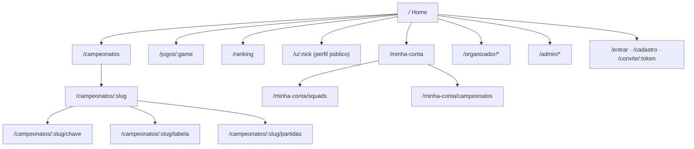

### 15.8 Estados e microinterações

| Situação | Comportamento |
|---|---|
| Carregando | Skeletons com o formato do conteúdo (nunca spinner de tela cheia) |
| Lista vazia | Ilustração + ação sugerida ("Nenhum campeonato de 8 Ball aberto · Seguir jogo") |
| Erro | Mensagem humana + "Tentar novamente"; erros de formulário inline |
| Ao vivo | Ponto verde pulsando + "AO VIVO"; linhas da tabela animam ao mudar de posição (FLIP) |
| Booyah / Campeão | Confete discreto + badge dourado (respeita `prefers-reduced-motion`) |
| Ação destrutiva | Modal de confirmação digitando o nome do campeonato |

---

## 16. Arquitetura Técnica

> **Atualizado na v1.1:** a arquitetura original (React SPA + Vite, NestJS, Socket.IO, BullMQ, S3) foi substituída para o produto rodar **100% na Vercel**. A fonte da verdade é o [plano de implementação §2](plano-de-implementacao.md#2-arquitetura-na-vercel); esta seção é o resumo.

### 16.1 Stack

| Camada | Tecnologia | Justificativa |
|---|---|---|
| **Aplicação** | **Next.js (App Router) + React 19 + TypeScript** | Telas e API no mesmo projeto e no mesmo domínio; SSR/ISR nas páginas públicas |
| Estado do servidor | **TanStack Query** | Cache, revalidação, atualizações otimistas |
| Estado do cliente | Zustand | Simples, para UI/sessão |
| Formulários | React Hook Form + **Zod** | Schemas compartilhados com a API (`packages/schemas`) |
| Estilo | **Tailwind CSS** + CSS Custom Properties | Tokens únicos, produtividade |
| Componentes | Radix UI (primitivos acessíveis) + componentes próprios | Acessibilidade AA |
| Chaves/Gráficos | SVG próprio para chaves · Recharts para dashboards | Controle visual total |
| **API** | **Hono** em **Vercel Functions** (Node.js), montado em `/api/v1/*` | Monólito modular sem servidor para manter |
| ORM | **Prisma** | Migrations e tipagem |
| Banco | **Neon Postgres** | Relacional, JSONB para regras; um banco por preview |
| Cache / rate limit / idempotência | **Upstash Redis** (HTTP) | Feito para funções serverless |
| Jobs | **Upstash QStash** + **Vercel Cron** | Mensagens com hora marcada; o Cron é a rede de segurança |
| Tempo real | **Ably** + polling de 10 s como alternativa | Funções da Vercel não mantêm WebSocket |
| Arquivos | **Vercel Blob** (upload direto do navegador) | Prints, logos, capas |
| E-mail | **Resend** | Transacionais |
| Auth | Própria: `jose` (JWT 15 min + refresh rotativo em cookies `httpOnly`), `arctic` (OAuth Google/Discord), `otplib` (TOTP) | Mesmo domínio, sem CORS |
| Configuração e flags | **Vercel Edge Config** + Flags SDK | Leitura em milissegundos |
| Observabilidade | Vercel Observability, `@vercel/otel`, Sentry | — |
| Testes | Vitest + fast-check, Testing Library, Storybook, Playwright, axe-core, k6 | — |
| CI/CD | GitHub Actions + integração Git da Vercel (preview por PR) | — |

### 16.2 Visão de contêineres

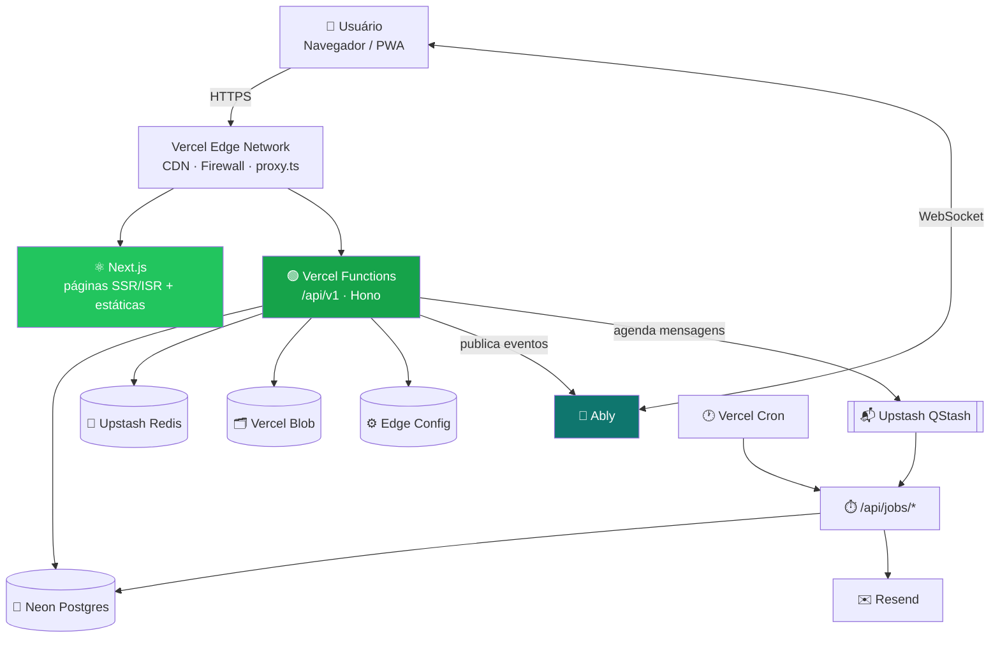

### 16.3 Módulos da API (monólito modular)

```
packages/api/src/
├── modules/
│   ├── auth/            # login, OAuth, refresh, 2FA
│   ├── users/           # perfis, IDs de jogo
│   ├── roles/           # RBAC, convites de admin/organizador
│   ├── games/           # catálogo, modos, modelos de pontuação
│   ├── tournaments/     # CRUD, ciclo de vida, staff
│   ├── stages/          # fases, chave, classificação (usa packages/engine)
│   ├── matches/         # partidas, agenda, check-in, resultados, disputas
│   ├── teams/           # squads, convites, elencos
│   ├── registrations/   # inscrições, lista de espera
│   ├── notifications/   # no site, e-mail, preferências
│   ├── moderation/      # denúncias, sanções
│   ├── audit/           # AuditLog somente-inserção
│   └── realtime/        # token e publicação no Ably
├── middleware/          # requireRole, requireTournamentAccess, validação Zod, erros
└── jobs/                # handlers de /api/jobs/* e /api/cron/*
```

> **Domínio puro:** o chaveamento e a pontuação ficam em `packages/engine`, como **funções puras** sem dependência de framework, testadas por propriedade e reaproveitadas no navegador para a pré-visualização.

### 16.4 Fluxo de tempo real (resultado → tabela)

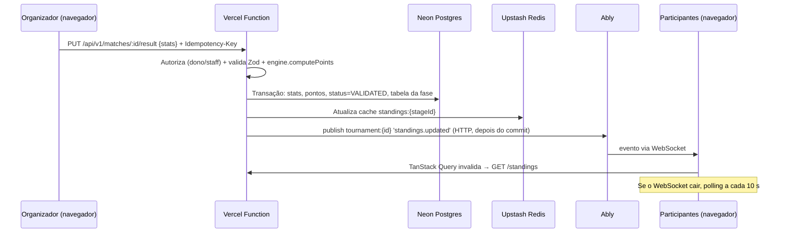

### 16.5 Segurança

- **Camadas:** `proxy.ts` (redireciona na borda) → middleware `requireRole` (papel global) → `requireTournamentAccess` (dono/staff do recurso). A checagem que vale é a da API.
- **Princípio do menor privilégio:** o organizador só enxerga os recursos dos próprios campeonatos.
- **Dados sensíveis:** código/senha da sala ficam visíveis **só para participantes daquela partida**, e apenas X minutos antes do início. O código nunca vai em evento de tempo real.
- **Anti-fraude:** limite de contas por dispositivo/IP (alerta), detecção de IDs de jogo duplicados, evidência obrigatória em resultados contestados.
- **Rate limiting** por rota e por usuário (Upstash Ratelimit + Vercel Firewall).
- **CSRF:** cookies `SameSite=Lax` + checagem do cabeçalho `Origin` em toda mutação.
- **Headers:** CSP restritiva com nonce, HSTS, `X-Content-Type-Options`, `Referrer-Policy`.

---

## 17. Modelo de Dados

### 17.1 Diagrama ER (principal)

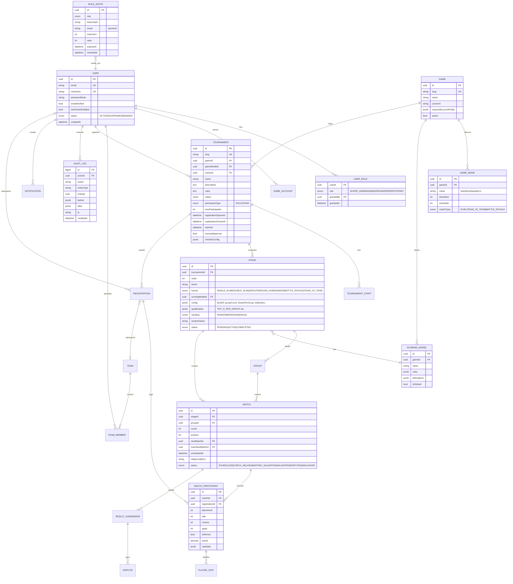

### 17.2 Índices e observações

- `REGISTRATION (tournamentId, teamId)` e `(tournamentId, userId)` **únicos**.
- `MATCH (stageId, round, position)` para renderizar a chave.
- `STANDINGS` como **view materializada** (ou tabela recalculada pelo motor) por `stageId/groupId`, com cache no Redis (`standings:{stageId}`).
- `AUDIT_LOG` particionado por mês; permissão de banco só para `INSERT`/`SELECT`.
- `lobbyCodeEnc` cifrado em repouso (AES-256-GCM).

---

## 18. API (contratos principais)

**Base:** `/api/v1` no mesmo domínio do site · JSON · autenticação por **cookies `httpOnly`** (JWT de acesso de 15 min + refresh rotativo) · mutações com checagem de `Origin` · erros no padrão RFC 7807 (`application/problem+json`).

### 18.1 Endpoints

| Método | Rota | Papel | Descrição |
|---|---|---|---|
| POST | `/auth/register` · `/auth/login` · `/auth/refresh` · `/auth/logout` | Público | Autenticação |
| GET | `/auth/oauth/:provider` | Público | Google/Discord |
| GET/PATCH | `/me` | Logado | Perfil próprio |
| PUT | `/me/game-accounts/:gameId` | Logado | IDs de jogo |
| **Admin** | | | |
| GET | `/admin/stats` | Admin | KPIs do dashboard |
| GET/PATCH | `/admin/users` · `/admin/users/:id` | Admin | Gestão de usuários |
| POST | `/admin/users/:id/sanctions` | Admin | Suspender/banir |
| POST | `/admin/invites` | Admin | Criar convite (ADMIN/ORGANIZER) |
| DELETE | `/admin/invites/:id` | Admin | Revogar convite |
| POST/DELETE | `/admin/users/:id/roles` | Admin | Conceder/revogar papel |
| GET/PATCH | `/admin/organizer-requests/:id` | Admin | Fila de pedidos |
| CRUD | `/admin/games` · `/admin/games/:id/scoring-models` | Admin | Catálogo |
| GET | `/admin/audit-logs` | Admin | Auditoria |
| POST | `/invites/:token/accept` | Logado | Aceitar convite |
| **Campeonatos** | | | |
| GET | `/tournaments?game=&status=&mode=&page=` | Público | Listagem |
| GET | `/tournaments/:slug` | Público | Detalhe |
| POST | `/tournaments` | Organizador | Criar (rascunho) |
| PATCH | `/tournaments/:id` | Dono/Staff | Editar |
| POST | `/tournaments/:id/publish` · `/cancel` · `/finish` | Dono | Ciclo de vida |
| POST/DELETE | `/tournaments/:id/staff` | Dono | Co-organizadores |
| CRUD | `/tournaments/:id/stages` | Dono/Staff | Fases |
| POST | `/stages/:id/generate` | Dono/Staff | Gerar chave (retorna prévia) |
| POST | `/stages/:id/confirm` | Dono/Staff | Confirmar chave |
| PATCH | `/stages/:id/seeding` | Dono/Staff | Ajuste manual |
| POST | `/stages/:id/advance` | Dono/Staff | Avançar fase |
| GET | `/stages/:id/bracket` · `/stages/:id/standings` | Público | Chave/tabela |
| **Partidas** | | | |
| GET | `/tournaments/:id/matches` | Público | Lista |
| PATCH | `/matches/:id` | Staff | Agenda, sala |
| POST | `/matches/:id/check-in` | Participante | Check-in |
| PUT | `/matches/:id/result` | Staff | Lançar/validar resultado |
| POST | `/matches/:id/submissions` | Participante | Enviar resultado + prova |
| POST | `/submissions/:id/dispute` | Participante | Contestar |
| **Inscrições e Squads** | | | |
| POST | `/tournaments/:id/registrations` | Participante | Inscrever (solo ou `teamId`) |
| DELETE | `/registrations/:id` | Participante/Staff | Cancelar/remover |
| PATCH | `/registrations/:id` | Staff | Aprovar/recusar |
| CRUD | `/teams` · `/teams/:id/members` | Capitão | Squads |
| POST | `/teams/:id/invites` | Capitão | Convite (nick, link, código) |
| POST | `/team-invites/:code/accept` | Logado | Aceitar |

### 18.2 Exemplo — lançar resultado de queda BR

```http
PUT /api/v1/matches/7f3c.../result
Cookie: na_access=<jwt>
Idempotency-Key: 5b1e...
Content-Type: application/json

{
  "participants": [
    { "registrationId": "a1...", "placement": 1, "kills": 7 },
    { "registrationId": "b2...", "placement": 2, "kills": 9 },
    { "registrationId": "c3...", "placement": 3, "kills": 4 }
  ],
  "evidenceUrls": ["https://cdn.novaarena.gg/ev/123.png"]
}
```

```json
{
  "matchId": "7f3c...",
  "status": "VALIDATED",
  "results": [
    { "registrationId": "a1...", "team": "Squad Alfa",    "points": 10, "breakdown": { "kills": 7, "placement": 3 } },
    { "registrationId": "b2...", "team": "Squad Bravo",   "points": 9,  "breakdown": { "kills": 9, "placement": 0 } },
    { "registrationId": "c3...", "team": "Squad Charlie", "points": 4,  "breakdown": { "kills": 4, "placement": 0 } }
  ]
}
```

### 18.3 Eventos de tempo real (Ably)

| Sala | Evento | Payload |
|---|---|---|
| `tournament:{id}` | `match.updated` | `{ matchId, status, scores }` |
| `tournament:{id}` | `standings.updated` | `{ stageId, groupId? }` |
| `tournament:{id}` | `stage.advanced` | `{ fromStageId, toStageId }` |
| `tournament:{id}` | `announcement.created` | `{ title, body }` |
| `user:{id}` | `notification.created` | `{ id, type, title, link }` |
| `match:{id}` | `lobby.revealed` | `{ matchId }` *(só avisa; o código é buscado em `GET /matches/:id/lobby`, que confere a permissão)* |
| `user:{id}` | `session.revoked` | `{ reason }` |

---

## 19. Estrutura do Front-end (React)

> **Atualizado na v1.1** para o Next.js (App Router). Detalhes no [plano §4.4](plano-de-implementacao.md#44-estrutura-do-repositório).

### 19.1 Monorepo

```
nova-arena/
├── apps/
│   └── web/                 # Next.js — único projeto publicado na Vercel
│       ├── app/
│       │   ├── (public)/    # home, campeonatos, perfil público
│       │   ├── (participant)/
│       │   ├── organizador/
│       │   ├── admin/
│       │   └── api/         # v1 (Hono), jobs (QStash), cron
│       ├── features/        # auth, tournaments, brackets, matches, teams, organizer, admin, notifications
│       ├── shared/          # api (cliente único + query keys), realtime, hooks, lib
│       └── proxy.ts         # proteção de rotas na borda
└── packages/
    ├── ui/         # Design system + Storybook
    ├── schemas/    # Contratos Zod
    ├── engine/     # Chaveamento + pontuação (TS puro)
    ├── api/        # Hono: módulos, middlewares, serviços
    ├── db/         # Prisma
    └── config/     # ESLint, tsconfig, preset Tailwind
```

### 19.2 Proteção de rotas

- **Na borda:** `proxy.ts` valida o JWT e redireciona quem não pode abrir `/organizador` ou `/admin`.
- **No cliente:** `<RequireRole roles={[...]} require2FA>` nos layouts de cada área, com página 403.
- **Na API:** é a checagem que vale (ver §16.5).

### 19.3 Tempo real com TanStack Query

As telas usam a interface `RealtimeClient` (assinar canal, receber evento, estado da conexão). No protótipo ela é simulada; em produção, é implementada com o Ably.

```tsx
// shared/realtime/useTournamentChannel.ts
export function useTournamentChannel(tournamentId: string) {
  const qc = useQueryClient();
  const realtime = useRealtime();
  useEffect(() => {
    const channel = realtime.subscribe(`tournament:${tournamentId}`, (event) => {
      if (event.type === 'standings.updated') qc.invalidateQueries({ queryKey: ['standings', event.stageId] });
      if (event.type === 'match.updated') qc.invalidateQueries({ queryKey: ['match', event.matchId] });
    });
    return () => channel.unsubscribe();
  }, [tournamentId, qc, realtime]);
}
```

### 19.4 Motor de pontuação compartilhado (`packages/engine`)

```ts
// Free Fire padrão: kill = 1, Booyah = 3
computePoints({ kills: 7, placement: 1 }, [
  { stat: 'kills', type: 'PER_UNIT', points: 1 },
  { stat: 'placement', type: 'TABLE', table: { '1': 3 } },
]).total; // → 10
```

Os seis tipos de regra (`PER_UNIT`, `TABLE`, `OUTCOME`, `BONUS`, `CAP`, `MULTIPLIER`) estão descritos no §11.3.

---

## 20. Métricas de Sucesso

### 20.1 HEART (experiência)

| Dimensão | Sinal | Métrica | Meta |
|---|---|---|---|
| **Happiness** | Satisfação pós-campeonato | NPS de participantes / organizadores | ≥ 40 / ≥ 50 |
| **Engagement** | Acompanhamento | Sessões por participante durante um campeonato ativo | ≥ 4 |
| **Adoption** | Novos organizadores | Organizadores que publicam o 1º campeonato em ≤ 7 dias após a aprovação | ≥ 60% |
| **Retention** | Volta para jogar | Inscrição em novo campeonato em ≤ 30 dias | ≥ 40% |
| **Task Success** | Operação sem atrito | Tempo médio para lançar uma queda BR | ≤ 60 s |

### 20.2 AARRR (crescimento)

| Etapa | Métrica |
|---|---|
| Aquisição | Cadastros/semana; % vindos de link de campeonato compartilhado |
| Ativação | % de cadastrados que se inscrevem em até 7 dias |
| Retenção | Participantes ativos mensais (MAU) e coorte de 30/60/90 dias |
| Receita | *(v2)* Campeonatos com inscrição paga / patrocinados |
| Indicação | Convites de squad aceitos por capitão |

### 20.3 Métricas operacionais

- Taxa de W.O. · disputas por partida · tempo médio de resolução de disputa (≤ 24h).
- Erros 5xx (< 0,5%) · latência p95 · tempo de propagação do tempo real.

---

## 21. Roadmap e Marcos

```mermaid
gantt
    title Nova Arena — Roadmap
    dateFormat  YYYY-MM-DD
    axisFormat  %d/%m

    section Fundação
    Discovery, UX e Design System        :a1, 2026-11-16, 21d
    Setup monorepo, CI/CD, Auth & RBAC   :a2, 2026-11-30, 21d

    section MVP (Fase 1)
    Catálogo de jogos + pontuação         :b1, 2026-12-21, 14d
    Campeonatos + inscrições solo/squad   :b2, 2026-12-21, 28d
    Motor: mata-mata, grupos, BR          :b3, 2027-01-04, 28d
    Resultados + tabelas em tempo real    :b4, 2027-01-18, 21d
    Painel Admin (essencial)              :b5, 2027-01-18, 21d
    QA, beta fechado                      :b6, 2027-02-08, 14d
    Lançamento MVP                        :milestone, m1, 2027-02-22, 0d

    section v1 (Fase 2)
    Eliminação dupla, suíço, pontos corridos :c1, 2027-02-22, 21d
    Envio de resultado + disputas          :c2, 2027-03-01, 21d
    Moderação, denúncias, comunicados      :c3, 2027-03-08, 21d
    Perfil competitivo + modelos           :c4, 2027-03-15, 21d
    Lançamento v1                          :milestone, m2, 2027-04-05, 0d

    section v2 (Futuro)
    Ranking de temporada (ELO)             :d1, 2027-04-12, 30d
    Pagamentos e premiação                 :d2, 2027-04-12, 45d
    Bot Discord                            :d3, 2027-05-03, 21d
```

| Marco | Entregável | Critério de saída |
|---|---|---|
| **M0 — Fundação** | Design system no Storybook, Auth + RBAC, CI/CD | Login funcionando com papéis; tokens aplicados |
| **M1 — MVP** | Admin essencial, organizador cria campeonato com fases (mata-mata, grupos, BR), inscrição solo/squad, check-in, resultados, tabelas ao vivo | 3 campeonatos reais concluídos no beta sem planilha |
| **M2 — v1** | Formatos completos, disputas, moderação, perfil, modelos | Metas de OKR do trimestre acompanhadas no dashboard |
| **M3 — v2** | Ranking, pagamentos, integrações | A definir |

---

## 22. Riscos e Mitigações

| # | Risco | Prob. | Impacto | Mitigação |
|---|---|:-:|:-:|---|
| R1 | Resultados falsos enviados por participantes | Alta | Alto | Prova obrigatória, confirmação do adversário, validação do staff, auditoria, sanções |
| R2 | Complexidade do motor com fases mistas gera bugs | Média | Alto | Motor puro em pacote isolado, testes com propriedades, prévia antes de confirmar fase |
| R3 | Pico de acesso em finais quebra o tempo real | Média | Médio | Serviço gerenciado (Ably) que escala sozinho, alternativa de *polling* de 10 s |
| R4 | Abuso de papéis (admin malicioso) | Baixa | Alto | 2FA obrigatório, auditoria imutável, Super Admin único com poder de revogar, alertas para ações em massa |
| R5 | Questões de marca/direitos dos jogos | Média | Médio | Usar só nomes para identificação, sem logos oficiais sem autorização; aviso de "não afiliado" |
| R6 | Baixa adoção pelos organizadores | Média | Alto | Modelos prontos, onboarding guiado, importação de lista de inscritos via CSV |
| R7 | LGPD / dados de menores | Média | Alto | Idade mínima nos termos, consentimento, exclusão de conta, mínimo de dados pessoais |
| R8 | Fuso horário e agenda errados | Média | Médio | Datas guardadas em UTC, exibidas no fuso do usuário com indicação explícita |

---

## 23. Dependências e Premissas

**Dependências**
- Provedores OAuth (Google, Discord) e serviço de e-mail transacional.
- Armazenamento de objetos + CDN para imagens.
- Postgres e Redis gerenciados.

**Premissas**
- Os resultados serão lançados manualmente (organizador/participantes) no MVP; não há API pública confiável dos jogos para importação automática.
- O público acessa principalmente pelo celular (≥ 70%).
- Campeonatos do MVP são gratuitos (sem pagamento dentro da plataforma).
- Existe pelo menos 1 Super Admin definido no *seed* inicial.

---

## 24. Decisões de Arquitetura (ADRs)

> **Atualizado na v1.1.** As ADRs 001, 002, 005, 008 e 009 foram revisadas para a Vercel. Registros completos em [`docs/adr/`](adr/).

| ADR | Decisão | Alternativas consideradas | Motivo |
|---|---|---|---|
| ADR-001 | **Monólito modular em funções** (Hono em `packages/api`, montado no Next.js) | NestJS em servidor contínuo, microsserviços | Roda como Vercel Function; time pequeno; módulos com fronteiras claras |
| ADR-002 | **Next.js (App Router)**: áreas logadas no cliente, páginas públicas com SSR/ISR | SPA React + Vite | Mesmo domínio para telas e API (cookies funcionam), SEO nativo |
| ADR-003 | **PostgreSQL + JSONB** (Neon) para regras de pontuação/config de fase | Tabelas EAV, NoSQL | Integridade relacional + flexibilidade para novos jogos sem migration |
| ADR-004 | **Motor de chave/pontuação como pacote TS puro** compartilhado | Lógica dentro dos serviços | Testabilidade, prévia no front idêntica ao back |
| ADR-005 | **Ably** para tempo real + polling de 10 s | Socket.IO + Redis Pub/Sub, SSE | A Vercel não mantém WebSocket; serviço gerenciado escala nas finais |
| ADR-006 | **Pontos sempre derivados no servidor** a partir das estatísticas brutas | Cliente envia pontos | Integridade e auditabilidade; permite recálculo ao mudar o modelo |
| ADR-007 | **Seed aleatória registrada** em sorteios | `Math.random` sem registro | Sorteio reproduzível e auditável |
| ADR-008 | **QStash + Vercel Cron** para jobs, todos idempotentes | BullMQ + workers | Sem processo contínuo; o Cron é a rede de segurança |
| ADR-009 | **Autenticação própria** com cookies `httpOnly` no mesmo domínio | JWT em header `Bearer`, serviço de auth de terceiros | Atende RNF-06 e funciona no `proxy.ts` |

---

## 25. Questões em Aberto

> **Atualizado na v1.1:** Q1, Q3, Q5, Q6 e Q7 foram decididas na [ADR-0001](adr/0001-decisoes-iniciais.md).

| # | Questão | Situação |
|---|---|---|
| Q1 | Tamanho máximo de sala BR por padrão | ✅ **12 equipes por sala**, configurável por fase |
| Q2 | Existe parceria ou API oficial para importar resultados de algum jogo? | ⏳ Pós-lançamento |
| Q3 | A final BR com poucos squads deve ter sala completada por repescagem como padrão? | ✅ **Não.** Repescagem é opção por fase, desligada por padrão |
| Q4 | Organizador poderá cobrar inscrição? Qual modelo de taxa? | ⏳ Pós-lançamento |
| Q5 | Idade mínima para cadastro | ✅ **16 anos** *(provisória; validar com o jurídico antes do beta)* |
| Q6 | Kills por jogador serão obrigatórias para o ranking de MVP? | ✅ **Opcional por fase** |
| Q7 | Domínio definitivo | ✅ **`novaarena.gg`** *(provisória; o código usa `NEXT_PUBLIC_SITE_URL`)* |

Regras de negócio que o PRD citava sem definir (desistência, regerar chave, lista de espera com squad, mesclar contas etc.) estão em [`regras-de-negocio.md`](regras-de-negocio.md). O modelo de dados completo está em [`modelo-de-dados.md`](modelo-de-dados.md).

---

## 26. Glossário

| Termo | Definição |
|---|---|
| **Booyah** | Vitória (1º lugar) numa partida de Free Fire. |
| **Battle Royale (BR)** | Partida com várias equipes ao mesmo tempo; a pontuação combina colocação e kills. |
| **Queda** | Uma partida BR dentro de uma fase (ex.: "3 quedas no grupo"). |
| **Chaveamento / Chave** | Estrutura de confrontos de uma fase eliminatória. |
| **Seed / Cabeça de chave** | Posição de prioridade definida por ranking para equilibrar a chave. |
| **Bye** | Avanço automático sem jogar, quando faltam adversários na chave. |
| **MD3 (Bo3)** | Melhor de 3 partidas. |
| **W.O.** | Vitória por ausência do adversário (*walkover*). |
| **Check-in** | Confirmação de presença antes da partida. |
| **Squad** | Equipe (no Free Fire, normalmente 4 jogadores). |
| **Capitão** | Membro responsável pelo squad: inscreve, convida e confirma. |
| **Fase (Stage)** | Etapa do campeonato com formato e pontuação próprios. |
| **Modelo de Pontuação** | Conjunto de regras que transforma estatísticas em pontos. |
| **RBAC** | Controle de acesso baseado em papéis. |

---

<div align="center">

### ✅ Checklist de aprovação

| Área | Responsável | Status |
|---|---|:-:|
| Produto — escopo e prioridades | PM | ⬜ |
| Engenharia — viabilidade e arquitetura | Tech Lead | ⬜ |
| Design — UX, paleta e componentes | UX Lead | ⬜ |
| QA — critérios de aceite testáveis | QA Lead | ⬜ |
| Jurídico — LGPD e termos | Jurídico | ⬜ |

---

🟢 **Nova Arena** · *Onde todo campeonato vira história.*
<sub>Documento vivo: atualize a versão a cada mudança aprovada.</sub>

</div>
