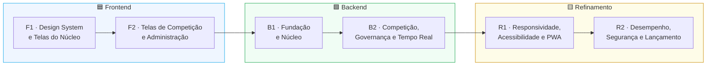
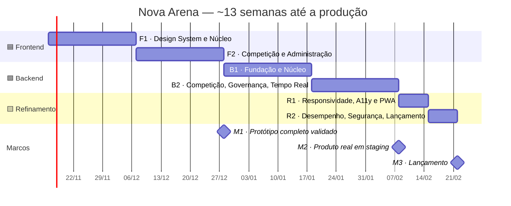
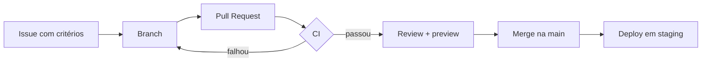

<div align="center">

# 🟢 NOVA ARENA — Plano de Implementação

**Frontend → Backend → Refinamento · 6 fases · todo o PRD coberto**


-0F766E?style=for-the-badge)


| Campo | Valor |
|---|---|
| **Documento** | Plano de Implementação |
| **Baseado em** | [`prd.md`](prd.md) v1.0 |
| **Data** | 11/11/2026 |
| **Público** | Desenvolvedores front-end e back-end, QA, design, gestão |

</div>

---

## 📑 Sumário

1. [Como o plano funciona](#1-como-o-plano-funciona)
2. [Cronograma](#2-cronograma)
3. [Regras para todas as fases](#3-regras-para-todas-as-fases)
4. [🟦 Módulo Frontend](#4--módulo-frontend)
   - [F1 — Design System e Telas do Núcleo](#f1--design-system-e-telas-do-núcleo)
   - [F2 — Telas de Competição e Administração](#f2--telas-de-competição-e-administração)
5. [🟩 Módulo Backend](#5--módulo-backend)
   - [B1 — Fundação e Núcleo](#b1--fundação-e-núcleo)
   - [B2 — Competição, Governança e Tempo Real](#b2--competição-governança-e-tempo-real)
6. [🟨 Módulo Refinamento](#6--módulo-refinamento)
   - [R1 — Responsividade, Acessibilidade e PWA](#r1--responsividade-acessibilidade-e-pwa)
   - [R2 — Desempenho, Segurança e Lançamento](#r2--desempenho-segurança-e-lançamento)
7. [Cobertura do PRD (nada fica para trás)](#7-cobertura-do-prd-nada-fica-para-trás)
8. [Cenários de teste de referência](#8-cenários-de-teste-de-referência)
9. [Checklist de produção](#9-checklist-de-produção)
10. [Melhorias sugeridas](#10-melhorias-sugeridas)

---

## 1. Como o plano funciona

O projeto tem **3 módulos** feitos **nesta ordem**, cada um com **2 fases**:



### Por que o frontend vem primeiro

1. **O produto é validado antes de construir o servidor.** O front é feito com uma **API simulada** (MSW — Mock Service Worker, com um "banco" em memória). No fim do frontend existe um **protótipo navegável completo**, testado com organizadores e jogadores reais. Mudanças de fluxo nessa etapa custam pouco.
2. **As telas definem os contratos.** Durante o front são escritos os schemas de dados (Zod, em `packages/schemas`). O backend implementa exatamente esses contratos, sem idas e vindas.
3. **O motor de chaveamento e pontuação nasce no front.** O `packages/engine` é TypeScript puro: roda no navegador durante o protótipo e depois é **reaproveitado sem mudanças no servidor**. A parte mais difícil do projeto fica pronta e testada cedo.
4. **O backend fica mais direto.** Ele só precisa "trocar o mock pelo real", tela por tela, com o comportamento esperado já definido.

### Formato de cada fase

> **Objetivo** → **Entregas** (com prioridade e IDs do PRD) → **Testes** → **Critérios de saída**

| Prioridade | Significado |
|---|---|
| **P0** | Obrigatório para fechar a fase |
| **P1** | Entra na fase; se atrasar, fecha na fase seguinte do mesmo módulo, nunca depois do lançamento |

---

## 2. Cronograma



| Semanas | Fase | Resultado no fim |
|---|---|---|
| 1–3 | **F1** | Design system + telas de conta, exploração, criação de campeonato, squads e inscrição, funcionando com dados simulados |
| 4–6 | **F2** | Todas as telas do PRD prontas: chave, partidas, resultados, Admin, notificações. **M1 — protótipo validado com usuários** |
| 7–9 | **B1** | API real de conta, papéis, jogos, campeonatos, squads e inscrições; essas telas deixam de usar o mock |
| 10–12 | **B2** | API real de competição, Admin, moderação, notificações e tempo real. **M2 — produto completo em staging** |
| 13 | **R1** | Revisão de responsividade, acessibilidade e PWA |
| 14 | **R2** | Desempenho, segurança, beta e **M3 — lançamento** |

> **Equipe de referência:** 1 dev front-end, 1 dev back-end e 1 designer em meio período.
> **Para encurtar sem mudar a ordem:** o dev back-end pode montar a infraestrutura (repositório de API, banco, CI) durante F2, já que ela não depende das telas. Com 1 dev full-stack, conte ~20 semanas.

---

## 3. Regras para todas as fases

### 3.1 Definição de Pronto

- [ ] Pull Request revisado por outra pessoa.
- [ ] Lint, checagem de tipos e testes passando no CI.
- [ ] Tela funcionando em **360 px** e **1440 px** (*mobile-first* desde o primeiro dia).
- [ ] Estados de **carregando, vazio e erro** implementados.
- [ ] Permissões verificadas no back-end *(a partir de B1)*.
- [ ] Ações sensíveis registradas na auditoria *(a partir de B1)*.

### 3.2 Fluxo de trabalho



- **Ambientes:** local → preview (um por PR) → staging → produção.
- **Commits:** *Conventional Commits* (`feat:`, `fix:`, `test:`…).
- **Feature flags** para liberar recursos aos poucos.

### 3.3 Ferramentas de teste

| Tipo | Ferramenta | Meta |
|---|---|---|
| Unitário | Vitest + fast-check (testes por propriedade) | Motor ≥ 90% · resto ≥ 70% |
| Componentes | Testing Library + Storybook | Todo o design system |
| Integração da API | Supertest + Postgres em contêiner | Todos os endpoints |
| Contrato | Respostas da API validadas pelos schemas de `packages/schemas` | 100% dos endpoints |
| E2E | Playwright (desktop + celular emulado) | Todos os fluxos P0 |
| Acessibilidade | axe-core | 0 violações sérias |
| Desempenho/carga | Lighthouse CI · k6 | Metas do PRD (RNF-01 a 04) |

### 3.4 Estrutura do repositório

```
nova-arena/
├── apps/
│   ├── web/        # React (F1, F2)
│   └── api/        # NestJS (B1, B2)
└── packages/
    ├── ui/         # Design system (F1)
    ├── schemas/    # Contratos Zod (F1/F2 → usados em B1/B2)
    ├── engine/     # Chaveamento + pontuação (F1/F2 → reaproveitado em B2)
    └── config/     # ESLint, tsconfig, preset Tailwind
```

---

## 4. 🟦 Módulo Frontend

### F1 — Design System e Telas do Núcleo

> **Objetivo:** identidade visual pronta e todas as telas de conta, exploração, criação de campeonato, squads e inscrição, funcionando com a API simulada.
> **Duração:** 3 semanas

#### Entregas

| # | Entrega | Detalhes | PRD | Prior. |
|---|---|---|---|:-:|
| F1.1 | **Setup** | Monorepo (pnpm + Turborepo), React 18 + Vite + TypeScript, React Router (rotas *lazy* por área), TanStack Query, Zustand, React Hook Form + Zod. **MSW com banco em memória** e *seed* (jogos, usuários dos 4 papéis, campeonatos). CI com lint, tipos, testes e preview. | §16.1 | P0 |
| F1.2 | **Design system "Nova Green"** | `tokens.css` com toda a paleta (verde da marca, neutros, teal, ouro/prata/bronze, status), tipografia (Rajdhani, Inter, JetBrains Mono), espaçamento, raio, sombra; tema claro e escuro ("Arena Night"); `prefers-reduced-motion`. Componentes com Radix UI: `Button`, `Input`, `Select`, `Badge/StatusPill`, `Card`, `Modal`, `Drawer`, `Toast`, `Skeleton`, `EmptyState`, `Avatar`, `Tabs`, `Stepper`, `DataTable`. Storybook. | §15.2–15.5 | P0 |
| F1.3 | **Layouts por área** | `PublicLayout`, `ParticipantLayout` (verde), `OrganizerLayout` (teal), `AdminLayout` (verde-escuro + dourado). `<RequireRole>`, página 403, troca de área para quem tem mais de um papel. Mapa do site do PRD (§15.7). | §4, §6 | P0 |
| F1.4 | **Conta e perfil** | Entrar, cadastrar, verificar e-mail, recuperar senha, botões Google/Discord. Minha conta (dados, avatar com recorte, IDs de jogo, redes, bio). Perfil público `/u/:nick`. Formulário "Quero ser organizador". | PAR-01, PAR-13, RF-01 | P0 |
| F1.5 | **Exploração** | Home (hero, atalhos por jogo, destaques, minhas próximas partidas). Lista com filtros (jogo, modo, status, data, vagas, organizador verificado) guardados na URL, busca e rolagem infinita. `TournamentCard`. Página do campeonato com abas (Visão geral, Regulamento, Inscritos, Comunicados). Página personalizável (banner, rich-text, premiação, links de transmissão). | PAR-02, PAR-03, ORG-13 | P0 |
| F1.6 | **Criação de campeonato** | Assistente em 7 passos (Informações → Jogo & Modo → Inscrições → Fases → Pontuação → Regras → Revisão) com rascunho automático. `StageBuilder` com **os 7 formatos** do PRD e regras de classificação. Começar a partir de **modelo** e salvar modelos próprios. Painel "Meus campeonatos". | ORG-01, ORG-02, ORG-04, ORG-05, RF-07, RF-08, RF-21 | P0 |
| F1.7 | **Jogos e pontuação (Admin)** | Lista e formulário de jogo (capa, modos, tamanho de equipe, reservas, campos de ID exigidos). **Editor de modelo de pontuação** com os 6 tipos de regra (`PER_UNIT`, `TABLE`, `OUTCOME`, `BONUS`, `CAP`, `MULTIPLIER`), ordem de desempate e prévia ("7 kills + 1º lugar = 10 pts"). | ADM-06, §11 | P0 |
| F1.8 | **Motor — parte 1 (`packages/engine`)** | `computePoints` com os 6 tipos de regra e os modelos padrão (FF: kill = 1, Booyah = 3; CR: coroas + vitória; eFootball: 3/1/0; 8 Ball: frames). Usado na prévia do editor e do assistente. | §11, RN-01 | P0 |
| F1.9 | **Squads e inscrições** | Meus squads (nome, tag, logo), `SquadRoster` com status dos convites e coroa do capitão, convite por nick/link/código, compartilhar (Web Share API), aceitar convite, transferir capitania. Inscrição solo (com aceite do regulamento e aviso de ID faltando) e com squad (pendente até o mínimo confirmar). Lista de espera. "Meus campeonatos". Organizador: inscritos, aprovar/recusar, remover/substituir, exportar CSV. | PAR-04 a 06, ORG-03, §12, RF-14, RF-15 | P0 |

#### Testes

| Área | O que testar |
|---|---|
| Design system | Testes de componente (estados, foco, teclado) · axe-core em todas as *stories* · contraste AA de todos os pares de cor · screenshots nos dois temas. |
| Motor | `computePoints({kills: 7, placement: 1}, modeloFF)` = **10** · cada tipo de regra isolado · `CAP` e `MULTIPLIER` combinados. |
| Rotas | Participante abrindo `/admin` vê a página 403. |
| E2E (360 px e 1440 px) | Cadastro e login · criar campeonato FF Squad com 3 fases (grupos BR → mata-mata → final BR) e publicar · capitão cria squad, convida, membros aceitam, squad inscrito · filtrar "Free Fire + vagas abertas". |
| Usabilidade | 3 pessoas que nunca usaram o sistema criam e publicam um campeonato em **≤ 10 minutos**. |

#### ✅ Critérios de saída

- [ ] Storybook publicado; nenhuma cor fora dos tokens.
- [ ] Schemas Zod de usuário, jogo, campeonato, fase, squad e inscrição prontos em `packages/schemas`.
- [ ] Todos os fluxos do núcleo navegáveis no preview, com dados simulados.

---

### F2 — Telas de Competição e Administração

> **Objetivo:** todas as telas restantes do PRD prontas. No fim, o **protótipo completo** é testado com usuários reais.
> **Duração:** 3 semanas

#### Entregas

| # | Entrega | Detalhes | PRD | Prior. |
|---|---|---|---|:-:|
| F2.1 | **Motor — parte 2 (`packages/engine`)** | Geradores dos **7 formatos**: eliminação simples (com *byes* e disputa de 3º), eliminação dupla (chave de perdedores e *reset* na final), grupos (serpentina por potes), pontos corridos (turno e returno), suíço (sem repetir confronto), Battle Royale (salas por tamanho máximo) e equipe x equipe (MD1 a MD7). *Seeding* aleatório com **seed registrada**, por ranking ou manual. `computeStandings` com os 8 critérios de desempate. `applyQualification` (top N por grupo, top N geral, vencedores). | §10.3–10.6, RF-09, RF-13 | P0 |
| F2.2 | **Chave e tabelas** | `BracketView` em SVG (simples e dupla; zoom e arrastar no desktop, **lista por rodada com abas** no celular). `GroupTable`, `StandingsTable`, tabela BR por queda e acumulada (Pos, Squad, Booyahs, Kills, Pts) com zona de classificação em verde. Explicação do desempate ao tocar na posição. | §15.5, PAR-09 | P0 |
| F2.3 | **Operação do campeonato** | Prévia da chave com **arrastar e soltar** antes de confirmar. Assistente "Avançar fase" com prévia dos classificados. Agenda (partida ou rodada inteira), código da sala. Equipe do evento (co-organizadores e moderadores). Comunicados (todos, uma fase ou um grupo). Pausar, cancelar e encerrar com pódio (ouro, prata, bronze). | ORG-04 a 06, ORG-10 a 12 | P0 |
| F2.4 | **Partidas e resultados** | `MatchCard` com todos os estados. Check-in com contagem regressiva. `ScoreInput` (duelos) e `BRDropTable` (quedas, com Tab/Enter, teclado numérico e coluna "Pontos (prévia)"). Kills por equipe ou por jogador (MVP). Upload de print com compressão no navegador. Importação de CSV com prévia dos erros. | ORG-07, PAR-07, RN-03 | P0 |
| F2.5 | **Envio, validação e disputas** | Participante envia placar + print; adversário confirma ou contesta. Fila "Resultados para validar" do organizador. Tela de disputa com histórico e anexos. | ORG-08, PAR-08, RF-19 | P0 |
| F2.6 | **Arte de resultado** | Geração da imagem de campeões / certificado para compartilhar. | ORG-12, RF-24 | P1 |
| F2.7 | **Perfil competitivo** | Estatísticas por jogo (campeonatos, vitórias, kills, coroas, títulos) e conquistas no perfil público. | PAR-11, RF-22 | P1 |
| F2.8 | **Painel Admin** | Dashboard (KPIs + gráficos com Recharts). Usuários (buscar, suspender com prazo, banir, redefinir senha, mesclar duplicadas). Administradores e Organizadores (promover, revogar, limites, selo verificado). **Convites** por e-mail ou link com validade e limite de usos. Fila de pedidos de organizador. Campeonatos (visão global, trocar responsável, destacar). Auditoria (linha do tempo com antes/depois, exportar CSV). Moderação (denúncias, disputas escaladas, ações rápidas). Comunicados globais. Configurações do site e *feature flags*. Saúde do sistema. Configuração do 2FA com QR code. | ADM-01 a 11 | P0 |
| F2.9 | **Denúncias** | Botão "Denunciar" em perfis, squads, partidas e resultados, com anexo. | PAR-12 | P0 |
| F2.10 | **Notificações e tempo real (simulados)** | Sino com contador, lista, marcar como lida, preferências por tipo. Hook `useTournamentChannel` ligado a um **socket simulado** que emite os eventos do PRD (§18.3). Indicador "AO VIVO", animação nas trocas de posição, aviso "reconectando…" e polling de 10 s como alternativa. | PAR-10, RF-17, RF-18 | P0 |

#### Testes

| Área | O que testar |
|---|---|
| Motor — casos fixos | 2, 3, 5, 8, 13, 16 e 64 participantes em cada formato. |
| Motor — **por propriedade** (N de 2 a 1.024) | Ninguém aparece duas vezes na mesma rodada · eliminação simples tem N − 1 partidas · na eliminação dupla ninguém perde mais de 2 vezes · no suíço não há confronto repetido · *byes* só para os melhores seeds · mesma seed = mesma chave · grupos diferem em no máximo 1 participante. |
| Pontuação | Queda do PRD: Alfa (1º, 7 kills) = 10 · Bravo (2º, 9) = 9 · Charlie (3º, 4) = 4. Cada critério de desempate isolado e em cadeia. |
| Visual | Chave simples e dupla com 8, 16 e 32 participantes, nos dois temas e no celular. |
| Acessibilidade | Cada confronto da chave tem `aria-label` ("Quartas: Squad Alfa contra Squad Bravo, 20h") e é navegável por teclado. |
| E2E | Gerar chave → arrastar dois participantes → confirmar · lançar MD3 → vencedor avança · **cenário completo do Free Fire** (CT-06) · Admin gera convite e outra conta aceita · tabela muda sozinha com evento do socket simulado. |
| Usabilidade | Lançar uma queda de 12 squads em **≤ 60 s**. |

#### ✅ Critérios de saída — Marco M1

- [ ] **Todas as telas do PRD** existem e estão navegáveis.
- [ ] Cobertura do `packages/engine` ≥ 90%, com os testes por propriedade passando.
- [ ] `packages/schemas` completo: é o contrato que o backend vai implementar.
- [ ] **Protótipo validado** com pelo menos 3 organizadores e 5 jogadores; ajustes de fluxo já feitos.

---

## 5. 🟩 Módulo Backend

> O backend implementa os contratos de `packages/schemas` e reaproveita o `packages/engine`. A cada entrega, **as telas correspondentes deixam de usar o mock** e passam a usar a API real.

### B1 — Fundação e Núcleo

> **Objetivo:** API real de conta, papéis, auditoria, jogos, campeonatos, squads e inscrições.
> **Duração:** 3 semanas · **Depende de:** M1

#### Entregas

| # | Entrega | Detalhes | PRD | Prior. |
|---|---|---|---|:-:|
| B1.1 | **Infraestrutura** | NestJS + TypeScript estrito, Prisma + PostgreSQL 16, Redis, BullMQ, Docker Compose local, armazenamento S3/R2, e-mail transacional, variáveis validadas, `GET /health`, CI e deploy em staging. | §16 | P0 |
| B1.2 | **Autenticação** | Cadastro, login, verificação de e-mail, recuperação de senha. Argon2id, JWT de 15 min + refresh rotativo em cookie `httpOnly` (com detecção de reuso). OAuth Google e Discord. Rate limit no login (5/min/IP). | RF-01, RNF-06, RNF-07 | P0 |
| B1.3 | **Papéis, permissões e auditoria** | `UserRole`, `RolesGuard` (papel global) e `ResourceAccessGuard` (dono/staff do campeonato), matriz RBAC do PRD. *Seed* do Super Admin. `AuditLog` somente-inserção com interceptor `@Audited()`. | §6, RF-02, RF-06, RNF-15 | P0 |
| B1.4 | **Perfil** | `/me`, IDs de jogo, upload de avatar por URL assinada (5 MB, só imagem), nick único, pedido para virar organizador. | PAR-01, PAR-13, RNF-09 | P0 |
| B1.5 | **Catálogo de jogos** | `Game`, `GameMode`, `ScoringModel` (regras em JSONB validadas pelo schema). CRUD para o Admin. *Seed* com Free Fire, Clash Royale, 8 Ball Pool e eFootball. | ADM-06, RF-05 | P0 |
| B1.6 | **Campeonatos** | `Tournament`, `Stage`, `TournamentStaff`, modelos de campeonato. Máquina de estados do ciclo de vida (§8.3). CRUD, publicar, pausar, cancelar. Listagem com filtros, busca e paginação por cursor. Jobs para abrir e fechar inscrições. Comunicados. | ORG-01, 02, 10, 11, 13, RF-07, RF-08, RF-21 | P0 |
| B1.7 | **Squads** | `Team`, `TeamMember`, `TeamInvite` (nick, link, código; 72h). Trava de elenco por data. Transferir capitania. Um jogador por squad no mesmo campeonato. | §12, RF-15 | P0 |
| B1.8 | **Inscrições** | Solo e squad, vagas, prazo, ID de jogo obrigatório, aprovação manual opcional, lista de espera com promoção automática, organizador não se inscreve no próprio evento, exportação CSV. Controle de concorrência na última vaga (transação + *lock*). | ORG-03, RF-14, RF-23 | P0 |

#### Testes

| Área | O que testar |
|---|---|
| Auth | Cadastro → verificação → login → refresh → logout · reuso de refresh token derruba a sessão · 6ª tentativa de login em 1 min = 429. |
| Permissões | **Matriz RBAC do PRD** automatizada: cada rota × 4 papéis + visitante → 200/401/403. |
| Contrato | Toda resposta validada pelos schemas de `packages/schemas`. |
| Campeonatos | Transições inválidas recusadas · organizador A não edita o campeonato do B. |
| Inscrições | **CT-02:** 100 inscrições simultâneas para 10 vagas → 10 confirmadas, 90 na lista de espera · cancelamento promove o primeiro da lista. |
| Squads | Convite expirado recusado · jogador não fica em dois squads no mesmo campeonato. |
| Auditoria | `UPDATE`/`DELETE` em `AuditLog` falham no banco. |
| E2E | Os testes E2E de F1 rodam **contra a API real** (mocks desligados) e continuam passando. |

#### ✅ Critérios de saída

- [ ] Telas de F1 funcionando 100% com a API real.
- [ ] Matriz RBAC passando para as rotas existentes.
- [ ] CT-01 e CT-02 passando no servidor.

---

### B2 — Competição, Governança e Tempo Real

> **Objetivo:** API real de chaveamento, partidas, resultados, Admin, moderação, notificações e tempo real.
> **Duração:** 3 semanas · **Depende de:** B1

#### Entregas

| # | Entrega | Detalhes | PRD | Prior. |
|---|---|---|---|:-:|
| B2.1 | **Chave** | `Group`, `Match`, `MatchParticipant`. Geração com o `packages/engine` (os 7 formatos): **prévia** → ajuste manual → confirmar. Seed registrada. Chave travada após a 1ª partida concluída (só o Admin destrava). Ajustes manuais auditados. | RF-09, ORG-04 | P0 |
| B2.2 | **Agenda e check-in** | Agenda por partida ou rodada. Código da sala **cifrado** (AES-256-GCM), revelado só aos participantes perto do horário. Janela de check-in e job de **W.O. automático**. Lembrete 15 min antes. | ORG-06, PAR-07, RF-16, RN-04 | P0 |
| B2.3 | **Resultados** | Lançamento de duelos (placar MD) e de quedas BR (colocação + kills, por equipe ou por jogador). Pontos **sempre calculados no servidor**. Prova (print). Avanço automático do vencedor. Importação de CSV. Correção com recálculo. Cabeçalho `Idempotency-Key`. | ORG-07, RF-11, RF-12, RN-01 a 03 | P0 |
| B2.4 | **Classificação e avanço** | Tabela recalculada a cada resultado e guardada no Redis. Avanço de fase com prévia. Mudança de modelo em fase em andamento recalcula tudo (com auditoria). Encerramento com 1º, 2º e 3º. Estatísticas do perfil competitivo. Arte de resultado. | ORG-05, ORG-12, RF-10, RF-13, RF-22, RF-24, RN-02 | P0 |
| B2.5 | **Envio e disputas** | Envio pelo participante → confirmação do adversário → validação do staff. Contestação, disputa com anexos e escalonamento para o Admin. | ORG-08, PAR-08, RF-19 | P0 |
| B2.6 | **Administração** | KPIs do dashboard. Gestão de usuários (suspender, banir, redefinir senha, mesclar). **Convites de Admin/Organizador** por e-mail ou link com validade e limite de usos (token guardado como hash). Fila de pedidos de organizador. Limites por organizador e selo verificado. Gestão global de campeonatos. Consulta de auditoria com exportação CSV. Configurações e *feature flags*. Comunicados globais. Saúde do sistema. | ADM-01 a 05, 08 a 11, RF-03, RF-04, RF-25 | P0 |
| B2.7 | **2FA** | TOTP obrigatório para acessar `/admin`, opcional para os demais. | RNF-08 | P0 |
| B2.8 | **Moderação** | Denúncias (usuário, squad, resultado), fila com status, sanções com efeito imediato (sessões derrubadas), desclassificação com recálculo da tabela. | ADM-07, PAR-12, RF-20, RN-05 | P0 |
| B2.9 | **Tempo real** | Gateway Socket.IO autenticado, salas `tournament:{id}`, `match:{id}`, `user:{id}`, Redis adapter. Eventos `match.updated`, `standings.updated`, `stage.advanced`, `announcement.created`, `notification.created`, `lobby.revealed`. | RF-17, §18.3 | P0 |
| B2.10 | **Notificações** | No site (WebSocket) e por e-mail (fila com novas tentativas). Preferências por tipo. Todos os eventos de PAR-10. | PAR-10, RF-18 | P0 |

#### Testes

| Área | O que testar |
|---|---|
| Chave | Gerar → ajustar → confirmar → ajustar de novo depois de uma partida concluída = 409. |
| Resultados | Colocação repetida = 400 · quem não é staff = 403 · correção recalcula tabela e chave (CT-08) · mesma `Idempotency-Key` não grava duas vezes. |
| Check-in | W.O. com relógio simulado (CT-07) · quem não está na partida não recebe o código da sala. |
| **Cenário completo** | **CT-06:** 48 squads FF → grupos BR → mata-mata MD3 → final BR → campeão igual ao da planilha de referência, via API. Mais um Clash Royale 1v1 em eliminação dupla e um 8 Ball em suíço. |
| Admin | Convite expirado ou revogado não concede papel (CT-03) · Admin não remove o Super Admin · sem 2FA, `/admin/*` = 403. |
| Moderação | Banido perde a sessão em até 1 minuto (CT-09) · desclassificação zera pontos e reordena a tabela. |
| Tempo real | Resultado salvo → evento no cliente em < 2 s · **k6:** 2.000 conexões numa sala, p95 < 2 s · WebSocket caído → polling funciona (CT-10). |
| Notificações | Cada evento gera a notificação certa · preferência desligada não envia e-mail · falha do provedor tenta de novo sem duplicar. |
| Permissões | Matriz RBAC **completa** do PRD automatizada. |
| E2E | Todos os testes E2E de F2 rodam contra a API real. |

#### ✅ Critérios de saída — Marco M2

- [ ] **Nenhuma tela usa mais o mock.**
- [ ] CT-01 a CT-10 passando em staging.
- [ ] 100% das ações sensíveis auditadas.
- [ ] Campeonato completo jogado pelo time inteiro em staging.

---

## 6. 🟨 Módulo Refinamento

> As regras *mobile-first*, os estados de carregando/vazio/erro e o axe no CI valem desde a semana 1. O refinamento é a **revisão final e o fechamento** para a produção.

### R1 — Responsividade, Acessibilidade e PWA

> **Objetivo:** todas as telas perfeitas em qualquer tamanho e acessíveis.
> **Duração:** 1 semana

#### Tamanhos de tela

| Nome | Largura | Referência | Layout |
|---|---|---|---|
| `xs` | 360–479 px | Android de entrada, iPhone SE | 1 coluna, barra inferior |
| `sm` | 480–767 px | Celulares grandes | 1 coluna |
| `md` | 768–1023 px | Tablets | 2 colunas, menu lateral recolhível |
| `lg` | 1024–1439 px | Notebooks | 3 colunas, menu lateral fixo |
| `xl` | ≥ 1440 px | Desktops | Conteúdo com largura máxima de 1280 px |

#### Como os componentes se adaptam

| Componente | Celular | Tablet | Desktop |
|---|---|---|---|
| Navegação do participante | Barra inferior (5 ícones) | Barra inferior ou lateral | Header completo |
| Navegação Org/Admin | *Drawer* (☰) | Menu lateral recolhível | Menu lateral fixo |
| Chave | Lista por rodada com abas | SVG com zoom | SVG completo |
| Tabelas de classificação | Pos, Equipe, Pts + linha expansível | Todas as colunas com rolagem | Todas as colunas |
| Tabelas do Admin | Cartões | Tabela compacta | Tabela completa + ações em lote |
| Filtros | *Drawer* de baixo para cima | Barra lateral | Barra lateral fixa |
| Assistente de criação | Um passo por tela, botões no rodapé | Stepper horizontal | Stepper lateral + resumo |
| Lançar queda BR | Um squad por cartão | Tabela | Tabela com atalhos de teclado |
| Modais | Tela cheia | Centralizado | Centralizado |

#### Entregas

| # | Entrega | PRD | Prior. |
|---|---|---|:-:|
| R1.1 | Revisão de **todas as telas** nos 5 tamanhos e em paisagem (checklist abaixo). | RNF-13 | P0 |
| R1.2 | Áreas de toque ≥ 44×44 px, teclado certo em cada campo (`inputmode`), *safe areas* do notch. | RNF-13 | P0 |
| R1.3 | **PWA:** manifesto, ícones, *service worker* com cache dos estáticos, página offline, botão "Instalar app". | RNF-12 | P0 |
| R1.4 | **WCAG 2.2 AA:** foco visível, "pular para o conteúdo", `aria-live` nas mudanças ao vivo, rótulos, textos alternativos. Revisão com NVDA e VoiceOver. | RNF-11 | P0 |
| R1.5 | Microinterações do PRD revisadas: skeletons, estados vazios ilustrados, confete do campeão respeitando `prefers-reduced-motion`. | §15.8 | P0 |
| R1.6 | Textos externalizados (i18n) com pt-BR como padrão. | RNF-16 | P0 |

#### Checklist por tela

| Tela | 360 | 768 | 1024 | 1440 | Paisagem |
|---|:-:|:-:|:-:|:-:|:-:|
| Home e exploração | ⬜ | ⬜ | ⬜ | ⬜ | ⬜ |
| Página do campeonato (todas as abas) | ⬜ | ⬜ | ⬜ | ⬜ | ⬜ |
| Chave e tabelas | ⬜ | ⬜ | ⬜ | ⬜ | ⬜ |
| Squads e inscrição | ⬜ | ⬜ | ⬜ | ⬜ | ⬜ |
| Check-in, envio de resultado e disputa | ⬜ | ⬜ | ⬜ | ⬜ | ⬜ |
| Assistente de criação | ⬜ | ⬜ | ⬜ | ⬜ | ⬜ |
| Lançamento de resultados | ⬜ | ⬜ | ⬜ | ⬜ | ⬜ |
| Perfil e perfil competitivo | ⬜ | ⬜ | ⬜ | ⬜ | ⬜ |
| Painel Admin (todas as telas) | ⬜ | ⬜ | ⬜ | ⬜ | ⬜ |

#### Testes

- Playwright com os fluxos P0 em **iPhone SE (375), Pixel 7 (412) e desktop (1440)**.
- Screenshots de cada tela nos 5 tamanhos.
- Verificação automática: **nenhuma rolagem horizontal em 360 px**.
- axe-core em todas as páginas: 0 violações sérias ou críticas.
- Teste manual em aparelhos reais: 1 Android de entrada, 1 iPhone, 1 tablet.

#### ✅ Critérios de saída

- [ ] Checklist por tela 100% preenchido.
- [ ] Roteiros com leitor de tela aprovados (inscrição, check-in, ver chave, lançar resultado).
- [ ] PWA instalável no Android e no iOS.

---

### R2 — Desempenho, Segurança e Lançamento

> **Objetivo:** produto rápido, seguro, monitorado e no ar.
> **Duração:** 1 semana + beta

#### Entregas

| # | Entrega | Detalhes | PRD | Prior. |
|---|---|---|---|:-:|
| R2.1 | **Desempenho** | Índices e consultas revisados, cache das listas públicas, Brotli, imagens WebP/AVIF com `srcset` via CDN, divisão de código por área, pacote inicial **≤ 180 KB gzip**. | RNF-01 a 04 | P0 |
| R2.2 | **Segurança** | Revisão OWASP Top 10, headers (CSP, HSTS…), varredura de dependências e segredos, teste de acesso de um usuário aos dados de outro em todos os recursos, alertas anti-fraude (contas por IP/dispositivo, IDs de jogo duplicados). | RNF-06 a 09, §16.5 | P0 |
| R2.3 | **LGPD** | Exportar e excluir dados pessoais, banner de cookies (opção mais restritiva por padrão), Termos, Privacidade, aviso de "não afiliado aos jogos", idade mínima no cadastro. | RNF-10 | P0 |
| R2.4 | **Operação** | Logs estruturados, OpenTelemetry, Sentry, alertas (erro > 1%, latência acima da meta, fila travada), backup diário **com restauração testada**, *runbook* de incidentes, *rollback* em < 5 min. | RNF-05, RNF-14 | P0 |
| R2.5 | **Beta e lançamento** | Beta fechado com 3–5 organizadores → correções → cadastro público liberado por *feature flag* → 2 semanas de monitoramento intensivo. | §21 | P0 |

#### Testes

| Tipo | Meta |
|---|---|
| Lighthouse mobile (páginas públicas) | ≥ 90 · LCP ≤ 2,5 s · INP ≤ 200 ms |
| k6 — carga geral | 5.000 usuários simultâneos, 50 campeonatos ativos · API p95 ≤ 300 ms (leitura) / ≤ 600 ms (escrita) |
| Segurança | Nenhuma vulnerabilidade alta ou crítica aberta |
| Backup | Restauração completa em ambiente separado |
| Regressão | Suíte E2E completa verde antes do beta e antes do lançamento; *smoke test* depois de cada deploy |

#### Etapas do lançamento

| Etapa | Para avançar |
|---|---|
| Beta fechado | **3 campeonatos reais concluídos** sem planilha e sem bug crítico aberto |
| Cadastro público | Taxa de erro < 0,5% e nenhuma disputa causada por erro de pontuação |

#### ✅ Critérios de saída — Marco M3

- [ ] Metas de desempenho atingidas no teste de carga.
- [ ] [Checklist de produção](#9-checklist-de-produção) 100% verde.
- [ ] Site em produção.

---

## 7. Cobertura do PRD (nada fica para trás)

Todos os itens do PRD e a fase em que são feitos (tela → API).

### Administrador

| ID | Funcionalidade | Tela | API |
|---|---|:-:|:-:|
| ADM-01 | Dashboard | F2 | B2 |
| ADM-02 | Gestão de Administradores (convites) | F2 | B2 |
| ADM-03 | Gestão de Organizadores e pedidos | F2 | B2 |
| ADM-04 | Gestão de Usuários | F2 | B2 |
| ADM-05 | Gestão global de campeonatos | F2 | B2 |
| ADM-06 | Catálogo de jogos e pontuação | F1 | B1 |
| ADM-07 | Moderação | F2 | B2 |
| ADM-08 | Auditoria | F2 | B1 (registro) · B2 (consulta) |
| ADM-09 | Configurações e *feature flags* | F2 | B2 |
| ADM-10 | Saúde do sistema | F2 | B2 |
| ADM-11 | Comunicados globais | F2 | B2 |

### Organizador

| ID | Funcionalidade | Tela | API |
|---|---|:-:|:-:|
| ORG-01 | Assistente de criação | F1 | B1 |
| ORG-02 | Modelos de campeonato | F1 | B1 |
| ORG-03 | Gestão de inscrições | F1 | B1 |
| ORG-04 | Fases e chaveamento (aleatório, ranking, manual) | F1 · F2 | B2 |
| ORG-05 | Troca de formato entre fases | F1 · F2 | B2 |
| ORG-06 | Agenda de partidas | F2 | B2 |
| ORG-07 | Lançamento de resultados (duelo e BR, CSV) | F2 | B2 |
| ORG-08 | Validação e disputas | F2 | B2 |
| ORG-09 | Tabelas ao vivo | F2 | B2 |
| ORG-10 | Equipe do evento | F2 | B1 |
| ORG-11 | Comunicados | F2 | B1 |
| ORG-12 | Encerramento e arte de resultado | F2 | B2 |
| ORG-13 | Página pública personalizável | F1 | B1 |

### Participante

| ID | Funcionalidade | Tela | API |
|---|---|:-:|:-:|
| PAR-01 | Cadastro e perfil | F1 | B1 |
| PAR-02 | Explorar campeonatos | F1 | B1 |
| PAR-03 | Página do campeonato | F1 · F2 | B1 · B2 |
| PAR-04 | Inscrição solo | F1 | B1 |
| PAR-05 | Inscrição com squad | F1 | B1 |
| PAR-06 | Meus campeonatos | F1 | B1 |
| PAR-07 | Check-in | F2 | B2 |
| PAR-08 | Envio de resultado | F2 | B2 |
| PAR-09 | Acompanhar ao vivo | F2 | B2 |
| PAR-10 | Notificações | F2 | B2 |
| PAR-11 | Perfil competitivo | F2 | B2 |
| PAR-12 | Denúncia | F2 | B2 |
| PAR-13 | Pedir para ser organizador | F1 | B1 |

### Motor de campeonatos e pontuação

| Item do PRD | Onde |
|---|---|
| 7 formatos (simples, dupla, grupos, pontos corridos, suíço, Battle Royale, equipe x equipe) e MD1 a MD7 | F2 (engine + telas) · B2 (API) |
| 7 regras de chaveamento (sorteio com seed, ranking, manual, byes, serpentina, suíço, salas BR) + avanço | F2 · B2 |
| 8 critérios de desempate configuráveis | F2 · B2 |
| 6 tipos de regra de pontuação (`PER_UNIT`, `TABLE`, `OUTCOME`, `BONUS`, `CAP`, `MULTIPLIER`) | F1 · B1 |
| Modelos padrão: Free Fire (kill = 1, Booyah = 3, e a tabela alternativa), Clash Royale, eFootball, 8 Ball Pool | F1 · B1 |
| RN-01 a RN-05 (pontos no servidor, recálculo, kills por jogador, W.O., desclassificação) | B2 |
| Squads: capitão, convites, reservas, trava de elenco, exclusividade, transferir capitania | F1 · B1 |
| Ciclo de vida completo do campeonato (incluindo Pausado e Cancelado) | F1 · B1 |

### Requisitos não funcionais

| RNF | Onde |
|---|---|
| RNF-01 a 04 (desempenho e escala) | R2 |
| RNF-05 (disponibilidade) | R2 |
| RNF-06 a 09 (segurança, 2FA, uploads) | B1 · B2 · R2 |
| RNF-10 (LGPD) | R2 |
| RNF-11 (acessibilidade) | Todas · fechamento em R1 |
| RNF-12, 13 (compatibilidade, responsividade) | Todas · fechamento em R1 |
| RNF-14 (observabilidade) | R2 |
| RNF-15 (auditoria) | B1 |
| RNF-16 (i18n) | R1 |
| RNF-17 (qualidade do motor ≥ 80%; aqui a meta é 90%) | F1 · F2 |

### Considerações futuras do próprio PRD (§5.3)

O PRD marca estes itens como **fora do escopo desta versão**. Eles continuam no plano, para depois do lançamento:

| Item | Observação |
|---|---|
| Ranking de temporada (ELO/MMR) | Usa o histórico de partidas já guardado desde B2 |
| Marketplace de organizadores verificados e campeonatos patrocinados | O selo verificado já existe desde F2/B2 |
| Bot do Discord (avisos e check-in) | Usa os mesmos eventos do tempo real |
| Pagamentos e premiação | Depende da decisão Q4 do PRD |
| Importação automática de resultados pelas APIs dos jogos | Depende da decisão Q2 do PRD |

---

## 8. Cenários de teste de referência

Sempre na suíte de regressão, desde a fase em que aparecem:

| ID | Cenário | Esperado | Desde |
|---|---|---|:-:|
| CT-01 | Queda FF: Alfa (1º, 7 kills), Bravo (2º, 9), Charlie (3º, 4) | 10 / 9 / 4 pontos | F1 |
| CT-02 | 100 inscrições simultâneas para 10 vagas | 10 confirmadas, 90 na lista de espera | B1 |
| CT-03 | Convite de admin expirado | Acesso negado, nenhum papel concedido | F2 · B2 |
| CT-04 | 5 participantes em eliminação simples | *Byes* para os seeds 1, 2 e 3; 4 partidas no total | F2 |
| CT-05 | Empate em pontos no grupo, desempate por Booyahs | Quem tem mais Booyahs fica à frente | F2 |
| CT-06 | Campeonato FF de 48 squads, grupos → mata-mata → final BR | Campeão igual ao da planilha de referência | F2 · B2 |
| CT-07 | Participante sem check-in | W.O. ao fechar a janela; adversário avança | B2 |
| CT-08 | Correção de resultado já validado | Tabela e chave recalculadas, registro na auditoria | B2 |
| CT-09 | Usuário banido com sessão aberta | Sessão derrubada em até 1 minuto | B2 |
| CT-10 | WebSocket desconectado | Página atualiza por polling a cada 10 s | F2 · B2 |

**O CI quebra o build se:** cobertura do motor < 90% · violação séria de acessibilidade · pacote inicial > 180 KB gzip · Lighthouse mobile < 90 nas páginas públicas · resposta da API fora do contrato.

---

## 9. Checklist de produção

**Infraestrutura**
- [ ] Domínio com HTTPS e HSTS.
- [ ] Banco gerenciado com backup diário e restauração testada.
- [ ] Pelo menos 2 instâncias da API e do gateway de tempo real; Redis gerenciado.
- [ ] CDN para arquivos estáticos e imagens.
- [ ] Segredos no gerenciador de segredos (nunca no repositório).

**Segurança**
- [ ] 2FA obrigatório para todos os Admins.
- [ ] Rate limit nas rotas sensíveis.
- [ ] Headers de segurança validados.
- [ ] Nenhuma vulnerabilidade alta ou crítica aberta.

**Qualidade**
- [ ] Suíte E2E verde em staging.
- [ ] Metas de desempenho e acessibilidade atingidas.
- [ ] CT-01 a CT-10 passando.

**Operação**
- [ ] Sentry e alertas configurados e testados.
- [ ] *Runbook* de incidentes revisado.
- [ ] *Rollback* em < 5 min testado.

**Legal**
- [ ] Termos, Privacidade e aviso de "não afiliado aos jogos" publicados.
- [ ] Idade mínima definida (PRD Q5) e aplicada.
- [ ] Exportação e exclusão de dados (LGPD) funcionando.

---

## 10. Melhorias sugeridas

Itens que **não estão no PRD** e que, na minha visão, valem a pena. Nenhum deles atrasa o lançamento.

| # | Melhoria | Por que vale a pena | Quando |
|---|---|---|---|
| 1 | **Notificações push** no PWA | O jogador não perde o check-in com o site fechado; menos W.O. | R1 (se sobrar tempo) ou logo depois |
| 2 | **Histórico de resultados como eventos** (cada lançamento ou correção guardado) | Permite "voltar no tempo" da tabela e resolver disputas com precisão | B2 |
| 3 | **Modo telão** — tabela e chave ao vivo em tela cheia, com fundo transparente para o OBS | Organizadores transmitem; vira divulgação gratuita | Pós-lançamento |
| 4 | **Assistente de formato** — sugere o formato pelo nº de inscritos e tempo disponível | Facilita para organizadores iniciantes | Pós-lançamento |
| 5 | **Leitura do print com OCR** (sugere kills e colocação) | Pode cortar pela metade o tempo de lançamento, sempre com confirmação humana | Experimental |
| 6 | **Lançamento de resultados offline** | Organizador com internet ruim continua trabalhando | Pós-lançamento |
| 7 | **Exportar partidas para o calendário** (.ics) | Menos faltas | Pós-lançamento |
| 8 | **Chat por partida** entre capitães e moderador | Tira a combinação de horários do WhatsApp | Pós-lançamento |
| 9 | **Ligas semanais** que somam pontos numa temporada | O participante volta toda semana | Pós-lançamento |
| 10 | **Plano "Organizador Pro"** e espaço para patrocinadores | Receita sem depender de apostas ou de taxa dos jogadores | Pós-lançamento |
| 11 | **Pré-renderização das páginas públicas** de campeonato | Melhor SEO e links compartilhados abrindo mais rápido | R2 ou depois |

---

<div align="center">

🟢 **Nova Arena** · *Frontend → Backend → Refinamento · ~13 semanas até a produção.*
<sub>Plano vivo: revise ao fim de cada marco.</sub>

</div>
